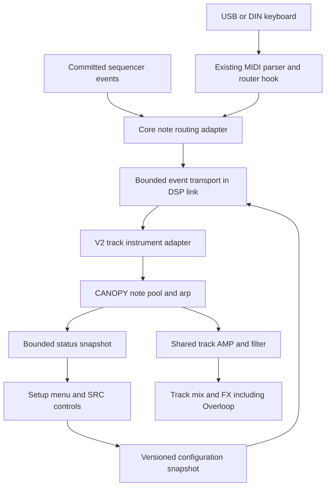
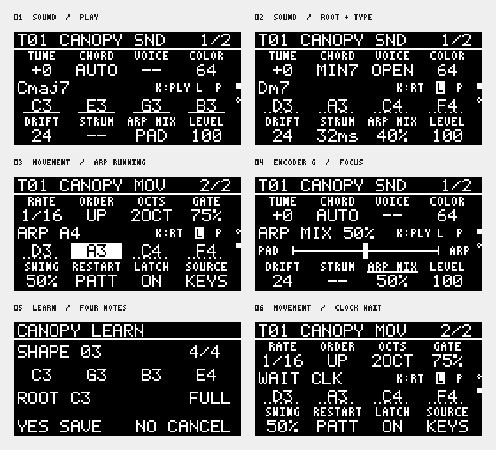

# CANOPY technical design

Status: proposed implementation, 2026-10-29. Target: Digitakt II OS 1.17. Source baseline: `9b168c21` on `codex/short-loop-proof`. This design specifies new capabilities; it does not claim that CANOPY or the proposed interfaces already exist.

Implementation has started with [instrument MIDI ownership](../../modules/core/adapters/midi-events/README.md): bounded token/FIFO ownership, reset tombstones, queue acknowledgements, an optional USB dispatcher and a separately pinned DIN hook. Host and ColdFire component tests cover the production C logic. [DSP-link](../../modules/core/adapters/dsp-link/README.md) owns the optional 32-word forward reservation, matching loader bounds and 16-word reply allocation, preserving Overloop's fields. The retained CF batch sender, SHARC packet validator, ordered receiver, configuration transaction helpers, bootstrap ACK reply writer and CF heartbeat watchdog are implemented and component-tested. Tests exchange actual processor-produced packets in both directions. The CF sender and DSP receiver now connect through DSP-link and the existing pattern-position frame hook; composed instruction-core tests cover register preservation and missing-consumer behavior. The DSP lifecycle bridge now gates atomic callbacks using per-track generations and committed revisions, including cross-track reset isolation and configuration aborts. Proof-only CANOPY callbacks now connect packets to isolated sine banks with atomic batch application and bounded reset ramps. They are not linked into normal firmware; public V2 initialization and live readiness are still absent. An emulator-only fixture now proves USB/DIN delivery into CANOPY banks through real reset, configuration and event ACKs; a separate carrier fixture now initializes the selected Sound without audition and reaches final PCM with independent note retirement and post-release quietness. The carrier fixture also resets and re-admits after a machine change and a stopped pattern change, preserving stale-release tombstones. A fixture-only Sound-deserializer wrapper now closes admission before in-place writes and blocks refresh until completion; ColdFire tests exercise same-pointer, same-type replacement through the real stock routine. A booted panel-driven temporary pattern reload now proves same-pointer Sound invalidation and fresh MIDI playback with stale-release protection. The fixture waits through scheduled-pattern lookahead before applying the committed destination; a booted internal-clock switch between two prepared WERP shadows proves the ownership ordering. The sine callback now implements per-port/channel CC64 sustain, CC121 pedal reset, CC123 sustain-aware All Notes Off and CC120 emergency All Sound Off, plus fixed +/-2-semitone 14-bit route bend with phase-preserving coefficient updates and CC121 centering, with atomic pedal/voice batches, bounded deferred-token storage and reset clearing. Booted final-audio pitch measurements now verify center, maximum upward bend, other-port isolation and CC121 centering. A booted route-panic scenario verifies USB/DIN isolation, stale physical release protection, unchanged instance generation and final quietness. The booted emulator verifies pedal-owned USB audio beyond the normal release time, independent DIN release, pedal-up preserving a physically held note, and final quietness. The booted carrier now also passes a low-first/high-second final-output RMS comparison against a fresh loud-note reference. Running-switch acceptance now checks retained ownership and the original physical release across compatible switches, measures source/destination PCM and settled release quietness, and captures the transition for discontinuity analysis. Other Sound-load paths, broader transport cases, public initialization and sample-aligned final-output continuity remain open. Routes remain inactive without a ready V2 consumer. Stage 0 is still open: schema publication, V2 capability, wider live routing/recovery and coexistence remain; stage 1's final-output lifetime gate has not passed. A [four-note sine kernel](../../modules/machines/canopy/README.md) now provides independent token gates, phase, velocity and attack/release for the stage-1 proof, with SHARC component tests. The kernel now steals within four foreground slots and two shared tails, with at-most-64-sample delayed replacements when both tails are busy; full eight-event bursts and stale releases are component-tested. The MIDI lifecycle-to-kernel connection is component-tested and the carrier now has a booted emulator proof; public V2 initialization and full audio acceptance remain open. There is no playable CANOPY DKM yet.

CANOPY is a keyboard-playable pad instrument on one audio track, with four independently articulated chord tones and an arpeggiator blended over the pad. PLAY sounds the notes the player actually presses. ROOT + TYPE generates a chord from a root key and a silent chord-selector key. LEARN TO ROOT captures a voicing for later transposition. Sequencer mode plays a chord from a stock note trig.

The enabling change is a versioned track-instrument interface with individual note events and persistent state. A MIDI queue attached to today's monophonic machine interface is insufficient: the firmware can restart or stop the entire track on each key event. Prove independent key release through the final audio output before building the full synthesizer or screen.

Implementation payoff is a playable harmonic instrument that coexists with Overloop. Confidence is high in chord generation and the bounded DSP engine, moderate in the required MIDI and track-lifecycle integration, and lower in automatic Sound/pattern persistence for extra settings. The complete implementation is multi-day work. The gates below keep uncertain firmware work ahead of expensive UI and synthesis work.

## Scope and decisions

Admission must initialize the stock track configuration before consuming keyboard
events. The cold-boot proof found no cached stock Sound source before the first
audition; acknowledging the separate CPS1 configuration is insufficient. Resolve
the selected Sound from the live project/kit, validate its track and instance,
publish its stock configuration, and wait for matching DSP readiness. Do not
dereference the empty cached source or directly force the DSP type mirror.
The acceptance scenario must select CANOPY and play its first keyboard note
without a panel audition or sequencer trig, then repeat after Sound/pattern
replacement. Keep routes closed when initialization or confirmation fails.
See the [measured admission boundary](../findings/78-canopy-carrier.md).

The carrier integration now has an optional early-frame expiry callback and an
internal CANOPY render entry that publishes shared stereo envelope controls.
Connected instruction-core tests cover frame/render/envelope handoff and reset
retirement. ACTIVE includes the final block of tail samples, with release on the
next empty block. A dispatcher shim now captures the live workspace's envelope
bank; the firmware probe checks it against the stock computation and relocation.
Normal hook installation, shared envelope configuration and final mixer proof
remain open; this checkpoint does not provide a playable machine or enable routes.

The firmware probe now uses the original DSP configuration caller and executes a
connected C/E/G note-and-release scenario through the real stock envelope in one
memory image. This closes the component gap between synthesized audio and AMP,
while live configuration delivery, neutral downstream velocity and final mixer
output remain required. Stock AMP remains a master shape; sustained proof settings
do not change the release design's treatment of user AMP controls.

The carrier probe also measures stock downstream gain and all five shared
velocity curves. Curve 0 produces a constant 127/128 factor across key velocities,
making it a candidate for the required neutral shared velocity. The probe now
follows the velocity latch into the gain coefficient builder, preserving separate
control attenuation and silence. Updating only the incoming cache leaves the
latched value unchanged. A proof hook now substitutes only the owned velocity
operand before gain construction, using a post-receive snapshot of admitted
instances and actual kernel tails/pending notes. Stereo/context component tests
and the original scalar gain builder pass. The connected musical proof now runs
through stock scalar audio gain as well, keeping the owned chord's gain stable
while shared velocity changes. The hook has resolved firmware declarations but
remains uninstalled. Preserve LEVEL and modulation, and prove final output
separately; live scheduling and changing-control smoothing remain open.

The musical proof also traverses the conditional ramp after gain. Controlled
31/32-sample cases establish that it fades only when a transition byte and an
envelope configuration flag are both set. The proof's zero configuration flag
preserves chord audio. The live control/event meanings remain unresolved, so this
does not yet establish arbitrary Sound compatibility or justify bypassing the ramp.

The incoming DSP track-trigger mask sets that per-voice byte, and a machine-type
change forces the fade configuration flag on. Preserve that machine-change fade.
ColdFire component tests now execute the production USB/DIN trampolines and
confirm that owned keys select the consumed continuation, including velocity-zero
releases and reset tombstones, with arguments/registers preserved. Readiness is
injected and the continuations are test observers; live parser-to-trigger-frame
delivery remains open. These checks do not enable keyboard routes or satisfy the
final-output gate.

- Ship a DTII-only experimental module, proposed ID `digikit/canopy`, with an explicitly required new runtime capability. Keep existing V1 machines compatible.
- Support four foreground pad notes. Additional fixed slots handle one arp note and two shared release tails. Voice count never grows with release time.
- Use internal envelopes and velocity for individual notes. Retain the stock filter, level, pan, mute and FX routing. Treat the stock AMP envelope as a shared master shape, subject to the lifecycle proof below.
- Make KEYBOARD and SEQUENCER explicit source choices. Do not merge their ownership implicitly in the first version.
- Start with four existing machine knobs and a module setup menu. Deliver the two SRC pages through a separate, versioned UI/control extension.
- Save extended settings as explicit DigiKit presets first. Automatic Elektron Sound/project persistence and parameter-lock support require separate proofs.
- Defer MPE, arbitrary MIDI CC mapping, internal MIDI-track routing, DNII support, rootless-chord guessing and more than four foreground notes.

## Existing interfaces and required changes

| Area | Present implementation | Required extension |
| --- | --- | --- |
| Voice input | V1 supplies one pitch, velocity, block count and mono output buffer | Track identity, event batches, instance lifetime, effective controls and transport |
| Voice lifetime | Stock note-on initializes the machine; inactive stock voices skip its renderer | Wake on events; render through independent releases; reset only at instance boundaries |
| MIDI receive | Runtime owns a gathered USB-message router hook used for upload | Compose an optional channel-message handler; establish DIN coverage on 1.17 |
| Machine controls | Four custom words at B/C/E/F; TUNE and LEVEL remain stock | Versioned extended bank and page-to-parameter mapping |
| Pattern timing | Overloop bridge publishes committed master-grid boundaries | Validated finer clock for subdivisions, triplets and swing |
| Settings | Device-wide runtime store, called on the UI task; no public DKM settings API | Bounded module-owned settings access and explicit presets |

Source evidence: [machine ABI](../../sdk/include/dk/gen/machine.h), [DTII profile](../../devices/digitakt-ii.toml), [machine adapter](../../modules/core/adapters/dsp-voice/src/dsp/dsp-voice.s), [MIDI declarations](../../devices/fw/midi.toml), [upload analysis](../findings/43-digikit-upload.md), [typed descriptor validation](../../packages/patchkit/src/typed.rs), [module authoring](../MODULE-AUTHORING.md), [pattern-position ABI](../../sdk/include/dk/pattern_position.h), and [settings implementation](../../modules/core/runtime/src/rs/src/settings.rs).

The USB hook's declaration still describes SysEx. Pinned 1.17 component execution
now confirms that the cable-0 byte parser also queues complete channel messages,
including fragmented/running-status notes and interleaved clock. Static task
inspection places the existing hook after the USB receive-enable and auto-channel
tests. A separate zero-DSP Vitest scenario now observes both USB and DIN messages
at the stock task hooks in booted firmware, checks ordinary/auto channels and
receive-enable settings, and forwards every message to the stock router. This
closes ingress reachability for those cases. A separate coupled CANOPY transport fixture now proves owned USB/DIN notes and
independent releases through the actual DSP acknowledgements. It installs no
renderer, so the final-output chain remains unproved; no new SDK API is published.

## Architecture and ownership

Follow the [repository layers](../ARCHITECTURE.md). Core adapters own firmware addresses, routing, gates and physical transport. CANOPY accesses only generated SDK contracts. Do not let content code write firmware voice records or inspect undocumented frame offsets.

Proposed new children under `modules/core/adapters/` are `midi-events` for routing and `machine-controls` for extended pages/control state. Extend the existing `dsp-voice`, `dsp-link`, `pattern-position` and `dyndsp` adapters rather than installing competing hooks at their sites. Add the content machine as child `canopy` under `modules/machines/`.

Keep MIDI routing/ownership in the core control path, outside the UI task's redraw cadence. CANOPY owns its keyboard modes, chord generation, oscillator, envelope, arp and voice-allocation state on the DSP; the framework does not hard-code CANOPY chord tables or selector mappings. Chord naming and display formatting run on the UI side from immutable status snapshots. The UI is never the audio scheduler.

## MIDI routing and event ownership

### Ingress

Extend the runtime-owned receive hook with an optional adapter callback before the uploader's short-message/SysEx filter. Preserve the original consumed/fallthrough paths and buffer cleanup. Never patch this hook twice.

The first route is explicit and exclusive: `(input port, MIDI channel) -> CANOPY track`. A route becomes active only when that track has a loaded, healthy CANOPY instance. Unclaimed traffic, stock tracks, MIDI clock and upload SysEx retain their existing routing. Handle valid channel messages after the firmware parser has normalized the byte stream; do not add a second byte parser in an interrupt.

USB and DIN are separate acceptance cases. A directly attached DIN keyboard is the standalone target; USB tests use a host forwarding MIDI. Support for native Auto Channel follows an independently verified target resolver. It is not inferred from a guessed selected-track field.

Claimed Note On/Off messages must be consumed before stock per-key voice handling. Otherwise each note could restart the whole pad or alter its shared velocity. This may also bypass native live recording: the initial keyboard mode does not promise recording polyphonic chords into an audio-track pattern. Sequencer root/chord programming remains a separate path.

In SEQUENCER source mode, consume and ignore fresh claimed keyboard performance notes, pedal and bend; still drain previously owned note-offs and accept PANIC. In KEYBOARD mode, suppress stock sequencer note/gate rearming for that CANOPY track before it can restart the shared AMP. Parameter changes continue through their supported paths. Source selection must govern both event routes and stock carrier handling.

### Ownership ledger

Maintain a bounded ledger keyed by input port, channel and note, with press order, velocity, destination track and routing generation. Note-off follows the destination recorded at note-on, even if the selected track changes. Repeated note-ons at the same pitch receive separate tokens, paired FIFO with note-offs. Bound repeated-note counts; overflow invokes controlled reset rather than wrapping.

MIDI ownership and DSP slots are separate. A stolen note's later note-off must not release the note that replaced its slot. Token matching occurs before changing an envelope. Keep physical key state distinct from sustained, latched, sounding and stolen states.

Routing edits, source/mode changes, project load, machine removal and faults advance the affected instance generation. Clear its sounding state with a short bounded ramp and invalidate pending old-generation events. Preserve bounded tombstones for outstanding physical presses until their matching note-offs arrive; these releases remain consumed and never redirect to a new track. Tombstones take part in the FIFO pairing even if a fresh same-pitch press has a new destination. Re-enable sounding input with fresh presses after such a reset. If ownership/tombstone capacity is exhausted, quarantine that route until an explicit reset with keys released instead of discarding ownership and guessing.

### Controller rules

| Event | Behavior |
| --- | --- |
| Note On velocity 0 | Normalize to Note Off |
| CC64 below/above 64 | Pedal up/down; pedal up releases deferred notes whose physical keys are up |
| CC120 | Panic the route: clear keys, pedal, latch and arp, with only the emergency de-click ramp |
| CC123 | Release all physical keys; ordinary sustain rules still apply |
| CC121 | Reset controllers, including pedal and channel bend; release pedal-only notes |
| Pitch bend | Shared channel bend, initially fixed at +/-2 semitones, applied once after note/chord generation |
| Explicit PANIC | Clear all CANOPY ownership and tails, even if no MIDI message arrives |

Implement only claimed supported controllers; document the fallthrough policy for others. Use MIDI Active Sensing timeout only after that stream has actually enabled it. A DIN cable unplug cannot generally be detected. An internal bridge heartbeat timeout is independent of keyboard inactivity, so a deliberately held note does not expire just because no MIDI arrives.

## Keyboard modes

### PLAY

Every accepted note-on starts its own voice immediately, subject to the fixed four-note foreground limit. Note-off starts only that voice's release unless pedal or latch holds it. Preserve the played pitches, octave spread and velocities. Generated-chord VOICING does not rearrange PLAY notes. The admitted set of at most four tones also supplies chord recognition and arp candidates; a stolen, still-held key stays in the ownership ledger but is excluded from all three until pressed again. Publish the excluded count so the display can show `+N` instead of implying unlimited keyboard polyphony.

Chord recognition is display-only in this mode. After 35 ms without a note-set change, compare the pitch-class mask with a small dictionary of exact chord templates and their inversions. Prefer a root present in the played set and an exact template; use the previous equally valid interpretation to reduce flicker. Show the lowest sounding pitch as the bass in slash notation. If interpretation is ambiguous, show note names. Display updates do not delay notes, quantize them or retune them.

Recognize major, minor, sus2, sus4, fifth, sixth, major seventh, minor seventh, dominant seventh and add9. Avoid an expensive probabilistic recognizer. Repeated notes and octave duplicates affect voicing display but not pitch-class matching. Distinguish physical/pedal notes from old audio release tails; tails do not change the detected chord.

### ROOT + TYPE

A configurable selector octave is silent. White keys C/D/E/F/G/A/B select major/minor/sus2/sus4/dominant7/minor7/major7. Assign the five black keys major6/minor6/add9/diminished/custom. Key names are relative to the selected octave, with MIDI note numbers shown in setup to avoid octave-label ambiguity.

An optional dedicated selector-channel route allows a second controller or keyboard zone to choose types without reserving an octave on the root-playing channel. Route roles are explicit configuration; root and selector roles cannot overlap ambiguously for the same port/channel/note. Both still use the same ownership and silent-selector handling.

Selector note-on changes a latched chord type; its note-off remains consumed and silent. Other keys supply roots, using last-pressed-root priority. Releasing the current root restores the most recent still-held root; pedal/latch determine the behavior when none remain. A selector update rebuilds the chord from the current root and never becomes an audible note.

When a selector and root arrive together, apply selector changes first within the same DSP batch. Cross-block ordering remains event order, with smooth reassignment. In PAD mode apply changes immediately. With quantized chord changes enabled, stage the entire new chord and commit at the next arp event, never one interval at a time.

Offer close/open voicings and explicit inversions. Optional voice leading searches bounded octave/inversion candidates to minimize total pitch movement, preserving common tones where possible. Apply it only to generated chords. Reject a generated voicing that cannot fit the supported pitch range; never clamp several out-of-range tones onto the same pitch silently.

### LEARN TO ROOT

LEARN opens a capture session. Collect up to four unique physically played notes, preserving octave spacing; excess notes show a capacity message. SAVE commits the set relative to its lowest captured note. CHORD names remain informational: an inferred root must not silently change the transposition anchor.

For capture C-G-B-E, store offsets 0, 7, 11, 16. Playing D as root gives D-A-C#-F# with the same voicing. CANCEL leaves the previous shape intact. Learning auditions use ordinary PLAY voices. SAVE updates RAM immediately and queues explicit persistence outside the MIDI task.

Library slots are templates. A saved preset embeds its learned intervals by value, so editing a library slot cannot alter existing presets unexpectedly.

### Latch and sustain

In latch mode, releasing keys preserves the current chord. Once all physical keys have been released, the next note-on begins a replacement phrase; subsequent pressed notes join it. Replace the old latched membership atomically with the first new note, retaining only bounded audio tails. A slow rolled chord grows as played, without waiting for recognition.

Latch replacement clears the previous phrase's pedal-only membership too; otherwise successive phrases could accumulate indefinitely. Pedal and latch never allocate additional hidden voices. Disabling latch releases notes that are neither physically held nor pedal-held.

## Versioned instrument interface

Add an opt-in V2 contract in `sdk/sdk.toml`, generate its C/assembly bindings, and extend descriptor parsing, DKM packing, runtime validation, DSP registration and conformance together. Never enlarge `dk_voice_in` or reinterpret V1 descriptors in place. A V2 module must fail to load with a clear capability error on old firmware.

The semantic contract below now has an experimental binary layout in
`sdk/sdk.toml` under `[instrument]`, with generated C and assembly bindings in
`sdk/include/dk/gen/instrument.h`, `sdk/include/dk/gen/instrument_consts.h` and
`sdk/asm/dk_instrument.inc`. The input is 72 bytes; the separate `DKIT` descriptor
is 48 bytes. Normalized events have six 32-bit words and require zero sample
offset. The descriptor declares track count, per-track state, bounded events and
controls, and process/reset instruction, call-depth and stack budgets.

`packages/patchkit/src/instrument.rs` validates descriptor sizes, reserved flags,
limits and aligned per-track allocation with overflow checks. These are declared
admission bounds, not measured CPU performance. The V1 packer explicitly rejects
this magic rather than interpreting it as a V1 voice. Existing V1 layouts and the
advertised machine contract remain unchanged at 1.0.

This is a serialization checkpoint, not completed V2 registration. Remaining:
runtime registry/capacity integration and validation/allocation; DSP callback dispatch and
lifecycle ownership; conversion of the sine fixture and conformance checks.
The `DK_INSTRUMENT` C macro and `.dk.desc` record kind 6 now declare reset/process
callbacks and their descriptor as distinct typed instruments. Reading a dynamic
module preserves these declarations for `patchkit desc`; duplicate instrument IDs,
collisions with V1 machine/effect IDs and missing names/symbols are rejected. V1
parameter/page ownership remains unchanged. Device resolution/packing and direct
static application explicitly reject instruments until V2 runtime support exists.
This prevents either silently dropping a declaration or interpreting it as a V1
voice. The `test/instrument-declaration` fixture compiles a real C macro and checks
inspection plus pack refusal; it contains no playable DSP machine. Validation:
14 descriptor-reader tests, nine SDK-generation tests, ten existing typed-machine
tests and the ColdFire C-to-CLI integration test pass. Logs are under
`out/canopy-v2-records-*`.

The host DSP packer now serializes separate instrument records in experimental
DKDS version 5. Reset/process callbacks must resolve to global text symbols, the
descriptor to initialized data. Parsing checks bounded counts, descriptor budgets,
aggregate allocation, duplicate types (including V1 collisions), table layout and
reserved bytes. A V5 DKM requests machine contract 2.0, while the current runtime
still advertises 1.0 and rejects that major version before allocation. This is a
format/header proof, not an emulator load proof. The normal `dkneeds::needs_of` resource
checker also continues to reject V5; do not interpret host serialization as a
loadable module. Public module packing remains guarded. Next: connect the runtime
instrument registry to loader transactions and the capacity protocol, then implement
callback dispatch.
The experimental `dkneeds::needs_of_v2` API now computes V2 memory requirements
without allocation: total DSP storage plus separate instrument rows, track
instances and state bytes. Legacy scan/fit callers remain on `needs_of`, which
rejects V5. This avoids losing an instrument requirement in the old capacity ABI.
The parser checks descriptors, table layout, duplicate types and overflow;
cycle/stack ceilings and full load validation remain the runtime's responsibility.
Accounting validation: 14 `dkneeds` tests, ten DSP packer tests (including a real
V2 file/accounting cross-check), and nine existing runtime-fit tests pass. Logs
are under `out/canopy-v2-needs*.log`. The two edited design documents have no stale
references. No emulator/device admission is claimed by this checkpoint.
Validation: ten DSP serialization tests and seven DKM compatibility tests pass
(`out/canopy-v5-tests.log` and `out/canopy-v5-dkm-tests.log`). The required
changed-file check passes layering but still reports the existing 256 stale
references in 78 files.

V2 registration bookkeeping is now implemented in
`modules/core/runtime/sdk/src/instrument_registry.rs`. A single loader task owns
eight fixed rows and a caller-supplied track-instance limit. A whole module is
reserved atomically, remains invisible until publication, and is hidden from new
admissions when retirement starts. Reserved and retiring rows continue to consume
capacity. Failed reservations leave no partial rows; rollback is allowed only
before publication and after any in-flight DSP work is quiescent. Retiring rows
are released only after the matching DSP detach/reset completion, never timeout.
Tickets bind the module slot and a monotonic generation; stale completions cannot
publish or release a replacement. Generation exhaustion fails closed.

`modules/core/runtime/fit/src/instruments.rs` checks the separately reported V2
row/instance capacity plus existing resources. Missing V2 capacity is unsupported,
not unlimited. Planning consumes both snapshots only after every requirement fits.
It does not reserve the live registry or change the existing scan/fit ABI.

These are tested library components, not wired loader or DSP publication paths.
The loader still rejects contract 2.0. Remaining integration must validate device
type ranges and V1/V2 conflicts, reserve memory and rows together, bind transfer
ACKs to tickets, publish after reset/initialization, and keep failed or timed-out
retirements quarantined. Full live initialization, DSP dispatch and public module
packing remain disabled. Five registry lifecycle tests and twelve fit tests
(including the nine existing cases) pass; logs are in
`out/canopy-v2-registry.log` and `out/canopy-v2-registry-fit.log`. The changed design
references pass their focused path check. No ColdFire or emulator execution of
these new lifecycle components has been claimed.

`modules/core/runtime/sdk/src/instrument_load.rs` now owns the registry through a
bounded transfer state machine. It emits commands for image transfer,
initialization, publication, detachment and storage release. Image transfer and
initialization require separate ordered acknowledgements carrying the reservation
ticket. A pre-transfer cancellation releases immediately; after transfer starts,
cancellation requires DSP detachment. Timeouts quarantine the reservation, and
late image/initialization acknowledgements cannot publish it. A late matching
detach completion may release it only after the transport has drained earlier
writes and callbacks. Repeated/stale completions cannot release a replacement.

The live loader's V1 path currently publishes ColdFire registrations before its
DSP transfer completes. Do not reuse that ordering for V2. The new state machine
is tested with the actual registry and capacity planner, but its commands are not
yet connected to DSP-link. Next: implement V2 DSP row/reset transport, bind its
acknowledgements to these commands, and then connect staged-file admission and
memory ownership. Contract 2.0 remains disabled until those paths work together.
Validation: nine transfer/registry tests and twelve fit tests pass, including
interleaved owners, cancellation at each transfer stage, stale completions and
retained capacity after timeout. Logs: `out/canopy-v2-load.log` and
`out/canopy-v2-load-fit.log`. These are host tests, not DSP transport acceptance.

DSP-link now carries optional V2 registration data through window 3. The existing
ColdFire sender encodes the fourth window, and both SHARC receivers use optional
`_dl_irows`/`_dl_iwords` provider bounds. Absent, misaligned, zero-sized or oversized
providers fail closed; each write must fit the declared region. Existing frame
suffixes and reply allocations are unchanged. Component tests execute the actual
sender and receiver. The optional DTII `core/instrument-registry` provider now supplies a 16-word
query-only command mailbox. `_dl_iwords` points to its word-count constant.
Committed, checksummed commands carry a strictly increasing sequence plus owner,
generation and row. Malformed or stale commands retain the previous reply.
QUERY reports zero capabilities; INITIALIZE and DETACH return unsupported, never
a successful lifecycle acknowledgement. The block wrapper invokes the provider
and copies its eight-word reply into existing instrument reply words 4..11,
covered by the existing reply checksum. No extra SPI reply rows are allocated.
See [mailbox protocol](../../modules/core/adapters/instrument-registry/README.md).
Next: implement bounded DSP initialization/reset and detachment, then connect the
load controller to these acknowledgements. No instrument rows are published yet.
Validation: 13 SHARC component cases (seven V2-window and six existing suffix-bound
cases) and the ColdFire window-encoding test pass. DSP-link rebuilds for DTII and
DNII; its CF and both DSP objects re-decode and check current. Logs are under
`out/canopy-v2-window-*.log`. This is processor-core execution, not hardware proof.
The changed-file check also passes 193 host tests (16 skipped), formatting, types
and layering; its remaining failure is the existing 256 stale references.

Mailbox checkpoint validation: 15 command/reply cases pass, including malformed
input, checksum failure, unsupported operations, replay and sequence exhaustion.
The 18 composed-frame cases pass with the optional provider present alongside the
carrier or absent, preserving processor context. Three standalone reply cases and
13 DSP-link window/suffix cases also pass. DTII/DNII DSP-link, DTII MIDI-events
and the new DTII registry objects rebuild, re-decode and check current. Logs:
`out/canopy-registry-final.log` (49 passing component cases) and
`out/canopy-registry-build.log`. The changed-file check passes formatting, types
and layering; it reports the existing 256 stale references and one unrelated
minimum-delay timer assertion (192 host tests passed, 16 skipped). That timer
test passes an isolated rerun in `out/canopy-registry-timing-recheck.log`. Changed
document references pass. Hardware validation remains outstanding.

The internal no-std mailbox client now binds loader commands to exact physical
rows, serializes clear/body/commit writes, and validates complete replies before
advancing. A module with several rows publishes or releases only after all rows
acknowledge the matching operation. Partial failure quarantines the entire module;
recovery requires the caller to drain prior writes and start a fresh detach.
Sequence exhaustion rejects the whole batch, and late or mismatched replies cannot
complete another row or a cancelled initialization. Owner IDs are bounded to the
mailbox's 32 module slots. The current DSP bootstrap still rejects lifecycle work;
successful lifecycle replies in client tests are synthetic. Live SPI scheduling,
DSP reset/detach implementation and staged-file admission are still outstanding.
Validation: 14 targeted SDK registry/load/mailbox host tests pass; log
`out/canopy-mailbox-client.log`. Changed documentation references pass. The
changed-file check passes layering and reports only the existing 256 stale
references (`out/canopy-mailbox-client-changed.log`). No device or ColdFire
execution is claimed.

An internal SHARC V2 single-instance reset worker is now implemented in
`modules/core/adapters/instrument-registry/src/dsp/lifecycle.s`. It validates the
state extent, callback range and reset reason before any write/call, clears state
only for CREATE, and accepts only a zero callback result. Its current clearing
limit is 1024 words per call. It is not yet connected to mailbox commands: trusted
row metadata, owned allocation bounds, reset-budget admission, complete callback
context protection and per-track scheduling remain required. The earlier CANOPY
event-reset hook is not ABI-compatible with this worker. No new V2 capability is
advertised and no lifecycle success is acknowledged by the bootstrap provider.
Validation: 29 SHARC component cases pass (`out/canopy-reset-worker.log`); the
registry adapter rebuilds, re-decodes all 130 instructions and checks current
(`out/canopy-reset-worker-build.log`). These are processor-core tests with a
synthetic V2 callback, not live firmware or hardware acceptance. The changed-file
check passes 193 host tests (16 skipped), formatting, types and layering; its only
failure is the existing 256 stale references. Changed document references pass.

The DSP now has an internal eight-row lifecycle table and begin/tick routines in
`modules/core/adapters/instrument-registry/src/dsp/rows.s`. Initialization and
detachment reset at most one track instance per tick. Completion follows the last
callback return; failures retain the owner/generation and attempted-instance count.
Partial initialization detaches only attempted instances, including a faulted
callback that may have written state. Detach retries preserve ownership; completed
rows retain a tombstone until trusted admission explicitly reuses them. READY does
not yet publish audio dispatch. Production admission does not populate these rows,
and mailbox commands still report lifecycle operations unsupported. Full callback
context protection and mailbox scheduling remain the next integration work.
Validation: 20 SHARC row lifecycle cases pass (`out/canopy-row-lifecycle.log`),
including partial initialization, detach failure/retry, cancellation, stale owners
and malformed metadata. The registry adapter rebuilds, re-decodes 281 instructions
and checks current (`out/canopy-row-lifecycle-build.log`). Changed document
references, formatting, types and layering pass. The changed-file check reports
the existing 256 stale references and the recurring minimum-delay timer failure
(192 host tests passed, 16 skipped); that timer test passes an isolated rerun in
`out/canopy-row-lifecycle-timing.log`.

A protected row-tick boundary is now implemented in
`modules/core/adapters/instrument-registry/src/dsp/protected.s`. It preserves V2
callback scratch context, both 80-bit multiplier accumulators, addressing lengths
and arithmetic mode/status while pinning the callback ABI. B3 is restored before
I3; accumulator guard words are restored after middle words. Entry must already be
non-SIMD and callbacks must comply with the ABI. The boundary is non-reentrant.
The actual row lifecycle component tests now execute through it. This supplies
the context protection needed for mailbox integration, but mailbox scheduling,
trusted admission and audio dispatch are still disconnected. Validation: four
context-preservation cases and 20 protected row lifecycle cases pass
(`out/canopy-protected-tests.log`); the adapter rebuilds, re-decodes 503 instructions
and checks current (`out/canopy-protected-build.log`). The changed-file check
passes 193 host tests (16 skipped), types and layering. Its import-format finding
was fixed and both changed test files pass Ruff check/format on recheck; the
existing 256 stale references remain. Changed documentation references pass.
No hardware proof is claimed.

The mailbox now schedules protected row work and emits delayed lifecycle replies.
It snapshots sequence/owner/generation/operation/row, consumes the sequence, and
runs at most one protected row tick per frame. While pending it preserves the
previous reply and ignores mutable command bytes. READY/DETACHED produce success;
row identity/phase rejection produces status 3 and callback/metadata faults produce
status 4, retaining owned rows. Replays do not rerun callbacks. An internal
cold-boot-zero `_ir_lifecycle_ready` gate keeps production lifecycle work disabled;
only future trusted admission may enable it after validating rows and budgets.
No production admission path sets it, no audio dispatch is published, and the
loader still rejects V2. Remaining work: owned image/state admission, live SPI
client integration and dispatch. Processor tests seed admission only in fixtures.
Validation: 40 mailbox/lifecycle/shared-frame component cases pass in
`out/canopy-mailbox-scheduler.log`, including real protected row execution with
synthetic callbacks. The expanded eight-case lifecycle suite also covers failed
detach and new-sequence retry (`out/canopy-mailbox-lifecycle-final.log`). The adapter
rebuilds, re-decodes 558 instructions and checks current
(`out/canopy-mailbox-scheduler-build.log`). Changed documentation, formatting,
types and layering pass. The changed-file check reports the existing 256 stale
references and recurring timer assertion (192 host tests passed, 16 skipped); the
timer passes an isolated rerun (`out/canopy-mailbox-scheduler-timing.log`). No
device or hardware acceptance is claimed.

An internal admission planner in `modules/core/runtime/sdk/src/instrument_admission.rs`
now validates ticket-bound allocator grants against reserved physical rows before
transfer. It checks exact type coverage, L2/image/state bounds, non-overlap,
executable callback extents, instance allocation and declared budgets. It produces
inert fixed-size row metadata only after the whole batch succeeds. The trusted
caller must still obtain exclusive grants, validate instruction boundaries and
supply remaining resource ceilings; the planner neither allocates nor enables the
DSP gate. Live allocator/SPI integration and V1/builtin type exclusion remain open.

This exposed a stride mismatch: descriptor allocation rounds each state to eight
bytes, while the row worker previously advanced by the raw state size. The worker
now uses the same rounded stride and preserves padding. A processor regression
covers three 12-byte states at 16-byte intervals through the protected lifecycle.
Validation: 19 admission/registry/load/mailbox Rust tests pass
(`out/canopy-admission.log`), and 29 protected row/mailbox DSP cases pass
(`out/canopy-admission-dsp.log`). The registry adapter rebuilds and re-decodes
560 instructions (`out/canopy-admission-build.log`). Focused documentation checks
pass. The changed-file check passes 193 host tests (16 skipped), formatting,
layering and types; it fails only on the existing pathcheck baseline of 256 stale
references in 78 files (`out/canopy-admission-changed.log`). No live admission is
claimed.

The live runtime now calls a shared, allocation-free DSP first-fit search over its
existing per-module offset/length ledger. This is the common pool used by legacy
voices and effects; future V2 reservations must use the same ledger rather than
an independent allocator. The search preserves absolute-address alignment and
lowest-gap reuse, and rejects overflowing, overlapping or out-of-bounds ledger
entries before returning a candidate. It does not reserve or free a range: the
single loader still owns ledger updates and must retain pending allocations.
Four host tests pass, including exhaustive comparison against a byte-by-byte
oracle for 131,072 small fragmented-pool requests
(`out/canopy-memory-tests.log`). The integrated runtime passes a release host
compiler check (`out/canopy-memory-runtime-check.log`). The ColdFire rebuild is
blocked because Rust-for-ColdFire is not installed (`out/canopy-memory-build.log`);
no rebuilt runtime artifact or device validation is claimed. V2 grant creation,
row installation and live SPI sequencing remain disconnected. Focused documentation
and layering checks pass; the changed-file check fails only on the existing 256
stale path references in 78 files (`out/canopy-memory-changed.log`).

The V2 load controller now supports ticket-bound memory reservations through a
borrowed view of the shared DSP allocation ledger. It claims one range for image,
BSS, alignment and instance states, derives image/state grants from that range,
and leaves the ledger unchanged on rejection. Legacy allocations remain occupied.
Memory-backed tickets enter a release-pending phase after pre-transfer cancellation
or completed detach. The owner slot stays busy until `release_memory` verifies the
exact generation and recorded range and clears the ledger entry. Timeouts, partial
mailbox completion and stale releases cannot free the allocation. Calls without
memory reservations retain the existing component behavior.
Validation: 25 targeted SDK tests pass (`out/canopy-memory-lifetime-tests.log`),
including derived-grant admission, other-module coexistence, rollback/retry,
quarantine, changed-ledger rejection and a two-row mailbox detach. The integrated
runtime passes a release host check (`out/canopy-memory-lifetime-runtime.log`).
The live loader does not call these reservation APIs yet: it must pass its actual
ledger, retain the CF record through release and bypass legacy unreserve on every
V2 error path. DKDS5 parsing, row installation and live SPI integration remain
open. The missing Rust-for-ColdFire toolchain still prevents a device build.
Focused documentation and layering checks pass; the changed-file check fails only
on the existing 256 stale references in 78 files
(`out/canopy-memory-lifetime-changed.log`).

Descriptor decoding is now shared no-std code in the runtime SDK; the host
packer uses that same implementation for the 48-byte V2 descriptor, admission
ceilings and eight-byte instance allocation. A bounded DKDS5 instrument-record
reader decodes BE records and LE descriptors into eight fixed slots. It rejects
truncation, duplicate/invalid keys, unaligned or out-of-image callbacks,
descriptor relocation overlap, and excessive aggregate state. It takes separately
bounded table/image/relocation slices; it does not validate the complete DKDS5
header, resolve keys/imports, relocate code or reserve memory.
The existing DKDS5 records do not preserve executable-section boundaries.
Image-range validation alone cannot establish that a callback belongs to code;
the loader still needs validated executable metadata before admission. The new
reader deliberately returns image offsets and does not manufacture a code grant.
Validation: 28 SDK tests and ten selected packer/schema tests pass, including
actual packed DKDS5 bytes read by the SDK decoder (`out/canopy-decoder-sdk.log`,
`out/canopy-decoder-packer.log`). The runtime passes a release host check
(`out/canopy-decoder-runtime.log`). Device admission remains disabled.
Focused documentation and layering checks pass; the changed-file check fails only
on the existing 256 stale references in 78 files (`out/canopy-decoder-changed.log`).

Experimental DKDS6 now preserves the linker's executable section ranges in a
bounded table. It reuses the 0x50-byte header, with table offset/count at 0x48/0x4c
and up to 32 sorted start/end pairs after the instrument records. The packer
emits V6 for new V2 images; host parsing still round-trips older DKDS5 without
inventing executable ranges, and legacy V1-V4 output stays unchanged. Both formats
continue to request machine contract 2.0 and remain rejected by normal admission.
The shared SDK decoder and experimental resource checker reject overlapping or
out-of-image ranges, callbacks outside text or crossing a section end, and
descriptors overlapping text. Text boundaries are not a proof of instruction
boundaries, control flow or budget compliance. The live loader must still consume
this metadata and install rows through the pending admission/SPI integration.
Validation: 29 SDK tests, 11 DSP packer tests and eight selected resource-reader
tests pass (`out/canopy-executable-sdk.log`, `out/canopy-executable-packer.log`,
`out/canopy-executable-needs.log`). The runtime host check passes
(`out/canopy-executable-runtime.log`); no ColdFire build or device capability is
claimed while its toolchain and live dispatch remain unavailable. Focused docs
and layering checks pass; the changed-file check fails only on the existing 256
stale references in 78 files (`out/canopy-executable-changed.log`).

Packed-metadata admission now composes the DKDS6 record/range decoders with the
allocator grant and reserved load ticket. It checks exact image extent and
resolved-type coverage, verifies descriptor track counts against reservations,
places each type's state using descriptor allocation sizes, and derives SHARC
callback PCs from the allocated image base. Reset and process may occupy separate
text sections; reset rows retain only reset bounds, while the inert plan retains
process bounds separately. No encompassing range spans a gap or data section.
The caller still supplies header-bounded slices and resolved types, with builtin
and V1 conflict checks, relocation/import validation and instruction-boundary
proof required before live loading. The operation neither allocates nor writes
DSP memory, and leaves failed reservations available for cancellation.
Validation: 32 targeted SDK tests and the runtime release host check pass
(`out/canopy-packed-sdk.log`, `out/canopy-packed-runtime.log`). Tests compose real
memory reservations with mixed-endian records, split text sections, reversed
physical-row order, aligned state layout and rejected metadata/type/phase changes.
Live loader calls, row publication, SPI integration and device proof remain open.
Focused docs and layering checks pass; the changed-file check fails only on the
existing 256 stale references in 78 files (`out/canopy-packed-changed.log`).

A bounded no-std whole-section DKDS6 reader now validates the canonical header,
device, table order/counts, zero padding, exact image extent, imports and relocation
metadata before exposing slices. It checks nonempty NUL-padded unique import
names, relocation kinds/classes/import indices and text-range containment, then
uses shared descriptor/range decoding. Image/BSS/state sizing is checked before
returning a memory request and a view suitable for packed admission. The reader
accepts instrument-only sections; mixed V1 voice/effect loads are rejected until
their coordinated lifecycle is implemented. Legacy loading remains separate.
Validation: 35 SDK tests, real packed-file compatibility and the runtime host
check pass (`out/canopy-section-sdk.log`, `out/canopy-section-packer.log`,
`out/canopy-section-runtime.log`). Tests cover parsing through reservation and row
planning, every truncation, byte mutations, aliases, invalid counts, import and
relocation errors, and trailing data. This establishes format validation, not
actual import resolution, relocation results, instruction boundaries, row writes
or transport readiness; live loader integration and device proof remain open.
The three parser cases pass again after final source-encoding cleanup
(`out/canopy-section-final.log`). Focused documentation and layering checks pass;
the changed-file check fails only on the existing 256 stale references in 78 files
(`out/canopy-section-changed.log`).

Validated instrument sections can now prepare a relocated image in caller-owned
storage without allocation or SPI activity. The relocator checks placement of the
entire image/BSS/state allocation in DTII L2, resolves each import exactly once
through a trusted callback, rejects overlapping fixup instructions and validates
all address arithmetic before copying any bytes. A missing import, invalid
placement, short output or late fixup error leaves the output unchanged. Internal
addresses use checked rebasing; abs32 import addends use signed arithmetic, while
abs24 retains the packer's unsigned-addend contract. Opcode parcels are preserved.
Validation: 39 targeted SDK tests pass, including late-failure atomicity, signed
addends, overlap rejection and output preservation (`out/canopy-relocation-sdk.log`).
A real packed fixture produces byte-identical output to the host reference
relocator (`out/canopy-relocation-packer.log`), and the runtime host check passes
(`out/canopy-relocation-runtime.log`). The live firmware export resolver is not
connected yet. Image transfer/BSS initialization, row installation and SPI-driven
lifecycle remain pending; no installable module or device proof is claimed.
Focused docs and layering checks pass; the changed-file check fails only on the
existing 256 stale references in 78 files (`out/canopy-relocation-changed.log`).

A ticket-bound image transfer controller now sequences the relocated image,
BSS zero-fill and alignment padding in at-most-256-byte writes. It validates the
exact allocator-recorded image/state grant before starting, borrows the immutable
image for stable retries, and binds each ACK to the ticket generation and exact
destination span. Duplicate or mismatched ACKs do not advance. Instance states
are not cleared by this transfer; their CREATE reset remains DSP-owned.
Initialization is offered only after image/zero-fill ACKs and a caller-confirmed
row-installation ACK. Transfer failure quarantines the load and requests detach;
external cancellation stops further writes. The caller must still drive real
SPI, prove write drainage before detach and retain the borrowed source until link
reads have stopped. The controller does not establish those facts itself.
Validation: 43 targeted SDK tests and the runtime host check pass
(`out/canopy-image-sdk.log`, `out/canopy-image-runtime.log`). Tests verify exact
image/zero contents, untouched state, retries, invalid grants, stale spans,
row-install gating and retained allocation through failed-transfer cleanup.
Firmware export lookup, row installation and actual SPI calls remain unconnected;
CANOPY is not installable and no device build is claimed. Focused docs and layering
checks pass; the changed-file check fails only on the existing 256 stale references
in 78 files (`out/canopy-image-changed.log`).

The DSP now has an internal row-install entry for the next transport integration.
It consumes a caller-owned immutable snapshot, validates owner/generation, complete
aligned state allocation, reset instruction extent and clean lifecycle fields,
then copies metadata and publishes RESERVED last. It accepts only an empty row
or a detached row with a strictly newer unsigned generation; reserved, initializing,
ready, detaching and faulted rows cannot be overwritten. Invalid input leaves
all rows and instance state untouched. Installation invokes no callback.
At that checkpoint the entry was not exposed through a transport window: the trusted
caller must provide private non-aliasing snapshot storage, enforce exclusive
allocation and callback budgets, drain image writes and serialize install/tick.
Bounds checking alone cannot prove those properties. An acknowledged mailbox
install command and its loader sequencing were still pending; the image
controller still took a caller-confirmed row-install boolean. Lifecycle capability
remains disabled, and CANOPY is not installable.
Validation: 86 focused DSP tests pass, including complete install/init/detach/reuse,
unsigned generation boundaries, malformed snapshots with no writes and odd-sized
state strides (`out/canopy-row-install-tests.log`). The registry artifact rebuilds
and passes its current-file check (`out/canopy-row-install-build.log`). Focused
documentation checks pass. The changed-file preflight passes lint, layering, host
tests and types; its only failure is the existing 256 stale references in 78 files
(`out/canopy-row-install-changed.log`).

The next checkpoint connects INSTALL (operation 4) to the existing 16-word mailbox.
Words 7..14 carry row fields 3..10; the DSP constructs phase/owner/generation and
zero lifecycle fields in a private snapshot before invoking the installer. It
acknowledges only the completed row installation, advertises capability bit 2 only
under the existing trusted-admission gate, and leaves callback work to INITIALIZE.
The SDK binds the admission plan to the exact allocated grant and physical rows,
requires acknowledged image/BSS writes first, and emits an opaque ticket-bound
receipt only after every row succeeds. The image controller now requires that
receipt instead of the preceding checkpoint's boolean. Transfer ACKs, missing
capabilities and stale row replies cannot authorize initialization.
Real SPI driving, firmware export lookup, trusted enablement and audio dispatch
remain unconnected. Failed partial installation stays quarantined; cleanup for
never-installed rows needs an explicit protocol before release can be supported.
No playable DKM or hardware acceptance is implied.
Validation: 44 SDK tests and 90 focused DSP tests pass, including multi-row receipts,
rejected/missing-capability replies, gated installation, no writes on rejection,
replay and install-to-initialize sequencing. Composed MIDI tests pass (84 passed,
three skipped); the runtime host check and rebuilt registry current-file check
also pass. Logs: `out/canopy-install-mailbox-{sdk,dsp,frame,runtime,build}.log`.
Focused docs, lint, layering, host tests and types pass. The changed-file check
fails only on the existing 256 stale references in 78 files
(`out/canopy-install-mailbox-changed.log`).

Partial-install cleanup now uses DETACH for every reserved row, including rows
that never installed. EMPTY or strictly older DETACHED rows become cleared
tombstones for the cancelled ticket without any callback or state-memory write.
The retained generation blocks delayed installation even under a newer command
sequence; another active owner and stale/wrapped generations remain rejected.
The scheduler also acknowledges already-detached rows without an invalid extra
tick, allowing lost-reply recovery. The SDK still requires transport drainage and
every matching detach reply before releasing the original allocator grant.
This closes the preceding checkpoint's never-installed-row cleanup gap at the
component level; live SPI integration and trusted admission remain pending.
Validation: 45 SDK tests pass; DSP row/mailbox/registry/protection checks pass,
including the additional mixed installed/missing-row scenario. Composed MIDI
checks pass (84 passed, three skipped), and the rebuilt registry is current.
Logs: `out/canopy-partial-install-{sdk,dsp,mailbox,frame,build}.log`.
Focused docs, lint, layering, host tests and types pass. The changed-file check
fails only on the existing 256 stale references in 78 files
(`out/canopy-partial-install-changed.log`).

The production ColdFire DSP-link now has tagged start/poll entry points for live
loader integration. Every accepted transfer, including legacy starts, consumes
a nonwrapping host-side identity. A tagged poll rejects stale identities without
changing the output, and reports drainage only after terminal status and all END
frames. This distinguishes an image/mailbox write from a replacement request and
provides an actual transport predicate for the SDK's drainage requirement. The
wire format and legacy status layout remain unchanged. The V2 runtime coordinator
has not yet been wired to these entry points; registry replies remain separately
required before installation or initialization may advance.
Validation: five new ColdFire execution tests pass, covering success/error END
frame drainage, replacement by a legacy request, untouched outputs on rejection,
busy/invalid starts and identity exhaustion. The DSP-link regression file passes
(28 passed, two skipped), and all DSP-link artifacts pass their current-file check.
Logs: `out/canopy-link-ticket-{tests,regression,build}.log`.
Focused docs, lint, layering, host tests and types pass. The changed-file check
fails only on the existing 256 stale references in 78 files
(`out/canopy-link-ticket-changed.log`).

A bounded no-std transport driver now connects the image/mailbox controllers to
the tagged link C ABI through supplied provider functions. It owns a dedicated
static 256-byte buffer, copies image bytes and encodes mailbox words little-endian,
retains the exact target with the accepted transfer ID, and waits for drainage
before producing an opaque controller completion. Drained errors never ACK;
uncertain identity or unexpected transport results freeze the buffer until reboot.
Moving/dropping the driver cannot invalidate the source of an accepted transfer.
Validation: 51 SDK tests and the runtime host check pass
(`out/canopy-transport-sdk.log`, `out/canopy-transport-runtime.log`). New tests cover
buffer retention, busy retries, endian encoding, exact-span advancement, mailbox
ACK gating, drained failure, stale/repeated identity, malformed writes and the C
ABI binding via host stubs. Actual provider resolution, boot-owned driver storage,
registry reply ingestion and the top-level live V2 coordinator remain pending.
No ColdFire runtime rebuild or live V2 firmware load is claimed.
Focused documentation and layering checks pass. The changed-file preflight fails
only on the existing 256 stale references in 78 files
(`out/canopy-transport-changed.log`).

Registry reply ingestion checkpoint: the CF MIDI receiver now accepts the optional
IRR1 block in reply words 4..11 while preserving zero-reserved words 12..14,
outer checksum, MIDI epoch and heartbeat checks. Previously its reserved-word
validation rejected every registry-bearing reply, preventing MIDI ACK progress.
The adapter caches the complete validated 16-word reply and exposes
`mi_registry_reply` as a bounded UI-task copy under the frame publisher's IRQ
lock. Missing/bad frames and explicit transport recovery invalidate the cache;
no firmware record pointer escapes the frame callback. Registry bootstrap does
not depend on the MIDI epoch. This is a framing snapshot, not freshness or
transaction acceptance: the coordinator must still match the mailbox sequence,
owner, generation, operation and row and enforce timeouts/reboot recovery.
Actual provider binding and the top-level V2 load coordinator remain pending.
Validation: all 87 MIDI component tests and 20 native MIDI host tests pass,
including an actual SHARC-produced registry reply consumed by ColdFire and the
snapshot capacity/corruption/recovery cases. The CF adapter is rebuilt and its
current-artifact check passes. Logs: `out/canopy-reply-tests.log`,
`out/canopy-reply-host.log`, `out/canopy-reply-build.log`. Focused documentation
checks pass; the changed-file preflight fails only on the existing stale-path
baseline (`out/canopy-reply-changed.log`).

The SDK now has an all-or-nothing optional-provider binding for tagged send,
tagged poll and the CF registry snapshot getter. Missing entries return no
binding without calling any provider. The unsafe binding boundary requires
validated entries from one boot and serialized UI-task ownership; symbol
presence alone is not a capability. Its reply adapter owns a private stack copy,
accepts only an exact 16-word result and feeds the mailbox validator. Unavailable
or mismatched transactions remain waiting without resetting any deadline;
provider errors, malformed replies, rejected operations and missing capabilities
remain explicit errors. Mailbox validation now also rejects nonzero reserved
reply words 12..14. Load transitions still require drained writes and matching
DSP replies. Actual firmware symbol resolution, boot-owned driver storage,
timeout/reboot handling and the live V2 coordinator are still pending; this is
an SDK integration boundary, not an activated runtime path.
Validation: 56 SDK instrument tests and the runtime host compile check pass
(`out/canopy-provider-sdk.log`, `out/canopy-provider-runtime.log`). New cases cover
all optional-symbol combinations, no provider calls during binding, exact-length
snapshot handling, transaction and capability rejection, reserved fields, and a
combined clear/body/commit transfer with terminal-but-undrained link status before
the matching registry reply. Focused documentation checks pass. No ColdFire Rust
runtime rebuild or hardware load is claimed.
The changed-file preflight passes layering and fails only on the existing 256
stale references in 78 files (`out/canopy-provider-changed.log`).

A bounded SDK exchange pump now holds exclusive borrows of the tagged driver,
mailbox, reply adapter and load registry while driving an already-started mailbox
transaction. One wrapping monotonic deadline covers every row, busy retry and
missing/stale reply. It never refreshes the deadline on traffic. Expiry stops
new writes and starts a separate bounded drain period. Once the accepted write
drains, its completion is discarded and the mailbox quarantines the load and
returns a fresh detach command. Only that detach's matching DSP replies may
release resources. An uncertain link identity or expired drain period blocks the
exchange with its buffer and allocation retained; further ticks do no work.
Dropping the pump is not cancellation or cleanup. The owner must retain the same
boot-local controllers and recover them, never recreate identities to retry.
The pump does not detect reboot or wire the firmware scheduler. It covers mailbox
transactions, not image-transfer deadlines. Live provider resolution, boot-owned
storage, image orchestration and whole-boot invalidation remain pending.
Validation: 65 SDK instrument tests and the runtime host compile check pass
(`out/canopy-exchange-sdk.log`, `out/canopy-exchange-runtime.log`). Nine new
exchange cases cover success, busy/missing replies, rollover, deadline-edge late
success, stuck drainage, drained failure versus unknown identity, invalid reply
recovery, invalid construction, and timeout through fresh detach completion.
Focused documentation checks pass. No live runtime or hardware activation is
claimed.
Changed-file preflight passes layering and fails only on the existing 256 stale
references in 78 files (`out/canopy-exchange-changed.log`).

The SDK now also pumps image/BSS transfers with one deadline across chunks,
zero fills and busy retries. Success returns ReadyToInstall only after every
exact write has drained; it cannot initialize or publish a module. Timeout stops
new writes, waits a bounded drain period, discards late ACKs and quarantines the
allocation through Transfer::failed before returning a detach request. Unknown
transfer identity or stuck drainage blocks without releasing storage. Tests use
the actual allocation ledger and confirm release_memory still refuses reuse.
Both pumps now expose explicit boot invalidation. It permanently disables the
old driver and, for mailbox transactions, the cached reply adapter. No further
provider calls or replies can advance that pump, even after dropping it. Storage
is retained because observing a boot change alone does not prove outstanding
source reads stopped. This hook is not automatic reboot detection or whole-boot
teardown. Live firmware binding, boot-owned controller storage, validated reboot
observation and a complete load coordinator remain pending.
Validation: 73 SDK instrument tests and the runtime host compile check pass
(`out/canopy-upload-sdk.log`, `out/canopy-upload-runtime.log`). New tests cover
chunked image/zero fill, busy retry rollover, timeout with late ACK, stuck drain,
unknown transfer identity, drained error, final-ACK deadline precedence, invalid
budgets, retained allocator grants, and permanent link/reply invalidation.
Focused documentation checks pass. No ColdFire Rust build or device load is
claimed.
Changed-file preflight passes layering and fails only on the existing 256 stale
references in 78 files (`out/canopy-upload-changed.log`).

The production CF registry snapshot now has an independent heartbeat trust
guard. It accepts forward progress and wraparound before MIDI epoch admission;
valid backward movement, a stalled/missing heartbeat for MT_STALL_BLOCKS or an
explicit transport recovery permanently invalidates the registry snapshot for
that CF boot. Getter result -2 copies no bytes. The SDK reply adapter latches
this result, and the exchange invalidates its driver and blocks rather than
sending a blind detach or freeing storage. This closes the gap where the MIDI
watchdog rejected a heartbeat but registry consumers could still read an old
otherwise valid reply. Corrupt frames never reset the guard's liveness deadline.
These are conservative trust-loss signals, not a unique DSP reboot identity.
An unobserved reset that resumes with an apparently forward counter remains
ambiguous; absent frame callbacks require the UI deadlines. Runtime binding and
an explicit boot/session identity handshake remain open; no automatic reload or
active V2 capability is enabled.
Validation: 87 MIDI component tests, 20 MIDI host tests, all 113 SDK tests and
the runtime host compile check pass. The production CF adapter is rebuilt and
its artifact check passes. Logs: `out/canopy-boottrust-cf.log`,
`out/canopy-boottrust-host.log`, `out/canopy-boottrust-build.log`,
`out/canopy-boottrust-runtime.log`. Focused documentation checks pass. Toolchain
status still reports codegen_gcc unavailable (`out/canopy-boottrust-toolchains.log`),
so no ColdFire Rust runtime rebuild or live V2 activation is claimed.
Changed-file preflight passes its host, type, formatting and layering checks;
only the existing stale-reference baseline fails (`out/canopy-boottrust-changed.log`).

ColdFire Rust build unblock: the backend installer now uses system development
libraries on Linux/WSL, applies the libgccjit Darwin patch and Apple libc++
workaround only on macOS, and publishes links only after the native JIT artifact
exists. Both Python and native Patchkit now select the host backend library
suffix rather than always requiring a dylib. Eleven installer tests and the
native Patchkit backend-readiness test pass (`out/canopy-linux-toolchain-python.log`,
`out/canopy-linux-toolchain-rust.log`). The actual pinned bootstrap log is
`out/canopy-codegen-bootstrap.log`; bootstrap completion and a ColdFire runtime
build are separate required checks, not established by these host tests.
The pinned nightly installed, but GCC checkout on the Windows-mounted drive was
still waiting on filesystem I/O after ten minutes. That bootstrap was stopped
without deleting its source cache. `DIGIKIT_CODEGEN_DIR` now selects an absolute
WSL-native build directory for both Python and native Patchkit; the default stays
under out/tools. The local ignored environment points to the WSL user cache.
Installer tests and the native readiness test pass again after this change.
Focused lint/docs and preflight layering pass; the required preflight fails only
on the existing 256 stale references in 78 files
(`out/canopy-linux-toolchain-changed.log`).

The Linux-native backend bootstrap now completes successfully: pinned libgccjit
and rustc_codegen_gcc are installed under the WSL cache selected by
DIGIKIT_CODEGEN_DIR (`out/canopy-codegen-native.log`). The production ColdFire
runtime builds with this backend; Patchkit re-decodes 31,690 instructions and
all runtime objects pass the current-source check
(`out/canopy-runtime-coldfire-build.log`, `out/canopy-runtime-coldfire-check.log`).
This removes the missing-toolchain blocker. It does not activate the V2 loader;
its provider binding, coordinator and boot/session identity still need live
integration and acceptance.
Runtime module check: one pass (Digitakt II), one skip (Digitone II), including
patched runtime boot and INFO responses through the existing coupled daemon
(`out/canopy-runtime-coldfire-module.log`). The framework is intentionally not a
single-object DKM, so the module check's pack-size line is not an install target.
Focused documentation checks pass. The required changed-file preflight passes
its host checks and fails only on the existing 256 stale references in 78 files
(`out/canopy-runtime-coldfire-changed.log`).

The SDK now owns a complete admitted-load transaction in `Coordinator`: its
load ledger, tagged driver, reply reader and mailbox stay together for the DSP
boot. Upload and exchange pumps keep reference-free phase state, allowing UI
calls to borrow the controllers for one tick without restarting their deadlines.
The coordinator uploads image/BSS, installs every row, consumes the opaque install
receipt, then initializes every row before returning Publish. Its deadlines cover
each entire phase, with a separate bounded drain period on timeout.

Recoverable upload/install/initialization failures drive one fresh detach batch.
Only its validated completion returns Release, and freeing memory still requires
the caller's original shared ledger. Failed detach, uncertain link identity and
undrained writes block further work while retaining storage. Explicit boot loss
or the reply provider's boot-invalidated result stops all provider calls and
prevents allocator release, even after an earlier Release result. No cancellation
or whole-boot reset is inferred from dropping this owner.

This is an SDK coordinator, not yet a firmware UI-loop integration. It adopts
pre-admitted reservations and a borrowed relocated image; live admission,
optional-symbol resolution, exclusive scheduling against legacy DSP loads,
boot/session identity and revocation of already-published MIDI routes remain
required. Its read-only load ledger is bookkeeping, not a live readiness signal.

Validation: all 123 SDK tests pass, including ten coordinator cases exercising
multi-row install/init order, a moved owner with a retained source pointer,
wrapping deadlines, busy transport, rejected install/init, missing replies,
failed detach, unknown transfer identity and boot loss. Logs:
`out/canopy-coordinator-sdk.log`. The ColdFire runtime rebuild and current-source
checks pass (`out/canopy-coordinator-build.log`,
`out/canopy-coordinator-check.log`). Its decoded artifact changes only the source
hash: the coordinator is not yet called from the firmware runtime, so this is not
a device execution test of the coordinator. Focused documentation checks pass.
Required preflight passes layering, host tests, formatting and types; it fails
only on the existing 256 stale references in 78 files
(`out/canopy-coordinator-changed.log`).

The ColdFire DSP-link now provides exclusive transaction leases. Claiming an
idle, drained channel returns a nonwrapping boot-local lease; owned sends require
that exact lease and still use tagged transfer completion. Legacy and unowned
starts return busy for the whole lease, including registry-reply gaps. Stale
release/send requests cannot affect a later owner, and release refuses START,
BUSY and outstanding END frames. Neither errors nor timeouts release ownership.
The on-wire protocol and SHARC objects are unchanged.

This supplies the physical-write boundary needed by the firmware scheduler. The
runtime must still keep legacy load/FX state machines out of their between-write
poll/start paths before claiming, hold the lease through V2 completion/recovery,
and retain it on blocked/boot-invalidated outcomes. Provider binding, scheduling
and explicit boot/session identity remain open; no V2 capability is activated.
Validation: the rebuilt ColdFire object passes all 37 DSP-link tests, with two
firmware-dependent skips (`out/canopy-link-lease-tests.log`). Nine added cases
execute the lease API on the ColdFire core, covering normal/error END drainage,
legacy exclusion, every transfer window, stale owners and exhausted generations.
The SHARC objects are unchanged (`out/canopy-link-lease-build.log`).
Python lint, formatting, focused docs and preflight host/types/layer checks pass.
Required preflight fails only on the existing 256 stale references in 78 files
(`out/canopy-link-lease-changed.log`).

The SDK coordinator now accepts an owned DSP-link transport. `OwnedProviders`
binds claim, release, owned send, tagged poll and reply snapshot as one complete
set without invoking any provider. `OwnedApi` retains its lease and the last
accepted lease generation across transactions, forwards the lease on every send,
and never releases on drop. Zero/reused leases or uncertain release results
permanently stop that owner; ordinary busy acquisition is retryable.

The scheduler-facing coordinator methods allow claim/release only between jobs.
An unowned transport cannot begin a load. Ownership remains through every upload,
install, initialize and recovery phase, including idle reply gaps. A busy release
keeps ownership and disallows new sends until release succeeds; uncertain release
blocks the coordinator and allocator reuse. Boot-invalidated/blocked jobs cannot
release or reacquire. Claim/release are explicit UI-task calls; acquisition and
release retry deadlines, legacy poller suspension, firmware optional-symbol
resolution and boot/session identity still belong to the pending live scheduler.
This does not enable the machine or advertise V2 support.

Validation: all 131 SDK tests pass (`out/canopy-owned-link-sdk.log`), including
all 32 optional-provider combinations, C ABI lease/request forwarding, busy and
stale ownership, retained ownership on drop/boot loss, coordinator exclusion of
mid-job release and failed-release prevention of memory reuse.
ColdFire runtime build and current-source checks pass
(`out/canopy-owned-link-build.log`, `out/canopy-owned-link-check.log`). The runtime
artifact changes only its source hash because these SDK entry points are not yet
called by the firmware scheduler; no device execution of this integration is
claimed.
Focused docs and required preflight layering, host tests, formatting and types
pass. Preflight fails only on the existing 256 stale references in 78 files
(`out/canopy-owned-link-changed.log`).

The firmware runtime now resolves the five optional V2 provider symbols on its
first UI-loop pass: claim, release, owned send, tagged poll and registry reply.
The SDK's boot-local binding checks every address before forming any function
pointer, stores a complete set only, and can hand it off at most once. Missing
symbols remain unavailable for that entire ColdFire boot; a later call cannot
silently rebind after a DSP fault. Binding itself never invokes a provider or
acquires DSP-link, so legacy loading and FX traffic continue normally.

`DKRT_INSTRUMENT_BINDING` exposes a three-word diagnostic header (attempted,
present-symbol bitmask, bound-at-boot) ahead of the private provider storage.
Presence/binding is not lifecycle capability or boot-identity proof. The live
scheduler must still quiesce legacy transactions, consume the provider set,
manage acquisition/release deadlines, and revoke readiness on DSP boot loss.
No V2 module admission or MIDI route is enabled by this binding.

Validation: all 133 SDK tests pass (`out/canopy-runtime-binding-sdk.log`). The
ColdFire runtime rebuild and current-source check pass, with 31,818 instructions
re-decoded (`out/canopy-runtime-binding-build.log`,
`out/canopy-runtime-binding-check.log`). Unlike the preceding SDK-only changes,
this checkpoint adds executable code to the actual firmware UI path.
The runtime module check passes for DTII (one pass, one DNII skip), covering
boot/INFO, patched reopen and restart with stable inputs
(`out/canopy-runtime-binding-module-stable.log`). An earlier run passed boot/INFO
but failed its cache-hit assertion after a manifest comment changed mid-run;
the stable rerun resolves that failure. This remains the default runtime set,
not an end-to-end V2 instrument load. Focused documentation references pass.
Required changed-file preflight passes layering, host tests, formatting and
types; its only failure is the existing 256 stale references in 78 files
(`out/canopy-runtime-binding-changed.log`).

The coordinator now owns bounded scheduler handoffs for DSP-link acquisition
and release. Acquisition waits for the caller's legacy-idle proof before making
any claim call; one deadline includes both logical legacy drainage and physical
link-busy retries. Release is allowed only between complete jobs and retains
ownership while the provider is busy. Repeated requests cannot renew either
deadline. Timeout, ambiguous release or boot invalidation blocks further calls
and preserves the lease and allocations; only an explicit Released result lets
legacy producers resume. Unbounded claim/release helpers are now private.

Five new coordinator scenarios cover legacy wait/claim retries, successful load
and release, deadline wraparound, release timeout, invalid budgets, and boot loss
in both waiting states. All 138 SDK tests pass (`out/canopy-handoff-sdk.log`).
The firmware scheduler still needs to supply the logical legacy-idle proof,
stop new legacy load/FX transactions, and own the coordinator and its buffer.
This checkpoint does not enable V2 admission or establish DSP boot identity.
The ColdFire rebuild and current-source check pass
(`out/canopy-handoff-build.log`, `out/canopy-handoff-check.log`); the executable
is unchanged and only its SDK source fingerprint changes.
Focused documentation references pass. Required preflight passes layering,
host tests, formatting and types; only the existing 256 stale references in
78 files fail (`out/canopy-handoff-changed.log`).

Only after those pieces pass together may a build advertise V2 support.

Validation of this checkpoint: two descriptor-validation tests, nine SDK-generation
tests and seven DSP-packer tests pass. A freestanding ColdFire compilation verifies
both struct sizes and all 30 field offsets against the generated constants. The
full `patchkit gen` command writes the SDK files but then fails in the existing
firmware declaration validation at `dsp.voice.hook.velocity_operand` (unknown
register `s7`); the independent SDK current-file test passes. No V2 runtime,
installation or hardware acceptance is implied by these checks.

The input semantics are:

| Input | Meaning |
| --- | --- |
| Version and size | Reject incompatible layouts before dereferencing fields |
| Track and instance generation | Stable owner for state and queued events |
| DSP block counter and output | One mono 32-frame block, plus absolute block identity |
| Global tune and bend | Separate from key pitches; do not apply stock TUNE twice |
| Event list and count | Bounded normalized events, matched to this generation |
| Effective control snapshot | Revision, bounded parameter count and immutable values |
| Transport snapshot | Validity, run generation, timing capability and clock position |
| Shared gate state | Adapter lifecycle information, separate from individual gates |

Events carry kind, source ownership, token, pitch, velocity and an optional sample offset. Initially every offset is zero: delivery at the next accepted block is the supported timing. Merely reserving an offset field does not establish sample-accurate MIDI timestamps. Raw MIDI tokens originate on CF; CANOPY creates separate internal generated-pad/arp tokens keyed to the source phrase generation and tone index. These namespaces cannot collide, and a raw key release changes only the mode state that owns its generated notes.

Use `reset(state, reason)` on instance creation or explicit reset, and `process(state, input)` for event handling plus rendering. Ordinary note-on does not clear state. `process` reports ACTIVE or QUIET; QUIET requires no audible release, arp gate or pending de-click ramp. Pending events wake a quiet instance before the stock inactive-voice shortcut.

The adapter supports up to the device's 16 track instances. Four internal foreground notes are a CANOPY allocator limit, not the descriptor's track-instance count. Keep per-track state isolated and preserve existing SHARC register, memory and finite-output guards.

## Track activation and shared AMP

The first firmware proof uses sine tones and this lifecycle:

1. An idle-to-active event starts the stock track carrier and shared AMP once, using a neutral shared velocity multiplier.
2. Further key events reach only the V2 state; they do not restart the stock AMP, reset oscillator state or change a global note-velocity multiplier.
3. Individual note-offs start local releases. The adapter keeps the stock render path alive while any internal voice, latch, arp gate or release remains active.
4. Only QUIET permits deactivating the stock track carrier. New events can wake it without a stock sample trig.

CANOPY needs local attack/release controls even with a shared stock envelope; expose these in setup initially, defaulting to approximately 80 ms attack and 1 s release. They belong to the effective configuration and preset. Stock AMP remains a master shape and can intentionally shorten the whole chord. Use a sustained stock AMP setting when proving held notes and independent releases.

Prove that the engine does not kill the custom renderer prematurely at its own envelope termination, and that stock shared velocity is neutral. A low-velocity first note must not reduce the volume of a later high-velocity note. Inspect both module output and final track output.

The raw-adapter component probe in
[test_canopy_carrier.py](../../tests/patchkit/test_canopy_carrier.py) now exercises
the sine kernel through the production voice wrapper. It checks inactive-track
rendering, stock retrigger independence, stereo-copy state preservation and
restarting after local QUIET. This is pre-AMP evidence only: the test does not run
the stock envelope, gain or mixer stages. The probe is not a V2 registration or a
production carrier implementation.

A [firmware component probe](../findings/78-canopy-carrier.md) now establishes a
sustained path through the stock envelope for 48,000 samples with synthetic
state, followed by release and retrigger. Sample activation and envelope state
are separate; calling the sample arm routine alone does not establish AMP wakeup.
Normal configuration, live flag ownership and final mixer output remain open.

The internal adapter carrier policy now emits per-track wake/release edges from
ACTIVE/QUIET and passes stock flags through for unowned tracks. Component tests
connect it to the real kernel's release lifetime; the firmware probe separately
feeds its output into the stock-configured envelope. Repeated stock trigger/release
flags do not restart or cut off an owned hold. The eventual hook must evaluate
the policy once per track and apply its result to both stereo voices. It remains
unlinked in normal firmware until frame integration and final-output proof pass.
The stereo handoff now has explicit publish/read entry points: a single track
publication stores the edge pair with a block stamp, and both voice reads return
that pair without consuming it. Missing or stale publications preserve stock flags.

The envelope entry interposer is now component-tested, including register/status
preservation and stock fallback. The firmware probe overlays its entry jump in
memory and enters through the original stock address for 1,500 held blocks. The
hook applies the actual published flags before resuming stock envelope code.
The harness still copies publications between separate producer and firmware
cores; live frame publication, manifest wiring and the full mixer remain open.

Complete the carrier work in this order:

1. Resolve the activation call and downstream envelope/gain initialization on the
   supplied DT2 1.17 image. Trace the normal caller's required frame, modifier and
   record state; setting ACTIVE alone is not an activation contract.
2. Add an adapter-owned V2 transition path: wake once from QUIET, retain through
   local releases and queued replacements, and retire both stereo records only
   after QUIET. Keep ordinary note admission out of the stock retrigger path.
3. Prove final output with a sustained stock AMP: quiet wake, a low-velocity note
   followed by a high-velocity note, independent releases, held notes beyond a
   stock sample lifetime, reset tails, and wake again after silence. Compare
   pre-AMP and final output to identify any shared velocity scaling.
4. Check LEVEL, mute, pan, filter and FX routing in the same running-firmware
   proof, plus an adjacent stock track and Overloop coexistence. Publish readiness
   only after the lifecycle works through the real frame and MIDI paths.

If a sustained carrier cannot provide the required lifetime, investigate an explicit V2-only unity envelope multiplier. This requires a separate pinned firmware hook and proof that LEVEL, pan, mute, filter and FX remain effective. Do not bypass the whole gain chain or ship keyboard mode under a silent compromise. Failure of both approaches blocks the full instrument; a root-only prototype can remain experimental but is not completion of this design.

## Transport alongside Overloop

The [DSP-link implementation](../../modules/core/adapters/dsp-link/README.md), [pattern-position provider](../../modules/core/adapters/pattern-position/README.md) and [Overloop display](../../modules/core/adapters/loop-display/README.md) already share forward/reply transport. Centralize any new allocation in DSP-link and its receiver. Preserve the pattern-position suffix and its ABI.

The DTII profile describes 174 spare forward words. Pattern position reserves the final 16. A candidate additional reservation is 32 words immediately before those 16: eight header words plus eight three-word event records. With the loader's existing three-word header, its maximum payload would become 123 words when both bridges are enabled. Confirm this calculation against the actual sender and receiver before assigning bytes; update both bounds and all upload chunk calculations together.

Proposed eight-word event-batch header fields are magic/version, message kind/count, stream epoch, ordered message sequence, first event sequence, required configuration revision, oldest enqueue block and integrity check. Event sequence is `first + index`; individual ingress timestamps remain in diagnostic logs. Group a batch by destination track and required configuration revision. Each three-word event contains the CF-assigned note token, instance generation, and packed arguments. Allocate argument bits as kind 4, normalized port 2, channel 4, track 4, note 7, value 7 and reserved 4. CF is the only note-token allocator; Note Off carries the exact Note On token. The DSP never reconstructs FIFO identity independently. Wrap a token counter only through a new instance generation after draining/resetting its old events.

Define argument interpretation by event kind: NOTE uses note/velocity, CC uses controller/value, and BEND combines the two seven-bit fields into the full 14-bit value. Non-note events reserve token zero. Configuration/routing metadata travels in typed control packets, not truncated MIDI fields.

All packet kinds share one ordered message sequence and cumulative ACK, separate from runtime-loader ACK. Tagged CONFIG_CHUNK payloads carry target track, instance generation, configuration revision, chunk index and total byte length before bounded chunk data. Assemble into a second buffer; CONFIG_COMMIT validates the complete length/schema/checksum and swaps the revision atomically before acknowledgement. Chunk acknowledgements mean buffered, not applied. Dependent note batches wait behind the commit and declare its required revision. Retries of chunks/commits are idempotent. A mismatch requests resynchronization instead of rendering notes against the wrong shape. Priority reset aborts any incomplete transaction. A per-track reset advances that instance generation; whole-stream resynchronization advances the separate stream epoch.

Reserve sixteen return words as a candidate: four for magic/version, stream epoch, accepted message sequence and DSP heartbeat; twelve for a typed status payload. The SRC interface section below assigns the fast-status fields and a bounded selected-track detail format. Publish ACK every DSP block independently of UI work. Without a detail transfer, rotate fast status across track instances once per block. During a detail transfer alternate fast status and detail fragments, so all sixteen fast records refresh within thirty-two blocks. The UI selects only matching track/generation snapshots and suppresses stale animation; track selection must never briefly display another track's notes.

Allocate these return words only after proving unused space and full copy-path coverage. Rows after 20 are candidates: Overloop owns rows 13-20, and earlier rows contain ACK/diagnostics. A second mailbox cannot simply use those existing rows. Lack of verified return capacity blocks stage 0 just as lack of forward capacity does.

Use a preallocated 128-event CF ring as a starting bound, at most eight events per forward batch. The MIDI task publishes complete entries before advancing the producer index; the audio sender consumes them under a short documented synchronization protocol. UI configuration/routing commands go through a serialized control handoff, not an unsynchronized second ring producer. No heap allocation, file access or logging loops in the MIDI/audio paths.

Retain batches until ACK, suppress replays and use wrap-safe sequence comparisons. Retransmission must not retrigger notes. A priority reset/epoch record has reserved capacity outside the ordinary event ring and is repeated until its own reset acknowledgement. Overflow, an unrecoverable sequence gap or a stale bridge heartbeat causes a short ramp to silence, clears sounding ownership while preserving physical-press tombstones, and requires fresh key presses after reset acknowledgement. Do not attempt an incomplete reconstruction of a held chord. Drop late old-epoch events and expose an overrun diagnostic. A receiver accepts a newer reset epoch even when normal in-order delivery is stalled.

At 48 kHz, 32 samples are about 0.667 ms. That is block quantization, not measured end-to-end latency. Set an initial target below 10 ms added median latency and 15 ms at the 99th percentile under the defined coexistence workload; measure from completed MIDI message ingress to final audio onset, separately from a controller's own scanning/USB/DIN transmission. Verify large event bursts, retransmission, configuration transfer and loader uploads. Adjust reservations before promising these targets.

The existing early DSP receive hook also needs composition through one owner. Do not install a second hook over pattern position. Test CANOPY, Overloop capture/playback/status and a module upload together, including byte preservation outside every declared allocation.

## DSP engine and bounded resource use

The maximum is seven tone groups per track: four foreground pad groups, one current arp group and two release groups shared by pad and arp. At two oscillators per group the ceiling is fourteen oscillators, including transitions. This is a proposed ceiling, not a measured capacity.

Use small band-limited wavetable families with interpolation, or an equivalently bounded oscillator proven across the supported pitch range. COLOR morphs between rounded and brighter spectra. DRIFT changes pitch/tone coefficients at control rate with deterministic per-instance seeds. Compute expensive pitch coefficients on events or control changes, and smooth gain/color changes in the sample loop. No allocation or full-spectrum analysis occurs there.

On note release, keep its foreground slot until needed or migrate it to a free release slot. Reclaim the quietest releasing slot first, then the oldest release. A fifth held note steals the oldest foreground note; mark its token stolen so its later note-off is harmless. Do not resurrect stolen held notes automatically when another key is released.

When stealing a non-silent slot, fade it for at most 64 samples before initializing its replacement, or use an already available tail slot. The new note can therefore incur a bounded steal delay. A four-note chord replacement can retain only two independent old tails; other displaced notes use the short steal ramp. Arp releases compete for the same pool. Long releases never allocate more groups.

Use conservative fixed headroom for the maximum pool and smooth PAD/ARP mixing; avoid instantaneous gain normalization when the note count changes. Guard finite values and the SDK level bound. At pure PAD/ARP endpoints, skip inaudible synthesis where possible while preserving event, envelope and clock state.

Set a memory target of at most 4 KiB per track, plus at most 64 KiB of shared tables and fixed transport/configuration buffers; confirm total placement against other loaded modules. If the CPU ceiling fails, reduce oscillator density before reducing the four-note musical limit.

Current conformance derives approximately 12,140 added instructions per track/block for a 16-track DTII case; see [conformance](../../tools/patchkit/pk_conform.py). That projection is not available headroom with Overloop. Count event processing, four simultaneous attacks, arp transitions and tails inside the same bounded block budget. Do not spend the old whole-device note-on allowance independently on every track.

For unrestricted track assignment, prove the maximum 16-track case alongside stock filtering/FX and then the supported Overloop workload. If it cannot fit, enforce a measured instance limit at track activation with a visible error; loading one DKM does not limit the number of tracks using it. Performance evidence states the ceiling first and uses the repository's paired A/B workflow. No silicon performance claim follows from oscillator counts alone.

## Arpeggiator and transport behavior

ARP MIX blends sustained pad and the separate arp group. Candidate notes come from admitted physical/sustained/latched membership in PLAY and from the generated chord in the other modes. Audio release tails and stolen keys outside the admitted four are excluded. The arp operates on a committed chord revision; a mid-step chord edit takes effect at the next scheduled note.

Support UP, DOWN, UP/DOWN without duplicate endpoints, AS PLAYED and seeded RANDOM; one to three octaves; and bounded gate duration. Each arp event has its own internal token. Gate changes release only arp ownership. Initially STRUM applies only to generated ROOT + TYPE, LEARN TO ROOT and SEQUENCER chords: it schedules their pad-tone onsets across a bounded interval and cancels pending old-chord onsets when the chord revision changes. PLAY always preserves immediate individual key onsets; adding a played note cannot cancel a still-held earlier note.

The first clocked proof uses committed master-step boundaries and integer multiples from Overloop's existing bridge. Do not infer BPM, per-track swing or a sample timestamp from its raw scheduler deadline. Faster divisions, triplets and swing require a versioned tempo/phase extension with measured behavior on internal and external clock. Represent subdivision phase rationally, so triplet rounding does not accumulate drift. Swing moves alternating events while preserving each pair's total duration.

Restart choices are TRIG, PATTERN and CONTINUE. In KEYBOARD mode TRIG means the beginning of a new phrase, not each added chord tone. PATTERN follows the committed pattern generation. CONTINUE preserves ordinal/phase across chord updates, while transport reset creates a new clock generation. Quantize pending changes against the clock source actually selected.

While stopped, direct keyboard pads remain playable. A standalone arp can use an explicit local BPM in setup after the local-clock stage; external sync does not silently fall back to that BPM on clock loss. A stale clock releases the current arp gate and pauses scheduling. Transport STOP cancels sequencer notes, pending strums and synchronized arp events; keyboard held/pedal/latch notes retain their ownership. PANIC clears them all.

On a pattern switch that keeps CANOPY on the same track, retain KEYBOARD tokens and oscillator state, then apply the destination's firmware-backed controls. The carrier fixture now retains its instance on a compatible pattern change within the same project and refreshes the destination stock carrier without resetting MIDI ownership. Same-pattern Sound replacement, machine changes, project changes and unknown running timing still invalidate admission. General production retention remains a release requirement; this fixture has one fixed sine configuration and shadows WERP on track 0. Initially the extra module controls remain at the current CANOPY configuration/preset; they do not acquire destination-pattern values automatically. If the machine changes, reset that instance. In SEQUENCER mode the destination's committed trigs and lengths own the generated chord. Tie, retrig, microtiming and note-length behavior need event-source tests; root pitch alone cannot supply a complete gate lifecycle.

## Controls and display

The keyboard proof retains existing stable custom word IDs: 0 CHORD at B, 1 VOICING at C, 2 COLOR at E, and 3 DRIFT at F. Keep stock TUNE and LEVEL. Use the public module menu for source, keyboard mode, explicit MIDI route, selector octave, latch, local attack/release, arp settings, LEARN, SAVE, CANCEL and PANIC.

The release layout is:

| Encoder | SOUND | MOVEMENT |
| --- | --- | --- |
| A | TUNE | RATE |
| B | CHORD | ORDER |
| C | VOICING | OCTAVES |
| D | COLOR | GATE |
| E | DRIFT | SWING |
| F | STRUM | RESTART |
| G | ARP MIX | LATCH |
| H | LEVEL | SOURCE |

SOURCE is KEYBOARD or SEQUENCER. PLAY/ROOT + TYPE/LEARN TO ROOT is selected in setup. In KEYBOARD PLAY, CHORD, VOICING and STRUM are visibly read-only; turning B, C or F does not edit their stored generated-mode values. In KEYBOARD LEARN TO ROOT, CHORD is USER and VOICING is AS LEARNED, both read-only; transposition preserves captured intervals and spacing, while STRUM remains active. The central status strip shows the recognized chord independently of these controls. During the initial stock-page prototype, retain the numeric controls as documented generated-mode-only settings; the no-op encoder handling and named display belong to the custom-page stage. SEQUENCER uses generated chords regardless of the stored keyboard mode, so these controls are active there. LATCH is read-only in SEQUENCER; retain its stored keyboard setting, but sequencer note lengths continue to own gates.

Separate logical parameter IDs, storage backing and physical encoder positions. Reordering COLOR onto D must not repurpose the firmware's sample-slot storage: D has sample-specific semantics today. Route the new page's D encoder to the existing COLOR backing word instead. Stock TUNE/LEVEL keep their native handlers.

Four fields retain firmware backing. Extra fields use a versioned module configuration bank, proposed maximum 32 32-bit words, delivered through the new interface; do not overrun V1's eight-word ABI or bypass the packer's four-control validation. Add an explicit descriptor/capability for free placement and multiple pages, leaving V1 rules intact. Maintain one effective snapshot with a revision so the displayed applied values match DSP values.

Reserve logical IDs 0-3 for CHORD/VOICING/COLOR/DRIFT; 4 STRUM, 5 ARP MIX, 6 RATE, 7 ORDER, 8 OCTAVES, 9 GATE, 10 SWING, 11 RESTART, 12 LATCH, 13 SOURCE, 14 LOCAL ATTACK and 15 LOCAL RELEASE. Mode, selector routing, local BPM and learned-shape data are separately versioned setup fields. TUNE and LEVEL remain stock identities. These IDs describe control identity rather than an instruction to allocate native firmware parameter slots; publish explicit enum values/ranges with the implementation and never reorder released IDs.

Add SRC paint/update/encoder hooks scoped to the resolved CANOPY machine, using an SDK-facing view adapter. Overloop's FX-specific draw hooks are a precedent, not a reusable SRC API. Compose the existing added-machine page hook as described below; simply painting a second screen is insufficient. Other machines use stock handlers. Page changes never mutate control values.

## SRC interface specification

### Reference screens and pixel layout

The [editable vector reference](assets/canopy-src-ui.svg) contains six original design frames, each drawn on a 128 by 64 one-bit grid and enlarged by an integer factor. These are interface mockups, not firmware captures. The top ten rows illustrate the native header; exact placement of the native track/title/transport content must be checked on the pinned firmware. The custom painter must not erase or replace existing transport or track information to imitate the illustration.

Use white pixels on black with no antialiasing, grayscale, color coding or tiny musical-symbol font. Draw custom content within x=0..123, y=10..63. Reserve x=124..127 for native page dots and y=0..9 for the native header. The page titles are CANOPY SOUND and CANOPY MOVEMENT, shortened to SND/MOV where the native title formatter requires it; the native page indicator shows 1/2 or 2/2.

| Region | Pixel bounds | Content |
| --- | --- | --- |
| A-D labels | y=11..15, four 31-pixel columns | Three-by-five bitmap font, four-pixel advance; at most seven characters |
| A-D values | y=18..24, same columns | Five-by-seven font, six-pixel advance; at most five characters |
| Performance heading | x=2..77, y=28..34 | Chord name on SOUND; current arp pitch or clock state on MOVEMENT |
| Source and mode | x=80..99, y=29..33 | `K:PLY`, `K:RT`, `K:LRN` or `SEQ` |
| Latch and pedal | x=102..120, y=28..35 | Fixed L/P badges; never move other text when they change |
| Four note slots | x=0..123, y=37..45 | One pitch label per 31-pixel column, plus ownership marks |
| E-H labels | y=48..52, four columns | Same label font and limits as A-D |
| E-H values | y=55..61, same columns | Same value font and limits as A-D |

Column origins are 0, 31, 62 and 93. Center values in their cell, with at least one pixel of horizontal margin. Font measurement must precede drawing. Clip each cell independently rather than letting a long string spill into a neighboring control. The custom bitmap alphabet must include lowercase chord suffixes, `#`, `b`, `:`, `%`, `/`, `+`, `-`, `*` and `>`; reuse existing project glyphs where suitable and add missing glyphs explicitly.

Always prioritize actual note names over a guessed chord label. Format MIDI note zero as `C-1`, not as an empty slot; use an explicit validity mask. Use `--` only for an absent note. Four-character pitches such as `C#-1` fit the slot; MIDI 127 is `G9`. Keep an unambiguous MIDI-number readout available in setup. Abbreviate or omit a long chord name and preserve slash bass where possible; do not scroll the note strip or hide a pitch to fit a title.

### Control labels and value formatting

The physical ordering in the preceding control table is unchanged. The reference uses compact legends `VOICE`, `OCTS`, `RESTART` and `SOURCE`; full names appear in focus feedback. Encoder letters are conveyed by their fixed positions, not repeated on every pixel cell.

| Control | Normal cell | Behavior and focus formatting |
| --- | --- | --- |
| TUNE / LEVEL | Native compact numeric value | Keep native range, adjustment and storage; show native precise value in focus |
| CHORD | `MAJ`, `MIN7`, `SUS2`, `ADD9`, `USER` | Full chord type in focus; read-only `AUTO` in KEYBOARD PLAY, read-only `USER` in KEYBOARD LEARN TO ROOT |
| VOICE | `CLOSE`, `OPEN`, `INV1`, `INV2`, `LEAD` | Full voicing name in focus; read-only `--` in KEYBOARD PLAY; read-only `ASLRN` in KEYBOARD LEARN TO ROOT, with AS LEARNED focus |
| COLOR / DRIFT | 0..127 | Preserve exact macro value; optional qualitative endpoint legend without claiming a measured spectral value |
| STRUM | `OFF` or e.g. `32ms` | Proposed 0..500 ms total spread; map the stored macro through a documented curve; `--` in KEYBOARD PLAY |
| ARP MIX | `PAD`, `ARP` or rounded percent | Percent is the arp contribution; endpoints map exactly to 0/127; focus shows the continuous PAD-to-ARP marker |
| RATE | `1/16`, `1/8T`, or `1STP` | Show only divisions supported by the active timing capability; step-only builds label master steps honestly |
| ORDER | `UP`, `DOWN`, `UP/DN`, `PLAY`, `RAND` | `PLAY` means input order, not keyboard mode; focus says AS PLAYED |
| OCTS | `1OCT`..`3OCT` | No octave animation or implicit chord transposition |
| GATE | Percentage | Exact implemented range appears in the descriptor; round for the cell, retain stored precision |
| SWING | `50%` straight to `75%` | Percentage of the event pair occupied by its first interval; unavailable timing shows `--` and consumes the turn |
| RESTART | `TRIG`, `PATT`, `CONT` | Full descriptions in focus: phrase/trig, pattern, continuous |
| LATCH | `OFF` or `ON` | This is the enabled keyboard setting; the separate L badge distinguishes an active retained phrase; read-only `--` in SEQUENCER |
| SOURCE | `KEYS` or `SEQ` | Changing this starts the instance reset described above; it is not a live-input blend |

Discrete enum controls advance one choice per detent, clamp at their endpoints and do not accelerate across multiple choices. Continuous controls retain verified native coarse/fine behavior where applicable. Do not introduce encoder-click or capacitive-touch gestures. Never write an unsupported value and merely draw it as unavailable.

Arp settings remain editable while ARP MIX is PAD, so a performer can prepare the next movement. Their values remain normal, while the MOVEMENT heading says `ARP OFF`. Changing them does not silently turn the arp up. Disabled controls consume turn/reset gestures without changing saved values, sending a configuration revision or creating a p-lock. Brief focus feedback says `YOUR NOTES` for the three disabled PLAY controls, `AS LEARNED` for CHORD/VOICE in LEARN TO ROOT, and `KEYS ONLY` for LATCH in SEQUENCER; leave the mode badge visible. Setup explains the mode-specific controls and selects the learned shape slot explicitly.

### Performance feedback

On SOUND, show the detected/generated chord at left, such as `Cmaj7`, `Dm7` or `C/E`. A pending quantized chord uses a rightmost `>` marker beside the current name until the DSP commits the new chord revision; never replace the displayed note slots with the future chord early. With no admitted notes, show `NO NOTES`; if only release tails remain, show `RELEASE` and empty note slots. These are note/lifetime indicators, not audio meters: a shared AMP or mute can make held notes inaudible.

The four slots show the admitted voicing, sorted by pitch for a stable visual order. Keep an explicit mapping from displayed slot to the underlying note token, so AS PLAYED arp order and repeated-pitch notes still highlight correctly. A solid underline means physical-key ownership; a dotted underline means pedal-only ownership; a short centered underline means latch-only ownership. Use physical > pedal > latch precedence when multiple flags apply. Generated chords inherit the ownership of their root phrase. Old release tails are counted separately and never enter the chord label or arp pool.

A fifth eligible key can steal an admitted voice as specified above. Show `+N` beside the chord or a compact capacity message when eligible-but-excluded keys remain. Recognition and arp both follow the same admitted set of at most four notes; the display must not name a larger chord that the pad cannot play. Counts track unique eligible pitches for this indicator; repeated-note tokens retain their own release pairing.

For KEYBOARD, L is plain when latch is off, outlined when enabled but no phrase is retained, and inverted while a latched phrase is active. P is plain when the routed pedal is up and inverted while down, even if no note is sounding. Both badges are plain in SEQUENCER because keyboard latch and pedal do not own sequencer gates. No flashing is needed for either badge.

On MOVEMENT, show `ARP G4` for the actual current arp pitch, including octave expansion. Invert the source tone's note slot only while its arp gate is active, the applied arp contribution is nonzero and its source chord revision matches the displayed chord revision. If the chord changes before the next arp event, retain the actual arp-pitch heading but suppress slot inversion until the source-match-valid flag is set. The slot label remains the base chord tone (e.g. A3) while the heading can show A4; this makes the octave relationship explicit. A scheduled but inaudible arp does not pretend to be an audio cursor.

| Condition | Heading or feedback | Animation |
| --- | --- | --- |
| Valid chord, arp mix at PAD | `ARP OFF` on MOVEMENT | Note ownership updates only |
| Ready but synchronized transport stopped | `STOPPED` | No arp cursor |
| External sync selected, no valid clock yet | `WAIT CLK` | No arp cursor; keyboard pad remains playable |
| Previously running external clock is lost | `CLK LOST` | Release arp gate, freeze no stale active highlight |
| Timing capability missing | `GRID ONLY` when a finer setting is attempted | Supported master-step choices remain usable |
| DSP telemetry stale or wrong generation | `LINK LOST`, note slots `--` | Stop all note/arp animation; retain labeled control values as unconfirmed |
| Instance fault | `VOICE ERR` | Clear note highlights; PANIC and setup remain reachable |
| Pending configuration | Small `*` next to focused requested value | Show pending until applied revision is acknowledged |
| Save failure | `NOT SAVED` after the save action | Current sound remains; retry through setup |

Clock source (LOCAL/INTERNAL/EXTERNAL) and exact state are shown in RATE focus and setup. The normal heading reserves space for the actionable state or note. Fault/stale status has priority over knob focus; a pending save notice must not conceal a voice fault. A stale snapshot must not be presented as an empty, healthy instrument.

### Encoder focus and input routing

A real encoder turn opens a 750 ms focus view within y=27..45; each additional turn restarts the timer. It replaces the central chord/note area only, preserving both rows of knobs, native header, page dots, source/mode and L/P badges. Use x=2..77 for the full or measured-abbreviated parameter/value heading. A second line shows a useful value explanation or endpoint marker. For ARP MIX, draw PAD at x=2, ARP at x=110 and the marker between x=21..103, matching reference frame 4. Resume the ordinary note view when the timer expires.

Show the requested value immediately after a turn. While its configuration revision is pending, add `*`; the blend marker and note/arp status continue to represent applied DSP state. Remove the marker only on matching applied revision, not merely a transport ACK. If focus expires while pending, retain a small pending marker in that cell's label area. Distinguish this from preset dirtiness: durability appears in setup/save feedback, not as the same star on all live controls.

Plain SRC cycles SOUND/MOVEMENT; native UP/DOWN page navigation is retained. Store the selected page as temporary per-track UI state, not as a musical parameter. On returning to a CANOPY track restore its page, initially SOUND. Leaving for AMP/FLTR or switching tracks cancels focus. Consume the page-switch event once; repeated key-down/held SRC must not repeatedly flip pages unless native behavior deliberately supplies repeat events.

Preserve FUNC+SRC for MACHINE selection. Preserve stock transport, trig keys, TRK selection and modifier combinations. Do not assign YES to setup or learning from the ordinary SRC page: added-machine YES/sample-picker handling remains an open firmware input question. Initial setup/LEARN access stays at DIGIKIT > MODULES > CANOPY > SETTINGS. Do not route a delayed turn captured for one page/generation into a different page or track after a mode switch.

The existing `mf_srcpage` hook resets added machines to one page on each draw. Extend it with the explicit multiple-page capability for CANOPY, leaving existing machines on their current path. Then provide page-specific paint, encoder and formatter dispatch. See [SRC page analysis](../findings/50-dt2-src-second-page.md), [input routing](../findings/71-ui-components-1-17.md) and the [current machine hook](../../modules/core/adapters/machines/src/cf/dt2/machines.s). This is a required implementation dependency, not only a mockup detail.

### LEARN dialog

The setup LEARN action opens an opaque modal with its own native title. Show the destination shape slot, unique captured count `0/4`..`4/4`, four captured pitches, and the lowest-note anchor labeled ROOT. The dialog uses the complete y=10..63 content area; the background SRC page stops animation. It owns YES SAVE and NO CANCEL only while visible. Encoder movement must not change hidden SRC parameters.

Capture is a separate session with a monotonic ID and revision. On entry, release the previous performance phrase and begin an isolated PLAY audition; selectors are ordinary notes here. Captured membership accumulates across key releases and is independent of pedal/audio release tails. Duplicate pitches do not consume another slot. A fifth unique pitch leaves the first four intact and shows FULL. Empty capture disables YES and shows `PLAY 1-4 NOTES` when attempted. NO discards the session without overwriting its previous saved shape.

YES commits exactly the displayed capture revision to the selected slot; if a new note changed capture after that revision, refresh the dialog before accepting another YES. On commit show LEARNED/UNSAVED immediately; show SAVED only after durable completion. A failed write keeps the new working shape and offers retry in setup. Closing releases audition voices, restores the preceding SRC page/mode and requires fresh presses; it does not unexpectedly switch the input source or turn on latch. Preserve tombstones for keys still physically held. Mode-specific selection of the learned shape remains explicit.

### Status payload and redraw contract

Freeze the fast-status payload at twelve words, using the following proposed packing. The four transport ACK/heartbeat words remain independent. All identity/revision fields use wrapping unsigned comparisons; a flag is not a replacement for a generation check.

| Word | Fast payload meaning |
| --- | --- |
| 0 | Publication DSP block |
| 1 | Kind bits 30..31 (`0` fast); track 0..3; source 4..5; mode 6..7; pedal/latch-enabled/latch-active/pending-chord bits 8..11; quiet/ramp/fault/learn-active bits 12..15; pitch-valid mask 16..19; active foreground count 20..22; total releasing-group count 23..25 (foreground, shared tails and arp); arp gate/audible bits 26..27; bits 28..29 reserved |
| 2 | Instance generation |
| 3 | Applied effective-control revision, including firmware-backed values |
| 4 | Applied chord revision |
| 5 | Four admitted MIDI pitches, one byte each; validity comes from word 1 |
| 6 | Four membership bytes: key, pedal, latch flags plus stable source-tone identity within the chord revision |
| 7 | Actual arp pitch bits 0..7; pitch-valid bit 8; source-match-valid bit 9; source-tone index bits 10..11; reserved bits 12..15; bounded ordinal bits 16..31. Source-match-valid means the arp source revision equals word 4; generate packed masks in SDK |
| 8 | Applied arp mix, unique physically held count, eligible-but-excluded count, and reserved byte |
| 9 | Clock source, clock state, timing-capability flags and applied rate ID, one byte each |
| 10 | Last fault code and saturating overrun count, sixteen bits each |
| 11 | Selected-track detail revision |

A separate typed DETAIL fragment uses the same twelve-word payload: publication block; kind/track; instance generation; detail revision; framing; associated applied-control revision; then six data words. Framing packs fragment index in bits 0..7, total fragments in 8..15, detail schema version in 16..23 and reserved zero in 24..31. Freeze schema 1 at exactly 64 snapshot words, with unused fields zeroed: eleven fragments indexed 0..10, the final fragment carrying four snapshot words and two zero padding words. It contains the full effective control bank, pending chord revision, LEARN session/capture revision, captured pitches/validity/count/anchor/full flag and shape revision. The CF side owns requested and durable-store revisions locally; do not pretend DSP ACK acknowledges card storage.

Transmit details only for the selected track or active LEARN dialog, at most 25 completed snapshots per second. A source snapshot remains immutable until its fragments complete; coalesce intervening requests. Alternate fast/status detail frames during a transfer to retain the thirty-two-block fast refresh bound. CF publishes a completed detail snapshot only after every fragment matches track, instance, revision, schema and expected length; reject invalid indices, counts or padding. Validate LEARN session identity and capture revision against the current dialog before publishing its capture fields. Discard incomplete/stale fragments on track/mode/session changes. After 150 ms without completion, discard that assembly and request a fresh snapshot through the ordinary control stream, with at most one retry per 150 ms. Keep the last matching complete controls marked unconfirmed while recovering; missing details must not disable retry or invalidate fresh fast notes. No new reply rows are claimed by this multiplexing.

Use a 150 ms initial freshness threshold for matching fast telemetry, measured on the UI clock. After it expires, stop animation and display LINK LOST; a paused UI loop does not infer a DSP fault until it can recheck fresh data. Detail freshness is checked separately and does not blank valid fast notes while a new detail snapshot is assembling. Paint only at most every 40 ms for animation, with immediate input/fault redraw permitted. Copy bounded data under a short lock/mask; format and draw after releasing it. Retain no firmware view pointers or DSP buffer pointers across updates.

### UI acceptance

Use a pure bitmap renderer with host fixtures for all six reference frames, plus NO NOTES, RELEASE, pedal down with no notes, latch enabled but empty, fifth key, pending chord, pending encoder value, LINK LOST and VOICE ERR. Check exact pixel bounds and independent field truncation at native resolution; the enlarged reference is not a substitute for native-font readability.

Exercise every encoder on both pages and every disabled PLAY/LEARN/SEQUENCER control; assert storage values and DSP revisions as well as pixels. Verify source/mode badges and capture ownership, MIDI note zero, long accidental/octave names, missing-clock capabilities, and source/rate changes while notes are held. Check an arp gate spanning a chord change: the actual pitch remains visible, but no mismatched source slot is inverted. Separate requested/applied/saved states in delayed-ACK and failed-save scenarios. Drop, duplicate and reorder detail fragments; reject invalid framing and old LEARN sessions, and prove timeout recovery without blanking fresh fast notes.

In running firmware, prove page persistence against `mf_srcpage`, SRC and UP/DOWN behavior, FUNC+SRC machine selection, focus expiry, return from AMP/FLTR, rapid switching between CANOPY and stock tracks, key repeat and modal ownership. A late status fragment or turn event must never show or modify the wrong track. Confirm the actual native header/page-dot geometry before accepting the layout, then check OLED readability and knob correspondence on hardware.

## Persistence and automation

The runtime settings store is device-wide and shared: 8 KiB total, with a 1024-byte maximum value. Introduce bounded namespaced access for content modules, or an explicitly scoped core settings owner. Keep all store reads/writes on the UI task. MIDI handlers publish pending changes only.

Start with eight learned shape templates and four explicit CANOPY presets, within a 1536-byte requested namespace quota including record overhead. Check shared capacity before accepting a save. Store schema version, control values, normalized intervals and optional captured velocity ratios. Persist routes separately from patch sounds. Never save held keys, sustain state, live tokens, pending events, arp phase or pointers.

Each preset embeds its learned shape by value. Validate record length, version, note count, interval ranges and parameter ranges before applying a complete revision. An invalid load leaves the current working configuration untouched. A failed save keeps the current audible configuration dirty/unsaved and preserves the previous durable copy; it does not roll back sound parameters later. Report unsaved/dirty/error states accurately; an in-RAM update is not a durable save. Use the existing deferred dual-copy persistence and its error reporting.

The first release distinguishes scopes explicitly:

| State | Initial persistence contract |
| --- | --- |
| Four existing machine values and stock TUNE/LEVEL | Existing firmware slot backing; verify save/load in CANOPY scenarios |
| Extra controls and learned shapes | Explicit DigiKit preset save/load; no automatic Sound/pattern association |
| MIDI routing | Device setup, restored only after valid CANOPY instances register |
| Sound/pattern copy, p-locks and LFO modulation of new fields | Not promised until their integration passes dedicated tests |

For full Sound/project integration, first prove stable identities and save/load/copy/paste/reload paths. A RAM Sound pointer or a pattern number is not a persistent key. Define behavior for missing modules and old schema versions before extending native serialization or adding a project sidecar. Keep that work separately releasable; do not imply that an attractive SRC page establishes native persistence.

## Implementation stages and acceptance

| Stage | Work | Exit evidence |
| --- | --- | --- |
| 0 | Pin MIDI boundaries and transport allocation on 1.17; define V2 capability | USB and DIN observation/fallthrough, upload intact, no overlapping forward/reply claims |
| 1 | V2 lifecycle and simple sine voices, explicit keyboard route | Hold C-E, add G, release E: C/G remain continuous in final output; pedal and low-then-high velocity pass |
| 2 | Bounded pool, PLAY, ROOT + TYPE, LEARN TO ROOT, latch and settings menu | Deterministic ownership, silent selectors, capture/transposition, panic and failure recovery |
| 3 | Pad oscillator families, local envelopes, drift and stock filter/FX integration | Pitch/aliasing/headroom checks, bounded memory/instructions, musical sustained/retrigger tests |
| 4 | Master-grid arp, blend/strum; then finer clock/local BPM | Correct note order/gates, chord commit, stop/restart, clock-loss and tempo-change behavior |
| 5 | Presets, named display and two SRC pages | Audio/display revision agreement, stable IDs, persistence errors, unaffected stock views |
| 6 | Coexistence, admitted instance count and hardware release proof | CANOPY + Overloop + uploads; worst-case CPU; real keyboard latency and lifetime checks |
| Later | Native Sound/project extension, automation and internal MIDI-track chords | Dedicated round-trip, copy/paste, p-lock/LFO and routing proofs |

Stage 1 is a go/no-go gate. A beautiful pad sound with shared-note cutoff is a failed keyboard instrument. The detailed two-page UI must not delay that proof. Do not expand into extra oscillator types or recognition heuristics while MIDI/AMP ownership remains unresolved.

## Tests and code owners

Use generated SDK constants and extend existing helpers. Core runtime/adapters retain their repository language conventions; content declarations/control code use C and DSP uses SHARC assembly. New device scenarios use TypeScript/Vitest. Reference-model tests must drive the shipped control logic or compare its executed results, rather than test a disconnected mock alone.

| Owner | Planned changes |
| --- | --- |
| `devices/fw/` and `devices/ports/` | New 1.17 MIDI, lifecycle and SRC declarations, hash-resolved anchors |
| `sdk/sdk.toml` and generated bindings | V2 instrument/events/control descriptors, settings capabilities |
| `packages/patchkit/` | Descriptor validation, capability/version errors, packing and tests |
| `modules/core/runtime/` | Optional MIDI callback composition, namespaced settings, loader checks |
| `modules/core/adapters/` | Note routing, composed transport, V2 lifetime, controls/views and clock extension |
| `modules/machines/` | New CANOPY declaration, DSP, control logic, player documentation and tests |
| `tests/support/machine_rig.py` | V2 event-stream conformance support |
| `tests/regression/` | Bounded running-firmware keyboard, persistence, timing and coexistence scenarios |

Required behavior tests include repeated same-note presses, stale note-off after stealing, four-note replacement with tails, pedal/latch interactions, selector/root ordering, route edits with held notes, channels on tracks 1 and 16, wrong epochs, full queues, ACK loss/replay, malformed configuration, missing provider and fault recovery. Explicitly test press C, reroute/reset, press C again, old C-off, new C-off: the old release must not kill the new note. Every failure must leave unrelated tracks and upload functional.

Timing tests cover keyboard input while stopped, repeated PLAY/STOP, pattern changes, clock loss/recovery, non-default master lengths/scales and external clock before those modes are advertised. Existing pattern-position proofs at one tempo/default pattern do not establish all these cases.

Audio checks inspect both the module output and final output: phase continuity of untouched notes, independent velocity/release, no NaNs or escaped writes, de-click transitions, unsupported-pitch handling and finite headroom. Test maximum simultaneous events plus rendering in one block. Keep V1 PLUCK and stock-machine fallthrough regression tests.

Use the owner's module check and filtered runtime/module suites while implementing; inspect the routed merge gate before integration as required by [testing](../TESTING.md). Run actual hardware USB/DIN keyboard checks after emulator gates. Keep component, running-firmware and hardware evidence distinct; the implementation status above records which gates remain open.
