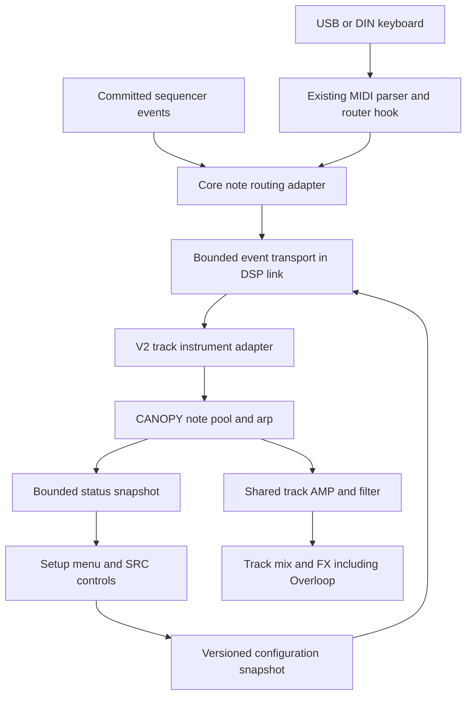

# CANOPY technical design

Status: proposed implementation, 2026-10-29. Target: Digitakt II OS 1.17. Source baseline: `9b168c21` on `codex/short-loop-proof`. This design specifies new capabilities; it does not claim that CANOPY or the proposed interfaces already exist.

CANOPY is a keyboard-playable pad instrument on one audio track, with four independently articulated chord tones and an arpeggiator blended over the pad. PLAY sounds the notes the player actually presses. ROOT + TYPE generates a chord from a root key and a silent chord-selector key. LEARN TO ROOT captures a voicing for later transposition. Sequencer mode plays a chord from a stock note trig.

The enabling change is a versioned track-instrument interface with individual note events and persistent state. A MIDI queue attached to today's monophonic machine interface is insufficient: the firmware can restart or stop the entire track on each key event. Prove independent key release through the final audio output before building the full synthesizer or screen.

Implementation payoff is a playable harmonic instrument that coexists with Overloop. Confidence is high in chord generation and the bounded DSP engine, moderate in the required MIDI and track-lifecycle integration, and lower in automatic Sound/pattern persistence for extra settings. The complete implementation is multi-day work. The gates below keep uncertain firmware work ahead of expensive UI and synthesis work.

## Scope and decisions

- Ship a DTII-only experimental module, proposed ID `digikit/canopy`, with an explicitly required new runtime capability. Keep existing V1 machines compatible.
- Support four foreground pad notes. Additional fixed slots handle one arp note and two shared release tails. Voice count never grows with release time.
- Use internal envelopes and velocity for individual notes. Retain the stock filter, level, pan, mute and FX routing. Treat the stock AMP envelope as a shared master shape, subject to the lifecycle proof below.
- Make KEYBOARD and SEQUENCER explicit source choices. Do not merge their ownership implicitly in the first version.
- Start with four existing machine knobs and a module setup menu. Deliver the two SRC pages through a separate, versioned UI/control extension.
- Save extended settings as explicit DigiKit presets first. Automatic Elektron Sound/project persistence and parameter-lock support require separate proofs.
- Defer MPE, arbitrary MIDI CC mapping, internal MIDI-track routing, DNII support, rootless-chord guessing and more than four foreground notes.

## Existing interfaces and required changes

| Area | Present implementation | Required extension |
| --- | --- | --- |
| Voice input | V1 supplies one pitch, velocity, block count and mono output buffer | Track identity, event batches, instance lifetime, effective controls and transport |
| Voice lifetime | Stock note-on initializes the machine; inactive stock voices skip its renderer | Wake on events; render through independent releases; reset only at instance boundaries |
| MIDI receive | Runtime owns a gathered USB-message router hook used for upload | Compose an optional channel-message handler; establish DIN coverage on 1.17 |
| Machine controls | Four custom words at B/C/E/F; TUNE and LEVEL remain stock | Versioned extended bank and page-to-parameter mapping |
| Pattern timing | Overloop bridge publishes committed master-grid boundaries | Validated finer clock for subdivisions, triplets and swing |
| Settings | Device-wide runtime store, called on the UI task; no public DKM settings API | Bounded module-owned settings access and explicit presets |

Source evidence: [machine ABI](../../sdk/include/dk/gen/machine.h), [DTII profile](../../devices/digitakt-ii.toml), [machine adapter](../../modules/core/adapters/dsp-voice/src/dsp/dsp-voice.s), [MIDI declarations](../../devices/fw/midi.toml), [upload analysis](../findings/43-digikit-upload.md), [typed descriptor validation](../../packages/patchkit/src/typed.rs), [module authoring](../MODULE-AUTHORING.md), [pattern-position ABI](../../sdk/include/dk/pattern_position.h), and [settings implementation](../../modules/core/runtime/src/rs/src/settings.rs).

The USB hook's declaration describes SysEx, while the upload analysis describes a router for gathered cable-0 messages. Its channel-message reachability must be checked on the pinned 1.17 image; do not treat the documentation discrepancy as a proven new API. DIN/common-dispatch hook addresses from older firmware must be resolved again.

## Architecture and ownership

Follow the [repository layers](../ARCHITECTURE.md). Core adapters own firmware addresses, routing, gates and physical transport. CANOPY accesses only generated SDK contracts. Do not let content code write firmware voice records or inspect undocumented frame offsets.

Proposed new children under `modules/core/adapters/` are `midi-events` for routing and `machine-controls` for extended pages/control state. Extend the existing `dsp-voice`, `dsp-link`, `pattern-position` and `dyndsp` adapters rather than installing competing hooks at their sites. Add the content machine as child `canopy` under `modules/machines/`.

Keep MIDI routing/ownership in the core control path, outside the UI task's redraw cadence. CANOPY owns its keyboard modes, chord generation, oscillator, envelope, arp and voice-allocation state on the DSP; the framework does not hard-code CANOPY chord tables or selector mappings. Chord naming and display formatting run on the UI side from immutable status snapshots. The UI is never the audio scheduler.

## MIDI routing and event ownership

### Ingress

Extend the runtime-owned receive hook with an optional adapter callback before the uploader's short-message/SysEx filter. Preserve the original consumed/fallthrough paths and buffer cleanup. Never patch this hook twice.

The first route is explicit and exclusive: `(input port, MIDI channel) -> CANOPY track`. A route becomes active only when that track has a loaded, healthy CANOPY instance. Unclaimed traffic, stock tracks, MIDI clock and upload SysEx retain their existing routing. Handle valid channel messages after the firmware parser has normalized the byte stream; do not add a second byte parser in an interrupt.

USB and DIN are separate acceptance cases. A directly attached DIN keyboard is the standalone target; USB tests use a host forwarding MIDI. Support for native Auto Channel follows an independently verified target resolver. It is not inferred from a guessed selected-track field.

Claimed Note On/Off messages must be consumed before stock per-key voice handling. Otherwise each note could restart the whole pad or alter its shared velocity. This may also bypass native live recording: the initial keyboard mode does not promise recording polyphonic chords into an audio-track pattern. Sequencer root/chord programming remains a separate path.

In SEQUENCER source mode, consume and ignore fresh claimed keyboard performance notes, pedal and bend; still drain previously owned note-offs and accept PANIC. In KEYBOARD mode, suppress stock sequencer note/gate rearming for that CANOPY track before it can restart the shared AMP. Parameter changes continue through their supported paths. Source selection must govern both event routes and stock carrier handling.

### Ownership ledger

Maintain a bounded ledger keyed by input port, channel and note, with press order, velocity, destination track and routing generation. Note-off follows the destination recorded at note-on, even if the selected track changes. Repeated note-ons at the same pitch receive separate tokens, paired FIFO with note-offs. Bound repeated-note counts; overflow invokes controlled reset rather than wrapping.

MIDI ownership and DSP slots are separate. A stolen note's later note-off must not release the note that replaced its slot. Token matching occurs before changing an envelope. Keep physical key state distinct from sustained, latched, sounding and stolen states.

Routing edits, source/mode changes, project load, machine removal and faults advance the affected instance generation. Clear its sounding state with a short bounded ramp and invalidate pending old-generation events. Preserve bounded tombstones for outstanding physical presses until their matching note-offs arrive; these releases remain consumed and never redirect to a new track. Tombstones take part in the FIFO pairing even if a fresh same-pitch press has a new destination. Re-enable sounding input with fresh presses after such a reset. If ownership/tombstone capacity is exhausted, quarantine that route until an explicit reset with keys released instead of discarding ownership and guessing.

### Controller rules

| Event | Behavior |
| --- | --- |
| Note On velocity 0 | Normalize to Note Off |
| CC64 below/above 64 | Pedal up/down; pedal up releases deferred notes whose physical keys are up |
| CC120 | Panic the route: clear keys, pedal, latch and arp, with only the emergency de-click ramp |
| CC123 | Release all physical keys; ordinary sustain rules still apply |
| CC121 | Reset controllers, including pedal and channel bend; release pedal-only notes |
| Pitch bend | Shared channel bend, initially fixed at +/-2 semitones, applied once after note/chord generation |
| Explicit PANIC | Clear all CANOPY ownership and tails, even if no MIDI message arrives |

Implement only claimed supported controllers; document the fallthrough policy for others. Use MIDI Active Sensing timeout only after that stream has actually enabled it. A DIN cable unplug cannot generally be detected. An internal bridge heartbeat timeout is independent of keyboard inactivity, so a deliberately held note does not expire just because no MIDI arrives.

## Keyboard modes

### PLAY

Every accepted note-on starts its own voice immediately, subject to the fixed four-note foreground limit. Note-off starts only that voice's release unless pedal or latch holds it. Preserve the played pitches, octave spread and velocities. Generated-chord VOICING does not rearrange PLAY notes.

Chord recognition is display-only in this mode. After 35 ms without a note-set change, compare the pitch-class mask with a small dictionary of exact chord templates and their inversions. Prefer a root present in the played set and an exact template; use the previous equally valid interpretation to reduce flicker. Show the lowest sounding pitch as the bass in slash notation. If interpretation is ambiguous, show note names. Display updates do not delay notes, quantize them or retune them.

Recognize major, minor, sus2, sus4, fifth, sixth, major seventh, minor seventh, dominant seventh and add9. Avoid an expensive probabilistic recognizer. Repeated notes and octave duplicates affect voicing display but not pitch-class matching. Distinguish physical/pedal notes from old audio release tails; tails do not change the detected chord.

### ROOT + TYPE

A configurable selector octave is silent. White keys C/D/E/F/G/A/B select major/minor/sus2/sus4/dominant7/minor7/major7. Assign the five black keys major6/minor6/add9/diminished/custom. Key names are relative to the selected octave, with MIDI note numbers shown in setup to avoid octave-label ambiguity.

An optional dedicated selector-channel route allows a second controller or keyboard zone to choose types without reserving an octave on the root-playing channel. Route roles are explicit configuration; root and selector roles cannot overlap ambiguously for the same port/channel/note. Both still use the same ownership and silent-selector handling.

Selector note-on changes a latched chord type; its note-off remains consumed and silent. Other keys supply roots, using last-pressed-root priority. Releasing the current root restores the most recent still-held root; pedal/latch determine the behavior when none remain. A selector update rebuilds the chord from the current root and never becomes an audible note.

When a selector and root arrive together, apply selector changes first within the same DSP batch. Cross-block ordering remains event order, with smooth reassignment. In PAD mode apply changes immediately. With quantized chord changes enabled, stage the entire new chord and commit at the next arp event, never one interval at a time.

Offer close/open voicings and explicit inversions. Optional voice leading searches bounded octave/inversion candidates to minimize total pitch movement, preserving common tones where possible. Apply it only to generated chords. Reject a generated voicing that cannot fit the supported pitch range; never clamp several out-of-range tones onto the same pitch silently.

### LEARN TO ROOT

LEARN opens a capture session. Collect up to four unique physically played notes, preserving octave spacing; excess notes show a capacity message. SAVE commits the set relative to its lowest captured note. CHORD names remain informational: an inferred root must not silently change the transposition anchor.

For capture C-G-B-E, store offsets 0, 7, 11, 16. Playing D as root gives D-A-C#-F# with the same voicing. CANCEL leaves the previous shape intact. Learning auditions use ordinary PLAY voices. SAVE updates RAM immediately and queues explicit persistence outside the MIDI task.

Library slots are templates. A saved preset embeds its learned intervals by value, so editing a library slot cannot alter existing presets unexpectedly.

### Latch and sustain

In latch mode, releasing keys preserves the current chord. Once all physical keys have been released, the next note-on begins a replacement phrase; subsequent pressed notes join it. Replace the old latched membership atomically with the first new note, retaining only bounded audio tails. A slow rolled chord grows as played, without waiting for recognition.

Latch replacement clears the previous phrase's pedal-only membership too; otherwise successive phrases could accumulate indefinitely. Pedal and latch never allocate additional hidden voices. Disabling latch releases notes that are neither physically held nor pedal-held.

## Versioned instrument interface

Add an opt-in V2 contract in `sdk/sdk.toml`, generate its C/assembly bindings, and extend descriptor parsing, DKM packing, runtime validation, DSP registration and conformance together. Never enlarge `dk_voice_in` or reinterpret V1 descriptors in place. A V2 module must fail to load with a clear capability error on old firmware.

The following is the semantic contract, not a frozen binary struct:

| Input | Meaning |
| --- | --- |
| Version and size | Reject incompatible layouts before dereferencing fields |
| Track and instance generation | Stable owner for state and queued events |
| DSP block counter and output | One mono 32-frame block, plus absolute block identity |
| Global tune and bend | Separate from key pitches; do not apply stock TUNE twice |
| Event list and count | Bounded normalized events, matched to this generation |
| Effective control snapshot | Revision, bounded parameter count and immutable values |
| Transport snapshot | Validity, run generation, timing capability and clock position |
| Shared gate state | Adapter lifecycle information, separate from individual gates |

Events carry kind, source ownership, token, pitch, velocity and an optional sample offset. Initially every offset is zero: delivery at the next accepted block is the supported timing. Merely reserving an offset field does not establish sample-accurate MIDI timestamps. Raw MIDI tokens originate on CF; CANOPY creates separate internal generated-pad/arp tokens keyed to the source phrase generation and tone index. These namespaces cannot collide, and a raw key release changes only the mode state that owns its generated notes.

Use `reset(state, reason)` on instance creation or explicit reset, and `process(state, input)` for event handling plus rendering. Ordinary note-on does not clear state. `process` reports ACTIVE or QUIET; QUIET requires no audible release, arp gate or pending de-click ramp. Pending events wake a quiet instance before the stock inactive-voice shortcut.

The adapter supports up to the device's 16 track instances. Four internal foreground notes are a CANOPY allocator limit, not the descriptor's track-instance count. Keep per-track state isolated and preserve existing SHARC register, memory and finite-output guards.

## Track activation and shared AMP

The first firmware proof uses sine tones and this lifecycle:

1. An idle-to-active event starts the stock track carrier and shared AMP once, using a neutral shared velocity multiplier.
2. Further key events reach only the V2 state; they do not restart the stock AMP, reset oscillator state or change a global note-velocity multiplier.
3. Individual note-offs start local releases. The adapter keeps the stock render path alive while any internal voice, latch, arp gate or release remains active.
4. Only QUIET permits deactivating the stock track carrier. New events can wake it without a stock sample trig.

CANOPY needs local attack/release controls even with a shared stock envelope; expose these in setup initially, defaulting to approximately 80 ms attack and 1 s release. They belong to the effective configuration and preset. Stock AMP remains a master shape and can intentionally shorten the whole chord. Use a sustained stock AMP setting when proving held notes and independent releases.

Prove that the engine does not kill the custom renderer prematurely at its own envelope termination, and that stock shared velocity is neutral. A low-velocity first note must not reduce the volume of a later high-velocity note. Inspect both module output and final track output.

If a sustained carrier cannot provide the required lifetime, investigate an explicit V2-only unity envelope multiplier. This requires a separate pinned firmware hook and proof that LEVEL, pan, mute, filter and FX remain effective. Do not bypass the whole gain chain or ship keyboard mode under a silent compromise. Failure of both approaches blocks the full instrument; a root-only prototype can remain experimental but is not completion of this design.

## Transport alongside Overloop

The [DSP-link implementation](../../modules/core/adapters/dsp-link/README.md), [pattern-position provider](../../modules/core/adapters/pattern-position/README.md) and [Overloop display](../../modules/core/adapters/loop-display/README.md) already share forward/reply transport. Centralize any new allocation in DSP-link and its receiver. Preserve the pattern-position suffix and its ABI.

The DTII profile describes 174 spare forward words. Pattern position reserves the final 16. A candidate additional reservation is 32 words immediately before those 16: eight header words plus eight three-word event records. With the loader's existing three-word header, its maximum payload would become 123 words when both bridges are enabled. Confirm this calculation against the actual sender and receiver before assigning bytes; update both bounds and all upload chunk calculations together.

Proposed eight-word event-batch header fields are magic/version, message kind/count, stream epoch, ordered message sequence, first event sequence, required configuration revision, oldest enqueue block and integrity check. Event sequence is `first + index`; individual ingress timestamps remain in diagnostic logs. Group a batch by destination track and required configuration revision. Each three-word event contains the CF-assigned note token, instance generation, and packed arguments. Allocate argument bits as kind 4, normalized port 2, channel 4, track 4, note 7, value 7 and reserved 4. CF is the only note-token allocator; Note Off carries the exact Note On token. The DSP never reconstructs FIFO identity independently. Wrap a token counter only through a new instance generation after draining/resetting its old events.

Define argument interpretation by event kind: NOTE uses note/velocity, CC uses controller/value, and BEND combines the two seven-bit fields into the full 14-bit value. Non-note events reserve token zero. Configuration/routing metadata travels in typed control packets, not truncated MIDI fields.

All packet kinds share one ordered message sequence and cumulative ACK, separate from runtime-loader ACK. Tagged CONFIG_CHUNK payloads carry target track, instance generation, configuration revision, chunk index and total byte length before bounded chunk data. Assemble into a second buffer; CONFIG_COMMIT validates the complete length/schema/checksum and swaps the revision atomically before acknowledgement. Chunk acknowledgements mean buffered, not applied. Dependent note batches wait behind the commit and declare its required revision. Retries of chunks/commits are idempotent. A mismatch requests resynchronization instead of rendering notes against the wrong shape. Priority reset aborts any incomplete transaction. A per-track reset advances that instance generation; whole-stream resynchronization advances the separate stream epoch.

Reserve sixteen return words as a candidate: four for magic/version, stream epoch, accepted message sequence and DSP heartbeat; twelve for one track's status. Status includes publication block, track/mode/source flags, instance generation, applied configuration revision, chord revision, four packed pitches, per-note key/pedal/latch membership, arp pitch/gate/ordinal, applied blend, clock state, fault code and overrun count. Publish ACK every DSP block independently of UI work. Rotate status across track instances, one per block, so all sixteen are refreshed within sixteen blocks. The UI selects only matching track/generation snapshots and suppresses stale animation; track selection must never briefly display another track's notes.

Allocate these return words only after proving unused space and full copy-path coverage. Rows after 20 are candidates: Overloop owns rows 13-20, and earlier rows contain ACK/diagnostics. A second mailbox cannot simply use those existing rows. Lack of verified return capacity blocks stage 0 just as lack of forward capacity does.

Use a preallocated 128-event CF ring as a starting bound, at most eight events per forward batch. The MIDI task publishes complete entries before advancing the producer index; the audio sender consumes them under a short documented synchronization protocol. UI configuration/routing commands go through a serialized control handoff, not an unsynchronized second ring producer. No heap allocation, file access or logging loops in the MIDI/audio paths.

Retain batches until ACK, suppress replays and use wrap-safe sequence comparisons. Retransmission must not retrigger notes. A priority reset/epoch record has reserved capacity outside the ordinary event ring and is repeated until its own reset acknowledgement. Overflow, an unrecoverable sequence gap or a stale bridge heartbeat causes a short ramp to silence, clears sounding ownership while preserving physical-press tombstones, and requires fresh key presses after reset acknowledgement. Do not attempt an incomplete reconstruction of a held chord. Drop late old-epoch events and expose an overrun diagnostic. A receiver accepts a newer reset epoch even when normal in-order delivery is stalled.

At 48 kHz, 32 samples are about 0.667 ms. That is block quantization, not measured end-to-end latency. Set an initial target below 10 ms added median latency and 15 ms at the 99th percentile under the defined coexistence workload; measure from completed MIDI message ingress to final audio onset, separately from a controller's own scanning/USB/DIN transmission. Verify large event bursts, retransmission, configuration transfer and loader uploads. Adjust reservations before promising these targets.

The existing early DSP receive hook also needs composition through one owner. Do not install a second hook over pattern position. Test CANOPY, Overloop capture/playback/status and a module upload together, including byte preservation outside every declared allocation.

## DSP engine and bounded resource use

The maximum is seven tone groups per track: four foreground pad groups, one current arp group and two release groups shared by pad and arp. At two oscillators per group the ceiling is fourteen oscillators, including transitions. This is a proposed ceiling, not a measured capacity.

Use small band-limited wavetable families with interpolation, or an equivalently bounded oscillator proven across the supported pitch range. COLOR morphs between rounded and brighter spectra. DRIFT changes pitch/tone coefficients at control rate with deterministic per-instance seeds. Compute expensive pitch coefficients on events or control changes, and smooth gain/color changes in the sample loop. No allocation or full-spectrum analysis occurs there.

On note release, keep its foreground slot until needed or migrate it to a free release slot. Reclaim the quietest releasing slot first, then the oldest release. A fifth held note steals the oldest foreground note; mark its token stolen so its later note-off is harmless. Do not resurrect stolen held notes automatically when another key is released.

When stealing a non-silent slot, fade it for at most 64 samples before initializing its replacement, or use an already available tail slot. The new note can therefore incur a bounded steal delay. A four-note chord replacement can retain only two independent old tails; other displaced notes use the short steal ramp. Arp releases compete for the same pool. Long releases never allocate more groups.

Use conservative fixed headroom for the maximum pool and smooth PAD/ARP mixing; avoid instantaneous gain normalization when the note count changes. Guard finite values and the SDK level bound. At pure PAD/ARP endpoints, skip inaudible synthesis where possible while preserving event, envelope and clock state.

Set a memory target of at most 4 KiB per track, plus at most 64 KiB of shared tables and fixed transport/configuration buffers; confirm total placement against other loaded modules. If the CPU ceiling fails, reduce oscillator density before reducing the four-note musical limit.

Current conformance derives approximately 12,140 added instructions per track/block for a 16-track DTII case; see [conformance](../../tools/patchkit/pk_conform.py). That projection is not available headroom with Overloop. Count event processing, four simultaneous attacks, arp transitions and tails inside the same bounded block budget. Do not spend the old whole-device note-on allowance independently on every track.

For unrestricted track assignment, prove the maximum 16-track case alongside stock filtering/FX and then the supported Overloop workload. If it cannot fit, enforce a measured instance limit at track activation with a visible error; loading one DKM does not limit the number of tracks using it. Performance evidence states the ceiling first and uses the repository's paired A/B workflow. No silicon performance claim follows from oscillator counts alone.

## Arpeggiator and transport behavior

ARP MIX blends sustained pad and the separate arp group. Candidate notes come from physical/sustained/latched membership in PLAY and from the generated chord in the other modes. Audio release tails are excluded. The arp operates on a committed chord revision; a mid-step chord edit takes effect at the next scheduled note.

Support UP, DOWN, UP/DOWN without duplicate endpoints, AS PLAYED and seeded RANDOM; one to three octaves; and bounded gate duration. Each arp event has its own internal token. Gate changes release only arp ownership. Initially STRUM applies only to generated ROOT + TYPE, LEARN TO ROOT and SEQUENCER chords: it schedules their pad-tone onsets across a bounded interval and cancels pending old-chord onsets when the chord revision changes. PLAY always preserves immediate individual key onsets; adding a played note cannot cancel a still-held earlier note.

The first clocked proof uses committed master-step boundaries and integer multiples from Overloop's existing bridge. Do not infer BPM, per-track swing or a sample timestamp from its raw scheduler deadline. Faster divisions, triplets and swing require a versioned tempo/phase extension with measured behavior on internal and external clock. Represent subdivision phase rationally, so triplet rounding does not accumulate drift. Swing moves alternating events while preserving each pair's total duration.

Restart choices are TRIG, PATTERN and CONTINUE. In KEYBOARD mode TRIG means the beginning of a new phrase, not each added chord tone. PATTERN follows the committed pattern generation. CONTINUE preserves ordinal/phase across chord updates, while transport reset creates a new clock generation. Quantize pending changes against the clock source actually selected.

While stopped, direct keyboard pads remain playable. A standalone arp can use an explicit local BPM in setup after the local-clock stage; external sync does not silently fall back to that BPM on clock loss. A stale clock releases the current arp gate and pauses scheduling. Transport STOP cancels sequencer notes, pending strums and synchronized arp events; keyboard held/pedal/latch notes retain their ownership. PANIC clears them all.

On a pattern switch that keeps CANOPY on the same track, retain KEYBOARD tokens and oscillator state, then apply the destination's firmware-backed controls. Initially the extra module controls remain at the current CANOPY configuration/preset; they do not acquire destination-pattern values automatically. If the machine changes, reset that instance. In SEQUENCER mode the destination's committed trigs and lengths own the generated chord. Tie, retrig, microtiming and note-length behavior need event-source tests; root pitch alone cannot supply a complete gate lifecycle.

## Controls and display

The keyboard proof retains existing stable custom word IDs: 0 CHORD at B, 1 VOICING at C, 2 COLOR at E, and 3 DRIFT at F. Keep stock TUNE and LEVEL. Use the public module menu for source, keyboard mode, explicit MIDI route, selector octave, latch, local attack/release, arp settings, LEARN, SAVE, CANCEL and PANIC.

The release layout is:

| Encoder | SOUND | MOVEMENT |
| --- | --- | --- |
| A | TUNE | RATE |
| B | CHORD | ORDER |
| C | VOICING | OCTAVES |
| D | COLOR | GATE |
| E | DRIFT | SWING |
| F | STRUM | RESTART |
| G | ARP MIX | LATCH |
| H | LEVEL | SOURCE |

SOURCE is KEYBOARD or SEQUENCER. PLAY/ROOT + TYPE/LEARN TO ROOT is selected in setup. In PLAY, CHORD shows detected notes/name as read-only status and encoder B is visibly disabled; turning it does not edit a hidden value. The chord parameter retains its generated-mode selection until the player changes mode. During the initial stock-page prototype, retain the numeric CHORD control as a clearly documented generated-mode-only setting; the read-only named display belongs to the custom-page stage.

Separate logical parameter IDs, storage backing and physical encoder positions. Reordering COLOR onto D must not repurpose the firmware's sample-slot storage: D has sample-specific semantics today. Route the new page's D encoder to the existing COLOR backing word instead. Stock TUNE/LEVEL keep their native handlers.

Four fields retain firmware backing. Extra fields use a versioned module configuration bank, proposed maximum 32 32-bit words, delivered through the new interface; do not overrun V1's eight-word ABI or bypass the packer's four-control validation. Add an explicit descriptor/capability for free placement and multiple pages, leaving V1 rules intact. Maintain one effective snapshot with a revision so the displayed applied values match DSP values.

Reserve logical IDs 0-3 for CHORD/VOICING/COLOR/DRIFT; 4 STRUM, 5 ARP MIX, 6 RATE, 7 ORDER, 8 OCTAVES, 9 GATE, 10 SWING, 11 RESTART, 12 LATCH, 13 SOURCE, 14 LOCAL ATTACK and 15 LOCAL RELEASE. Mode, selector routing, local BPM and learned-shape data are separately versioned setup fields. TUNE and LEVEL remain stock identities. These IDs describe control identity rather than an instruction to allocate native firmware parameter slots; publish explicit enum values/ranges with the implementation and never reorder released IDs.

Add SRC paint/update/encoder hooks scoped to the resolved CANOPY machine, using an SDK-facing view adapter. Overloop's FX-specific draw hooks are a precedent, not a reusable SRC API. Repeated SRC selects SOUND/MOVEMENT. Other machines use stock handlers. Page changes never mutate control values.

Display mode/source, detected or generated chord, actual note names, pedal/latch state, active arp note, rate/sync state and a PAD-to-ARP blend indicator. Render only bounded snapshots, at at most 25 Hz for animation; input can redraw immediately. Retain no stale firmware view pointers. Recognition and animation never read oscillator buffers.

## Persistence and automation

The runtime settings store is device-wide and shared: 8 KiB total, with a 1024-byte maximum value. Introduce bounded namespaced access for content modules, or an explicitly scoped core settings owner. Keep all store reads/writes on the UI task. MIDI handlers publish pending changes only.

Start with eight learned shape templates and four explicit CANOPY presets, within a 1536-byte requested namespace quota including record overhead. Check shared capacity before accepting a save. Store schema version, control values, normalized intervals and optional captured velocity ratios. Persist routes separately from patch sounds. Never save held keys, sustain state, live tokens, pending events, arp phase or pointers.

Each preset embeds its learned shape by value. Validate record length, version, note count, interval ranges and parameter ranges before applying a complete revision. An invalid load leaves the current working configuration untouched. A failed save keeps the current audible configuration dirty/unsaved and preserves the previous durable copy; it does not roll back sound parameters later. Report unsaved/dirty/error states accurately; an in-RAM update is not a durable save. Use the existing deferred dual-copy persistence and its error reporting.

The first release distinguishes scopes explicitly:

| State | Initial persistence contract |
| --- | --- |
| Four existing machine values and stock TUNE/LEVEL | Existing firmware slot backing; verify save/load in CANOPY scenarios |
| Extra controls and learned shapes | Explicit DigiKit preset save/load; no automatic Sound/pattern association |
| MIDI routing | Device setup, restored only after valid CANOPY instances register |
| Sound/pattern copy, p-locks and LFO modulation of new fields | Not promised until their integration passes dedicated tests |

For full Sound/project integration, first prove stable identities and save/load/copy/paste/reload paths. A RAM Sound pointer or a pattern number is not a persistent key. Define behavior for missing modules and old schema versions before extending native serialization or adding a project sidecar. Keep that work separately releasable; do not imply that an attractive SRC page establishes native persistence.

## Implementation stages and acceptance

| Stage | Work | Exit evidence |
| --- | --- | --- |
| 0 | Pin MIDI boundaries and transport allocation on 1.17; define V2 capability | USB and DIN observation/fallthrough, upload intact, no overlapping forward/reply claims |
| 1 | V2 lifecycle and simple sine voices, explicit keyboard route | Hold C-E, add G, release E: C/G remain continuous in final output; pedal and low-then-high velocity pass |
| 2 | Bounded pool, PLAY, ROOT + TYPE, LEARN TO ROOT, latch and settings menu | Deterministic ownership, silent selectors, capture/transposition, panic and failure recovery |
| 3 | Pad oscillator families, local envelopes, drift and stock filter/FX integration | Pitch/aliasing/headroom checks, bounded memory/instructions, musical sustained/retrigger tests |
| 4 | Master-grid arp, blend/strum; then finer clock/local BPM | Correct note order/gates, chord commit, stop/restart, clock-loss and tempo-change behavior |
| 5 | Presets, named display and two SRC pages | Audio/display revision agreement, stable IDs, persistence errors, unaffected stock views |
| 6 | Coexistence, admitted instance count and hardware release proof | CANOPY + Overloop + uploads; worst-case CPU; real keyboard latency and lifetime checks |
| Later | Native Sound/project extension, automation and internal MIDI-track chords | Dedicated round-trip, copy/paste, p-lock/LFO and routing proofs |

Stage 1 is a go/no-go gate. A beautiful pad sound with shared-note cutoff is a failed keyboard instrument. The detailed two-page UI must not delay that proof. Do not expand into extra oscillator types or recognition heuristics while MIDI/AMP ownership remains unresolved.

## Tests and code owners

Use generated SDK constants and extend existing helpers. Core runtime/adapters retain their repository language conventions; content declarations/control code use C and DSP uses SHARC assembly. New device scenarios use TypeScript/Vitest. Reference-model tests must drive the shipped control logic or compare its executed results, rather than test a disconnected mock alone.

| Owner | Planned changes |
| --- | --- |
| `devices/fw/` and `devices/ports/` | New 1.17 MIDI, lifecycle and SRC declarations, hash-resolved anchors |
| `sdk/sdk.toml` and generated bindings | V2 instrument/events/control descriptors, settings capabilities |
| `packages/patchkit/` | Descriptor validation, capability/version errors, packing and tests |
| `modules/core/runtime/` | Optional MIDI callback composition, namespaced settings, loader checks |
| `modules/core/adapters/` | Note routing, composed transport, V2 lifetime, controls/views and clock extension |
| `modules/machines/` | New CANOPY declaration, DSP, control logic, player documentation and tests |
| `tests/support/machine_rig.py` | V2 event-stream conformance support |
| `tests/regression/` | Bounded running-firmware keyboard, persistence, timing and coexistence scenarios |

Required behavior tests include repeated same-note presses, stale note-off after stealing, four-note replacement with tails, pedal/latch interactions, selector/root ordering, route edits with held notes, channels on tracks 1 and 16, wrong epochs, full queues, ACK loss/replay, malformed configuration, missing provider and fault recovery. Explicitly test press C, reroute/reset, press C again, old C-off, new C-off: the old release must not kill the new note. Every failure must leave unrelated tracks and upload functional.

Timing tests cover keyboard input while stopped, repeated PLAY/STOP, pattern changes, clock loss/recovery, non-default master lengths/scales and external clock before those modes are advertised. Existing pattern-position proofs at one tempo/default pattern do not establish all these cases.

Audio checks inspect both the module output and final output: phase continuity of untouched notes, independent velocity/release, no NaNs or escaped writes, de-click transitions, unsupported-pitch handling and finite headroom. Test maximum simultaneous events plus rendering in one block. Keep V1 PLUCK and stock-machine fallthrough regression tests.

Use the owner's module check and filtered runtime/module suites while implementing; inspect the routed merge gate before integration as required by [testing](../TESTING.md). Run actual hardware USB/DIN keyboard checks after emulator gates. The current change is this design only; its checks are repository path validation and the changed-file preflight.
