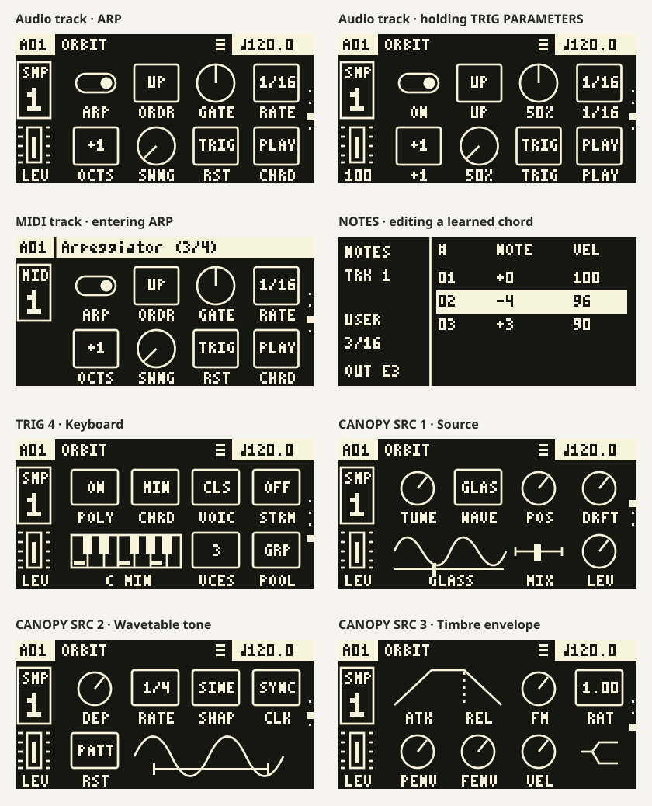

# DTII track keyboard, polyphony and arpeggiator proposal

Design for review · 21 November 2026 · Digitakt II OS 1.17 · checkout `7a30eda41`

Give each audio and MIDI track **Arpeggiator on TRIG 3** and **Keyboard on TRIG 4**. KEYS plays notes together and ARP plays the same notes in sequence. CANOPY’s SRC pages become synthesis controls. A player can hold a chord on the Digitakt keyboard or an external keyboard, change its order and octave spread, then record it as an editable trig. The selected track determines which sample, instrument or MIDI destination plays the notes.

## Finding ARP on the panel

| Track | TRIG 1 | TRIG 2 | TRIG 3 | TRIG 4 |
| --- | --- | --- | --- | --- |
| Audio | Note, length, velocity and trig conditions | Retrig and portamento | Arpeggiator | Keyboard |
| MIDI | Root, note offsets 2–4 and trig settings | FILL and COND | Arpeggiator | Keyboard |

From TRIG 2, tap **[TRIG PARAMETERS]** once. The next tap opens Keyboard, and one more returns to TRIG 1. UP/DOWN follows the user’s U/D KEY MODE setting, including octave changes while KEYBOARD is active. Hold **[TRIG PARAMETERS]** to see values. The sixteen numbered **[TRIG]** keys keep their keyboard, recording and performance roles. **[FUNC] + [TRIG PARAMETERS]** still opens Quantize. These gestures and the two stock page families are documented in the [OS 1.17 manual, §§6, 10.5–10.6, 11.1–11.3, 14.7.4 and A.2.7](https://www.elektron.se/wp-content/uploads/2026/10/Digitakt-2-User-Manual_ENG_OS1.17_260930.pdf).

On the ARP page, enable **ARP**, choose **PLAY** with **H CHRD**, and press E, C and G. **AS PLAYED** repeats E–C–G. **UP** repeats C–E–G. Set **OCTS +1** to include the next octave. A single held key gives a pitched roll, including on MIDI. Keyboard playing follows the selected tempo with the sequencer stopped.

## ARP parameter page



Proposed screens at a logical 128 × 64. The drawings use original graphics for review. The product uses the stock parameter and menu renderers.

The panel uses the stock TRIG parameter view. At page entry, ask the native title routine to show **Arpeggiator (3/4)** in the same temporary field as **Trig parameters (2/2)**. At rest the pattern name, mode and tempo return, with the third page mark lit at the right. On audio tracks the left column carries **SMP**, the track number and the **LEV** fader. On MIDI it carries **MID** and the track number, with empty space below as on MIDI TRIG 2. Native controls occupy all eight cells. Live notes and the current generated pitch appear in the NOTES editor. [Audio TRIG reference, p. 54](https://www.elektron.se/wp-content/uploads/2026/10/Digitakt-2-User-Manual_ENG_OS1.17_260930.pdf#page=54) · [MIDI TRIG reference, p. 102](https://www.elektron.se/wp-content/uploads/2026/10/Digitakt-2-User-Manual_ENG_OS1.17_260930.pdf#page=102)

| Encoder | Caption | Turn | Default |
| --- | --- | --- | --- |
| A | ARP | Enable arpeggiation for this track or held trig, in the same position as RTRG. | OFF |
| B | ORDR | Press order, ascending, descending, up/down or random. | AS PLAYED |
| C | GATE | Sound each note for 1–100% of its interval. C is also the duration position on the adjacent retrig page. | 50% |
| D | RATE | Choose a division of the selected tempo with the same encoder used for retrig RATE. | 1/16 |
| E | OCTS | Add one to three octaves above or below the played register. | 0 |
| F | SWNG | Swing alternate arp intervals, 50–75%. | 50% |
| G | RST | Restart the order on a new phrase (TRIG), on a pattern boundary (PAT), or continue (CONT). | TRIG |
| H | CHRD | Choose PLAY, a named chord or USER. Click to edit the note set. | PLAY |

ARP uses the switch graphic used for RTRG. RATE uses the retrig division display and formatter with its value supplied by the arp. GATE and SWNG use native continuous controls. OCTS uses signed integer formatting. ORDR, RST and CHRD use compact choices with full descriptions on focus. Use CANOPY’s four raw ticks per choice for ordinary turns on short lists, and announce each choice through native focus. Let native press-and-turn handle coarse adjustment where the parameter supports it. An ordinary H click opens **NOTES** on release. Turning, using a modifier or clearing a lock consumes that press.

**Normal and held views.** Match the neighboring TRIG screen at 128 × 64. Keep each graphic visible while the parameter key is held and let the firmware switch the captions to their formatted values and render the track column for that track type. Release returns to labels. There is one physical LEVEL/DATA control and it follows the stock view for the selected track. The firmware owns the right edge even when a value reaches four characters. CANOPY measured native cell origins at x = 24 + 26 × column on SRC. Use that as a starting point and measure the TRIG view itself before assigning any drawing rectangles. [Native drawing and show-values evidence](../findings/339-canopy-native-ui.md)

**Step locks.** In GRID recording, hold one or more populated steps and turn A–H to lock their values. Use stock inversion on the locked control and show the effective step value. Press the corresponding encoder while holding the step to clear that lock, including H. Holding a step and turning LEVEL/DATA retains native preset selection where the track supports it. On an eligible seed the ARP enable lock decides who repeats it. When ARP owns an audio seed, keep its RTRG setting saved and explain the override in RTRG’s temporary focus text. Manual RETRIGS performance retains priority for the duration of the gesture. Generated notes go directly to the selected instrument or MIDI channel.

## TRIG 4 · Keyboard

For a pitched sample, choose the track, tap [TRIG PARAMETERS] to **Keyboard (4/4)**, turn **A POLY** on and choose **B CHRD = PLAY**. Press H to open **VOICE GROUP**, and assign two available audio tracks. Now hold C–E–G on the panel keyboard or via USB/DIN. The three pitches have independent starts and releases. Lift E and the other two continue. Turn B to MIN and one root plays a minor triad. Turn ARP on at TRIG 3 to hear the same chord one note at a time. On a MIDI track the same example uses its configured output channel. CANOPY uses its own foreground voices.

| Encoder | Caption | Action |
| --- | --- | --- |
| A | POLY | OFF / ON. Enables simultaneous track-keyboard playback. ARP can operate with POLY off. |
| B | CHRD | Same pattern value, lock and NOTES editor as ARP H. PLAY, named shapes and USER use the same ordered pitch set on both pages. |
| C | VOIC | CLOSE, OPEN, INV1, INV2 for named shapes. PLAY preserves the played register and USER preserves learned intervals. |
| D | STRM | OFF or 1–500 ms across the complete generated chord. PLAY keeps key timing. ARP keeps its RATE grid. Releasing the root cancels pending strum notes. |
| E/F | Keyboard display | A small keyboard marks sounding and sustained notes. When a played note exceeds the voice limit the display distinguishes held input from sounding pitches. No parameter under these two cells. |
| G | VCES | Maximum simultaneous notes, bounded by the backend and group. Focus shows the effective limit, e.g. **3 voices · T01 + T09 + T10**. |
| H | POOL | Press for voice allocation and capacity. On MIDI it shows channel, port and transmit limit. On CANOPY it shows its internal allocation. |

Use the same stock header, track column, native widgets, page marks and momentary show-values gesture as TRIG 3. Held-step turn/press sets or clears musical locks on A–D. G and H are track setup. Pool membership is a pattern-level assignment and cannot change under a held trig. The keyboard display is read-only. A naked B click opens NOTES and a held-step B click clears CHRD, exactly as for ARP H.

**Root plus a selector key.** Under NOTES → RIGHT → SELECTOR choose OFF (default), a selector octave, or a dedicated external selector channel. Use CANOPY’s mapping: the white keys C through B select MAJ, SUS2, MIN, SUS4, DOM7, MIN7 and MAJ7. The five black keys in ascending order select MAJ6, MIN6, ADD9, DIM and USER. A held root immediately adopts the selected shape, keeping common pitches sounding. Selector notes are silent and recorded as a chord choice. In PLAY all keys are pitches. Keep the source and channel scoped to the addressed track. [CANOPY keyboard mapping](../../modules/core/adapters/instrument-play/README.md)

**Interaction between POLY and ARP.** With both off, the track plays its ordinary machine behavior. With POLY on alone, the held or recorded chord sounds together. With ARP on alone, the arp traverses the full input set at RATE, even on a one-voice track. With both on, the chord set feeds the arp. CANOPY additionally supports its pad/arp blend below. Switching modes releases the departing output ownership and reconciles still-held input once at the next applicable onset. The physical KEYBOARD key retains its normal scale and octave functions. External MIDI and recorded trigs can play a chord with the panel keyboard closed.

## Where simultaneous voices come from

| Destination | Proposed allocation | First proof |
| --- | --- | --- |
| MIDI machine | One note-on/off pair per pitch on the configured port/channel. Default four sounding notes, optionally up to the 16-note input limit, subject to bandwidth and the receiving synth. | Sustain C and G while E releases, including repeated notes and shared-channel ownership. |
| CANOPY | One admitted instrument instance supplies four foreground voices and its two short release tails. It accepts resolved notes with individual tokens. | Play four overlapping notes from one track and compare release and steal behavior with CANOPY PLAY today. |
| Stock sample and single-voice DigiKit machines | A **voice group** uses the source track and explicitly reserved audio tracks, one playback context per sounding pitch. Initial target one to four voices inclusive. One extra voice costs one reserved track. | ONESHOT on T01 with T09 and T10 reserved. Capture distinct pitches and independent AMP releases in stereo with the other tracks playing. |
| RELAY 0.5 | The owner and one reserved audio track provide two independent readers of the same committed tape. Record, overdub and undo stay single-owner. | Play two pitches during an open punch and verify that each reader keeps its own position and that both leave the writer intact. |
| Other stateful machines | The shared pages and arpeggiator use the machine’s supported note path. Helper tracks require a machine-specific playback and quiet contract. | The group uses only its owner until a helper backend is qualified. |

DTII stock voice groups use native contexts for pitch, playback position, velocity, filter and AMP release. They carry the seed’s sample, slice, start settings and machine-specific pitch behavior. The coupled emulator qualified ONESHOT, WERP, STRETCH, REPITCH, SLICE and GRID individually, including timing-derived pitch and slice selection. CANOPY uses independent voices in its own renderer. The same keyboard shows the effective sounding-voice limit for each track. [Stock machine qualification](../findings/369-track-keyboard-native-output.md) · [CANOPY voice bank](../../modules/machines/canopy/README.md) · [RELAY track contract](../../sdk/dsp/contract/dk_relay_track.inc)

**Assigning a group.** In POOL, tap numbered TRIGs to select helper tracks. LEDs show owner, selected helpers and unavailable tracks. YES applies the set together. NO cancels. Offer empty audio tracks only. Reject tracks with sequencer data, an existing reservation or an active recording. Never automatically claim a muted or momentarily silent track. A reserved helper shows its owner when selected. Release it in POOL to edit or sequence it independently. Keep its stored Sound, mix and pattern data intact. The playback overlay follows the owner’s Sound and resolved locks, and feeds the owner’s mixer, sends and mute exactly once. Owner LEVEL/DATA adjusts the whole chord. Independent helper copies in the mixer would give the chord the wrong level and routing. Prove that routing before enabling the backend.

**Allocation and cleanup.** Give each pressed key an ownership token. Prefer a free voice, then a releasing voice, then the oldest sounding voice. A stale note-off for a stolen token cannot stop the replacement. Keep held notes in the input ledger for arp traversal even if their direct voices were stolen. Preserve normal per-key velocity and pedal ownership. When a generated chord exceeds capacity, admit its root and then its ordered intervals up to the limit, and display the audible count. The complete recipe remains editable. Release reservations and pending notes on disable, reassignment or project change. At a playing-pattern switch, validate the destination group before admitting any notes. Pattern/track copies retain the requested configuration but may claim only eligible helpers. Conflicts show the effective capacity for the destination.

**Recording.** A chord trig holds a pattern-owned recipe. For a named shape, store root, shape, voicing and strum once. For PLAY, store the ordered notes, velocities and individual onset/release offsets when the player rolls a chord or lifts one finger early. Preserve the stock recorder’s placement and quantize policy. Notes placed on different steps keep their own step identity. Pair note-offs across step boundaries, including repeated pitches, and apply TRIG LEN as the phrase limit for an explicitly length-edited seed. Held-step NOTES edits an isolated draft. Save/load, copy, undo and ARP on/off must reproduce the same input performance. A four-note MIDI root/offset seed is the interoperable subset. Extra pitches and independent gates require the versioned pattern extension.

## CANOPY SRC after moving keyboard controls

CANOPY opens on **SOURCE**. TUNE is on A and source LEV is on H, using the native widgets once each. The dedicated LEVEL/DATA knob remains track level. Turn B to select Velvet, Reed, a wavetable or FM. **TONE** edits the selected oscillator and **ENV** edits its timbre envelope. AMP continues to control amplitude. Velvet and Reed need only SOURCE. Wavetable and FM use SOURCE → TONE → ENV. The selected base sound family determines the navigation count. A transient WAVE trig lock changes the sounding voice without changing the player’s page underneath their fingers.

| SRC page and family | A | B | C | D | E | F | G | H |
| --- | --- | --- | --- | --- | --- | --- | --- | --- |
| SOURCE · Velvet / Reed | TUNE | WAVE | COLR | DRFT | waveform | waveform | MIX | LEV |
| SOURCE · wavetable | TUNE | WAVE | POS | DRFT | table preview | table preview | MIX | LEV |
| SOURCE · FM | TUNE | WAVE | DEP | DRFT | operator diagram | operator diagram | MIX | LEV |
| TONE · wavetable | DEP | RATE / HZ | SHAP | CLK | RST | scan preview | scan preview | scan preview |
| TONE · FM | ALG | BAL | RTA | RTB | FDBK | algorithm diagram | algorithm diagram | algorithm diagram |
| ENV · wavetable | ATK | REL | FM | RAT | PENV | FENV | VEL | routing diagram |
| ENV · FM | ATK | DEC | SUS | REL | ENV | VEL | routing diagram | routing diagram |

Adjacent preview cells form a single read-only drawing. Wavetable POS has one home. Its TONE depth, rate, clock and reset control **scanning**. ARP rate and reset remain on TRIG. Keep the existing signed amounts, wheel assignments and fixed six modulation destinations per sound type. The source picker keeps the remembered values of each family. Show-values, focus, native tuning increments and held-step lock inversion follow the current SRC behavior. [Current CANOPY parameter definitions](canopy-ui-review.md)

**What moves.** The current SRC KEYS keyboard picture, CHRD, VOIC and STRM move to TRIG 4. The old four-page SRC cycle becomes SOURCE alone for Velvet/Reed, or SOURCE → TONE → ENV for wavetable/FM. The entire SRC ARP timing row moves to TRIG 3. NOTES becomes the front-panel home for learn and selector keys. SOURCE G keeps CANOPY’s **MIX** as a sound parameter because it balances two synthesis layers. When only POLY or only ARP is enabled, that path sounds at its normal level and MIX shows which lane is active. Enable both to edit the blend. When both are enabled on CANOPY, the common scheduler supplies separate direct and timed note events, and MIX blends them from pad to arp. The CANOPY renderer keeps native envelope and voice-tail behavior. One mapper and one clock generate those events. Other destinations use the arp alone when both switches are on.

**Existing projects and presets.** An unmodified CANOPY Sound supplies its legacy performance settings to the two TRIG pages until a track override is saved. Initialize its effective switches and blend from the original pad/arp behavior, including pure pad, intermediate mix and pure arp. Merely opening the pages writes nothing. For an inherited sound use its legacy engine where needed for exact recall. The first performance edit materializes pattern defaults. Migrate timing as rational divisions, including CANOPY’s 7/Q even though stock retrig lacks that division. Keep order, octave traversal, swing and reset semantics for recalled legacy phrases. Decode existing packed step locks and MOD by **parameter identity**, including CHRD, strum, ARP MIX, gate and swing. Existing timbre locks still reach the same synthesis control after its encoder moves. Apply a pattern override ahead of an inherited base, then the eligible step lock and native modulation. Never rewrite shared Sound data while copying or editing the pattern. Compare rendered notes, release timing and the blended sound before and after migration for each source family. [Existing controls and lock behavior](../../modules/machines/canopy/README.md)

## NOTES editor

Turn H on the main page for immediate choice of **PLAY**, a chord shape or **USER**. Press H with the step keys released for detailed editing. This follows the turn-to-select, click-to-browse behavior already used for sample slots. [DigiKit chooser and UI conventions](ui-rules.md)

- **PLAY** takes the input pitches, press order, inversions and velocities as played. On a MIDI trig the native root and enabled NOT2–NOT4 supply its chord. The editor shows absolute note names.
- **Chord shapes** include major, minor, sus2, sus4, diminished, augmented, dominant 7, major 7 and minor 7. The newest held key is the root. Releasing it returns to the previous held root.
- **USER** stores an ordered set of up to 16 intervals and velocities. The first learned note is its reference. Learning E3, C3, G3 yields 0, −4, +3. Playing D3 recalls D3, B♭2, F3 in AS PLAYED. Releasing the root stops the phrase unless another input owns it.

Open a native scrolling list with a short title at left and an inverse selection row at right. In USER, each row shows ordinal, signed semitone offset and velocity. Use the left column for track or step scope and the current output pitch while auditioning. Scrolling follows the player's selection. A sounding note can change while the selected row stays put.

| Gesture in NOTES | Result |
| --- | --- |
| UP/DOWN or LEVEL/DATA | Select an entry. The list opens on the current entry. |
| RIGHT | Open the action panel for LEARN, edit pitch/velocity, change reference, insert, remove, move or clear. LEFT or NO closes that panel. |
| LEARN, then play keys | Start a fresh draft. Enter notes together or one at a time. Key releases end audition and keep the entries. Show the entry count. A seventeenth note gives FULL without displacing a saved note. |
| RIGHT → EDIT STEP in Grid Recording | Tap an existing step to target its recipe. Scope shows track and absolute step. Release the step and use both hands to learn. The selection tap cannot add, remove or audition a trig. Cancel or finish a changed draft before retargeting. |
| YES at the draft list | Commit all edits to the displayed scope and return to ARP. A learned set selects USER for that scope. On a step this writes its CHRD override and its ordered recipe together. |
| NO at the draft list | Return to ARP and restore the choice and recipe present when the draft opened. |

Editing an entry uses a small native numeric editor. Changing the reference rebases offsets while keeping learned pitches. A change to a shared recipe creates a private copy for the edited scope. LEARN accepts resolved panel pitches and routed USB/DIN notes. While the editor owns a keyboard gesture it consumes its matching release, including if the user closes the editor first. Restore the original keyboard/grid mode, LEDs and page focus when the editor closes. A track, pattern or project change cancels the pending edit. This uses the input ownership lesson from [PRISM’s track selector](../findings/362-prism-track-select.md).

## Exact musical behavior

### Ordering and range

- AS PLAYED preserves first-admission order. Releasing a pitch fully and
  pressing it again puts it at the end. Simultaneous recorded note entries
  retain their stored order rather than being sorted automatically.
- UP/DOWN sort the complete octave-expanded pitch set. UPDN travels that full
  span without repeating end points: C, E, G, E when OCTS is zero.
- RANDOM chooses across the expanded set, avoiding immediate repeats when
  more than one candidate exists. Use reproducible per-track random state
  for deterministic recording/replay tests.
- AS PLAYED finishes the press order in the original register, then repeats
  it in each added layer. UP/DOWN/UPDN follow pitch across all layers. UP on
  C3/E3/G3 with +1 is C3/E3/G3/C4/E4/G4; DOWN reverses that sequence; UPDN
  returns through E4/C4/G3/E3 before repeating. OCTS -1 instead gives the
  range C2 through G3, and UP starts at C2. Thus OCTS determines available
  registers, while ORDR determines their traversal.
- OCTS +3 adds three layers above; -3 adds three below. A single setting never
  adds layers on both sides. Omit added pitches outside the destination's
  legal note range instead of clamping several notes onto one boundary pitch.

Target capacity is 16 distinct live pitches or 16 ordered USER entries, at
most 64 candidates after octave expansion. Duplicate live pitches occupy one
candidate but retain separate input ownership; releasing one keyboard cannot
release a pitch still held by another. When full, ignore additional live
admissions with a visible FULL indication and still pair their eventual
releases correctly. Do not evict a held note silently.

### Clock, length and reset

RATE follows the selected pattern's BPM. Include a labeled 7/Q entry for CANOPY compatibility. There is no local BPM or clock-source
selector. The initial division list follows the native retrig choices:
1/1, 1/2, 1/3, 1/4, 1/5, 1/6, 1/8, 1/10, 1/12, 1/16, 1/20, 1/24,
1/32, 1/40, 1/48, 1/64 and 1/80. A rate of 1/4 means one note per quarter note.

Use the selected stock BPM for both running and stopped performance. Acquire a valid tempo before the first timed onset. Advance by elapsed musical time and retain the most recent valid BPM through duplicate records, gaps and external-phase expiry. Apply a newly validated tempo to subsequent intervals without restarting the cursor or playing catch-up notes. A sequenced phrase still requires a real eligible trig. External phase loss conveys no new pattern boundary. This follows the revised CANOPY scheduler, which the repo tested at 120 and 180 BPM across PLAY and STOP. [Current clock behavior and evidence](../findings/348-canopy-pattern-arp.md)

Use the **playing pattern** for a destination change, at the boundary where its first step becomes audible. The scheduled pointer can change on the outgoing pattern’s last step. Keep that step’s locks and recipe through its lifetime. Use the committed position record for master boundaries, and the track’s resolved event time for swing, scale and microtiming. Repeated records represent one boundary. A short gap preserves tempo and pending note-offs. [Position receiver](../../modules/core/adapters/pattern-position/README.md) · [Playing versus scheduled pattern](../findings/365-loop-transport-and-playing-pattern.md)

RST controls the traversal cursor:

- **TRIG** (new phrase) — restart at the first candidate when an empty input becomes
  active, or a new sequencer seed starts. Adding a held key does not reset it.
- **PATTERN** — reset on each committed pattern-cycle boundary. For a new seed,
  derive its candidate index from the number of nominal RATE intervals since
  that boundary, modulo the current traversal length. While stopped, with
  no committed pattern cycle, use TRIG behavior.
- **CONTINUE** — preserve cursor across phrases and pattern changes, wrapping
  against the new candidate count. It does not preserve notes or latch input.

RST controls the note index, not the seed's actual onset time. A new phrase's
first note is due at the eligible seed/key event, including a microtimed trig;
its subsequent intervals start there and follow RATE/SWNG. Do not catch up
missed notes with a burst. CONTINUE remembers the next index while input is
empty; it does not advance it silently. PATTERN instead derives the index
from the running pattern grid on re-entry. For an E/C/G press-order set, a
fresh phrase starts E under TRIG; CONTINUE resumes C if E was the last note;
PATTERN starts G if two nominal RATE intervals have elapsed since the cycle
boundary. A boundary reset during an active phrase sets the next index to
zero without creating an additional onset.

The native **TRIG page 1 note LEN** gates the whole sequenced phrase; this is
not the retrig page's velocity-curve LEN. Preserve native note-length/track
scale semantics. GATE gates individual generated notes. Exclude an onset at
the exact phrase endpoint and clip its preceding gate to that endpoint.
Infinite note LEN runs until replacement, sequencer mute/stop, pattern switch
or another explicit cleanup event. At 100% GATE, send the previous note-off
before the next note-on, including repeated instances of the same pitch.

Keyboard release ends that key's ownership. If the currently generated note
loses its last owner, send its note-off immediately rather than waiting for
the rest of its gate; the next surviving candidate waits for the next onset.
A normal sustain pedal can extend
that ownership, but no pedal is required. For ARP-owned keyboard input,
consume CC64 into the input ledger: do not also forward it blindly and sustain
every generated MIDI note on the receiving synth. Explicitly sequenced output
pedal CCs retain their native meaning and may intentionally override audible
gate length on that synth. The native AMP
envelope and external synth release still control how sound decays after
note-off. GATE cannot force a one-shot sample to shorten if that machine's
native playback ignores note-off.

Apply track swing/microtiming once to the seed. Apply SWNG only to subsequent
arp intervals, keeping each pair's total duration constant. Do not run the
children through track swing a second time. RATE/OCTS/ORDR edits take effect
at the next onset; a gate already in flight keeps its scheduled note-off.

## Sequencing and live performance together

An audio trig supplies its resolved note/chord recipe and native sound/lock
context. A MIDI chord trig supplies its recorded notes in PLAY mode. Each
eligible new trig replaces that track's previous sequencer phrase. The live
keyboard temporarily takes priority over that phrase; advance the sequencer
phrase's cursor and clock without output during this override. On final live
release, resume a still-valid sequencer phrase at its current phase, otherwise stop.
Raw keyboard audition and generated notes must not sound twice.

Evaluate trig conditions/probability once for the seed. Each child inherits
the seed's sound and resolved locks for that phrase; it does not reroll the
condition or resend program changes. Later lock-only events can update
supported parameters. On phrase end or replacement, retire the old context
without leaking its locks into unrelated events. ARP enable and its musical
controls, including CHRD, are per-trig lock targets. Opening NOTES is an action.

ARP emits one timed pitch per onset. Direct POLY playback uses the allocated voices described above. MIDI uses the track's configured
channel/output ports and its existing controller behavior. MIDI SRC CHAN set to OFF suppresses output. Pair note-offs against the original port, channel and pitch even if routing changes. Per-key velocity
is retained; panel keys use their native trig velocity. Generated chord notes
inherit root velocity unless a USER entry supplies an explicit one.

Default recording records **input notes/chord recipes**, not every generated
note. Live recording, step recording and held-trig editing must all preserve
order and support playback without the keyboard attached. With both track performance switches off, ordinary tracks play the native seed fields: an audio track's root note or a MIDI
track's native chord (up to four notes). The extended ordered recipe remains
saved but inactive; this does not create a 16-voice stock chord. The editor
must distinguish that native seed from the extended recipe.

The release target is 16-note ordered recipes, including recording. Native
four-note storage alone does not satisfy that target. Use native note fields
where compatible, plus an explicit versioned extension for ordered recipes
and references. Never silently truncate to four notes. A bounded recipe pool
must fail an oversized/full edit visibly and atomically, leaving the old
step intact. The capacity and copy/save behavior must be proven before
promising an implementation is complete.

Do not automatically bake the arp output into the sequencer. An explicit
future `RENDER TO TRIGS` action can do that, with preview and capacity checks.

## CANOPY and track lifecycle

CANOPY accepts the shared keyboard’s resolved pitches and the arp’s timed events on distinct lanes. The SOURCE MIX rule above determines their levels. The local legacy generator yields ownership when the shared engine takes over.

On changes to POLY or ARP, retire output that loses ownership and retain still-valid voices in the other lane. On route, machine or project changes, release all old output ownership before adopting the new configuration.
Transport stop ends sequencer-owned phrases; keys still held can continue in
stopped keyboard mode. Ordinary track mute follows the native distinction
between sequencer muting and keyboard audition. A native panic/stop-all action
flushes both kinds of ownership and requires fresh input to restart them.
At the playing-pattern boundary, adopt destination arp settings. Physically held keyboard notes
remain input, subject to the selected RST mode. Never carry old sequencer
notes into a new pattern accidentally.

## Implementation boundaries

```text
panel keyboard   USB/DIN keyboard   sequencer note/chord + locks
       \              |                       /
          ownership and per-track input arbitration
                           |
                  ordered track note set
                   /                  \
        direct chords / strum     timed arp notes
                   \                  /
                  track voice assignment
                 /            |           \
       machine voices     audio group     MIDI queue
                         owner mixer     channel / ports
```

1. **Keyboard and recording.** Extend resolved panel input and the MIDI note-ownership ledger to all admitted tracks. Pair input by source and key. CANOPY's four-note chord support has separate live and step-recording paths. Step recording pairs the firmware's completed writer event to a bounded queue in press order. Live recording observes committed notes after input. Keep these paths distinct, expire stale work when the target changes and exclude generated notes from recording. [Recording evidence](../findings/349-canopy-recording.md)
2. **Clock and dispatch.** Implement one scheduler per track using the selected-BPM and playing-pattern rules above. Establish an eligible seed and a child note-on/off dispatch on both a stock audio machine and a MIDI machine. A DSP input frame proves an audio path only. Place routed MIDI events in a bounded non-blocking queue and drain it from the MIDI task. Retain same-pitch release priority, including when tracks share a port and channel.
3. **Pattern storage.** Place defaults, step locks and ordered recipes in versioned pattern-owned data. Follow a recipe through duplicate, clear, undo, save, reload and project transfer. A native MIDI trig can represent a root and three additional notes. CANOPY's packed chord IDs 53–55 and five carrier-specific SRC lanes already serve that machine. Claiming those slots on another machine can alter real source parameters. CANOPY's 40-byte Sound extension and per-track working copy solve Sound persistence. They have different ownership from a pattern's TRIG settings. Prove pattern identity and copy-on-edit before selecting physical storage for the 16-note extension. [Packed lock layout](../findings/347-canopy-trig-locks.md) · [Working-copy scope](../findings/356-canopy-working-copy.md)
4. **TRIG view integration.** Identify the 1.17 audio and MIDI TRIG view's page list, draw, resolver, action and held-step paths. Append both ARP and KEYS to the native page cycle and keep the original entries and normal dispatch available if registration fails. Current service registration for extra **SRC** pages and PRISM’s **FX** page provide examples of ownership and bounds. Neither registers a universal TRIG page. Bind to the actual TRIG view before claiming pixel parity. [SRC registration](../findings/337-canopy-src-pages.md) · [FX page integration](../findings/359-prism-send-effect-and-page.md)
5. **CANOPY.** Route generated pitches to the direct performance path described above. Keep distinct direct and timed note lanes so existing pad/arp blends can be recalled. Use an order-preserving schema for learned shapes. Include same-pitch retriggers, chord replacement at an off-grid trig, and short gates at zero attack. CANOPY now eases its reset/steal ramp while retaining onset timing. Test that renderer on CANOPY and native AMP behavior on stock machines independently. [Trig-click measurement](../findings/366-canopy-trig-click.md)

DIN MIDI has a shared bandwidth ceiling. Sixteen tracks at 1/64 and 120 BPM
would use roughly 3,072 bytes/s for three-byte note-on/off pairs before clock
and controllers, nearly the 3,125 bytes/s wire capacity. Account for this
before queueing. Reserve note-off capacity, prioritize due note-offs, and
reject excess new onsets with a visible `MIDI BUSY` indication rather than
building an ever-growing queue. Do not advertise unrestricted maximum-rate
arps on all MIDI tracks at once. USB and DIN routes need independent budgets.

The output budget and release guarantees require measurement under simultaneous audio and MIDI load. Receiver envelopes determine how external synths respond to note-off.

## Delivery and acceptance

**Visual acceptance on OS 1.17.** Capture unmodified audio TRIG 2 and MIDI TRIG 2 as separate references. With matching track, level, pattern, tempo and transport, compare normal, held parameter key, release, encoder focus and a held locked step. Compare protected chrome at logical 128 × 64 with zero pixel tolerance. Allow only the intentional four-page marker change and temporary page/parameter text to differ. For the reused switch and RATE widget, compare to stock RTRG and RATE at matching values. For every cell check caption baseline, lock inversion, sign, longest value and right-edge clipping. Compare editor selection and scrolling to the native list. Verify release-without-turn, press-and-turn, lock-clear, multi-step editing, [FUNC] + [TRIG PARAMETERS] and returning from a covering view. Keep actual captured firmware frames with local test output.

**Playback acceptance.** First prove simultaneous direct playback on one three-voice stock audio group and one MIDI track, then serial traversal on both using the same generator and
keyboard pool. This is the decision gate for the universal design; building
the editor first would not establish the hardest integration boundaries.

For each audio backend, measure one- versus four-note levels, pan and stereo placement, release continuity and CPU headroom under a busy pattern. Keep per-note gain stable as notes enter or leave. Check pre/post-fader sends and isolated track capture see the owner’s complete chord exactly once. Exercise helper conflicts, changing page with keys held, rejecting a stale release after stealing and stopping a strum before its final note. Compare old CANOPY projects with pure pad, pure arp and intermediate MIX, including a 7/Q lock and a preset lock on a different sound family.

Then deliver persistence/recording, full UI, CANOPY coexistence and multi-track
scheduling. Release acceptance includes:

- Audio-machine and MIDI-track arp from panel, USB and DIN; no raw-note double
  audition; exact order/octave examples above, including duplicate ownership.
- Stopped play, transport start/stop, internal/external clock, clock loss,
  pattern switches and all reset modes. Cover queued and direct changes, unequal pattern lengths, pause/continue, last-valid BPM and a single onset at coincident boundaries.
- Short/long gate, repeated same pitch, release tails, conditions,
  microtiming, swing, portamento, sound locks and lock-only events.
- Learn/save/cancel, changing PLAY/USER/chord types in both directions, and
  deliberate encoder travel with stock show-values/focus behavior.
- Live and step recording, held-trig edits, more than four notes, pattern
  save/reload/copy/undo, recipe capacity exhaustion and no corrupt partial edit.
- Existing CANOPY Sounds recall their pad/arp blend, legacy divisions and step locks through the SRC refactor. Verify TUNE/LEV parity and three source families in normal, held and lock views. No recursive
  note generation; route/channel/machine/project changes leave no stuck notes.
- Busy multi-track MIDI plus clock/controllers with bounded latency and
  guaranteed release capacity. Compare audio timing and CPU overhead against
  the feature disabled before making a performance claim.

## Implementation status

The experimental adapter implements the shared scheduler, native TRIG pages,
pattern-owned recipes, and stock sample voice groups. The [adapter guide](../../modules/core/adapters/track-keyboard/README.md)
describes the available controls and the held-trig edit gestures. The
[native output findings](../findings/369-track-keyboard-native-output.md)
record the six-machine stereo comparison, independent release, and the
ordinary mute test. [Pattern storage findings](../findings/371-track-keyboard-pattern-storage.md)
cover the bounded record and individual-trig clipboard tests.

On the DTII 1.17 emulator, a 16-step pattern switched to an 8-step
destination and produced one generated hit on the first trig through both
queued and direct-start routes. The host tests also cover a negative-timed
destination note arriving ahead of the nominal boundary. Early MIDI and
CANOPY scheduling requires a shared kit. The CANOPY route also requires
shared performance in both patterns. Voice groups wait for destination
helper validation.

The original audio and MIDI TRIG 1 and TRIG 2 body captures match stock
at OLED resolution. The page markers and page-count header reflect four
pages. On the hardware OLED, ARP's OFF and ON switch and 1/32 RATE widget
match the original audio retrig graphics at their exact coordinates. The
MIDI ARP widgets also match, and the MIDI ARP and KEYS pages retain the
stock track column. Holding TRIG shows the control values, encoder focus
briefly shows RATE's value, and both interactions restore the idle captions.
A held MIDI step showed inverted RATE graphics after turning the encoder.
Pressing the encoder without turning restored the track RATE for the step.
The packed CANOPY COLOR lock and a native filter cutoff lock both
reached the same generated phrase in the coupled emulator. An unlocked trig
restored both values. Separate SHARC tests cover locked and unlocked blends
across the three source families.

Physical USB tests measured stopped sample-track arpeggiation and the MIDI
sequence C–E–G at 120 BPM. The hardware image loaded CANOPY, Overloop,
PRISM, RELAY and remote together. The full experimental build uses a
440 KiB module arena to fit the fixed ColdFire code and patch metadata.
The verified full image leaves 4,440 bytes in ColdFire expansion and retains
the 151,552-byte DTII staging buffer. On the
physical unit, switching from shared polyphony to ARP-only initially stayed
silent until a Sound edit. The playback adapter now publishes the updated
lane mix when that routing changes. The rebuilt firmware measured RMS
0.044 in POLY-only and 0.030 in ARP-only without a SOURCE edit. Both modes
were tested on the same CANOPY track with the same panel chord.

Shared CANOPY phrases can use a supported native Sound from the project
pool. The phrase receives its source, TUNE and common performance controls
before explicit parameter locks and native modulation. The next unlocked
phrase restores the track Sound. The host test verifies the queued payload
and the SHARC rig verifies consumption and retirement, including bad
payload rejection. On the physical DTII, two panel-path starts and one
USB-clock start played an isolated CANOPY track in the first step. Each
take played Velvet at about 232 Hz on step 1, FM at about 468 Hz on the
locked step 9, and Velvet on the next cycle. START copies a native cached
event into the due queue. The adapter carries the step identity to that
copy and accepts the cache event type only when it can verify this origin.
The source and TUNE apply to the instrument instance, including any
overlapping release tail.

A DIN keyboard played a repeating three-note phrase on the sample track
at 1/16 with the transport stopped. The USB audio capture returned to
silence after the keys were released. A separate 12-second run played one
audio track and six MIDI tracks at 1/80 while receiving 750 USB controller
messages and 791 external clock ticks. Playback continued through a
one-second clock gap and resumed following the clock. Across six USB MIDI
channels, all 3,339 note-ons had matching releases, with no duplicate starts,
orphan releases or unreleased notes after USB MIDI Stop. In a separate
remote-panel run, the native MIDI Stop message came about 1.10 seconds after
the remote command acknowledgement. All 890 notes on that run had matching
releases, and the last onset preceded the native Stop by 15 ms. Panel input
latency and individual gate timing need separate measurements.

With the same pattern playing one sample track and six MIDI tracks, the
Health page showed 58% estimated DSP usage with ARP disabled and with all
seven arps set to 1/80. Reported DSP peaks were 61% and 61–62%, respectively.
The relative ColdFire indicator rose from 46% to 100%. That indicator uses
the quietest window since boot as its reference, so the test leaves absolute
ColdFire headroom open.

The POOL menu stages helper selection in checked track rows. APPLY GROUP
validates and writes the complete group. NO discards the draft. Recording
reports NOTES FULL when it hits the capture limit and keeps the first
sixteen notes. NOTES → RIGHT → EDIT STEP lists existing note trigs by
absolute step. Selecting a row retargets the editor without writing or
auditioning a trig. Apply or cancel an edited draft before retargeting.
On hardware the picker showed the two populated steps, and opening step 9
showed its track and step in the Apply row. A staged helper was discarded
with NO. Applying it in a new draft increased the track display to two voices.

POOL also accepts numbered TRIG presses and shows staged, unavailable, and
owner tracks on the LEDs. NOTES uses numbered TRIG presses and PAGE to
choose an existing step across 16-step banks. Each picker consumes its
own press and release. PLAY shows absolute pitches from a recorded recipe,
the native trig, or held keys. USER still displays intervals and velocities.
The coupled POOL test exercised a direct TRIG selection and its indicator.
On the physical unit, PAGE moved across the 16-step banks. Pressing TRIG 9
in bank 1 targeted track 1, step 9 and showed its absolute pitch, C4.

DIN and USB use independent transmit budgets. An onset pays for both messages
on each selected port. The native worker pairs the release on its original
channel, and the captured output mask keeps it on its original ports. The
coupled test switched each port while a note was held and observed the
release only on the original output. The host sequence test fills the recipe
pool and verifies that a refused write leaves the prior notes and locks intact.

RELAY 0.5 supports the shared keyboard. With one empty track assigned in
POOL, the owner and helper each provide a pitched playback head. They read
the owner’s committed tape, apply track AMP independently, and mix their
wet signals into the owner’s route. A commit or undo invalidates the readers
for the old take. The RELAY recorder retains ownership of the writer and the
tape’s history. A SHARC test played two pitches while opening a punch,
checked that both heads read the committed take, and verified that the
reads left both the writer and its copy-on-write metadata intact. Earlier
RELAY packages retain their native playback and recording controls.
The full image booted on the DTII with all five modules loaded. In a
disposable project, RELAY recorded a two-second take from a sample track.
Assigning T9 from POOL raised the effective voice count to two. Both
individual pitches were identifiable in the recorded two-note USB audio.

Release qualification still includes absolute ColdFire headroom under load,
physical DIN transmit saturation, and the rest of the held-value and
step-lock capture matrix.

### Building the full experimental image

Use a separate checkout to build the 440 KiB image. Set `[limits] arena_bytes`
to `450560` in the Digitakt II, Digitone II and Syntakt device profiles and
set `ARENA_BYTES` to the same value in the runtime ABI. Regenerate its C and
Rust ABI files and rebuild `core/runtime` and the Track Keyboard dependencies
in that checkout. The device profiles and the runtime must agree on the arena
size. Use the normal 512 KiB defaults for other builds.

```bash
patchkit apply --firmware firmware/Digitakt_II_OS1.17.syx \
  --modules core/track-keyboard,core/digikit-menu,core/health,core/input,core/loop-storage,core/loop-display,core/phrase-ui,core/relay-track \
  -o out/patch/track-keyboard-dt2.syx
patchkit preflight out/patch/track-keyboard-dt2.syx
```

## References and reusable evidence

- [Digitone II OS 1.12 manual, section 9.7](https://www.elektron.se/wp-content/uploads/2026/10/Digitone-2-User-Manual_ENG_OS1.12_261008.pdf):
  inspiration for press-order traversal, octave cycling and a direct arp
  editor. Its own arp is documented as unavailable on MIDI tracks; this
  proposal deliberately requires a different, track-wide dispatch design.
  Per-step offsets/rests like DNII can be a later phrase-editor extension;
  first implement the keyboard/USER pool and existing sequencer editing well.
- [CANOPY UI review](canopy-ui-review.md): deliberate enums, ARP controls and
  clear separation of played notes from generated notes.
- [CANOPY pattern-clock finding](../findings/348-canopy-pattern-arp.md):
  pattern BPM, stopped clock behavior and instrument-specific onset ramp.
- [CANOPY recording finding](../findings/349-canopy-recording.md): native
  four-note records, distinct recording paths and packed chord storage.
- [Native keyboard/UI finding](../findings/339-canopy-native-ui.md) and
  [instrument-play adapter](../../modules/core/adapters/instrument-play/README.md):
  resolved panel pitches, ownership and current learned-shape limitations.
- [UI rules](ui-rules.md): native lists, action completion and cancel behavior.

These references support the design choices. They do not establish the new
universal retrig/arp scheduler, MIDI queue integration or storage format as
implemented or hardware-tested.
