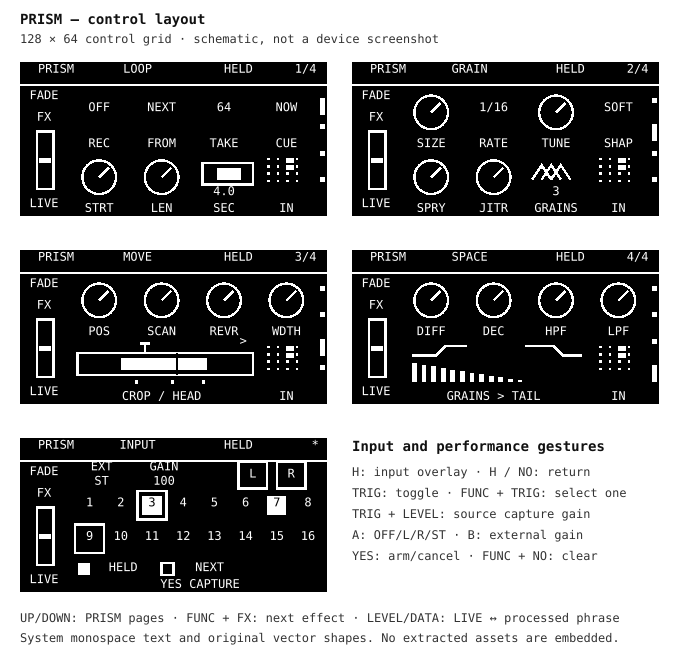

# PRISM granular phrase effect proposal

Status: experimental implementation, 2026-11-14. Release name: PRISM.

The implementation now lives in [the PRISM module](../../modules/fx/prism/README.md),
with separate phrase-control, phrase-ui and phrase-route adapters. The engine
and host control checks are implemented. Native FX UI, capture, scoped
CANOPY / Overloop coexistence and DTII load-conformance acceptance pass.
Full-system stress testing and physical audio qualification remain required.
The controls below describe the implemented first version; the acceptance
section records the remaining release requirements.

PRISM captures a phrase from chosen tracks or external audio, turns it into
grains, and lets the player crossfade those live sources into the captured
texture. The other tracks keep playing. Track selection uses a TRIG overlay
similar to mute mode; everyday playing needs no per-track FX-page edits or
DigiKit settings navigation.

The musical references are the rhythmic fragments and sustained textures of
[Microcosm](https://www.hologramelectronics.com/pages/microcosm) and the
always-listening capture of [MOOD MKII](https://www.chasebliss.com/mood-mkii).
PRISM exposes capture, grains, movement and space directly, instead of requiring
a different algorithm for each combination.

## Performance workflow

1. Press **FUNC + FX** to open the FX view, then repeat to select PRISM.
   **UP / DOWN** moves between PRISM's four pages. Press encoder **H, IN**.
2. Tap TRIGs to choose input tracks. Encoder **A, EXT** adds external L, R or
   stereo input. Hold a TRIG and turn LEVEL/DATA to balance that track's capture
   gain. Encoder B sets external capture gain.
3. Press H or NO to return to the same page. Set TAKE and CUE on LOOP.
4. Turn REC on, or press YES while in the input overlay. NEXT captures the
   upcoming phrase; PAST freezes the preceding phrase. Recording finishes
   automatically after one take and REC returns to OFF.
5. Turn **LEVEL/DATA, FADE** from **LIVE** toward **PRISM**. Only the sources in
   the held phrase fade out of the live mix. Adjust the grains, crop, movement
   and space while the phrase plays.
6. Choose different inputs for the next take if desired. They do not change
   the current crossfade until the new recording completes.

For example, capture tracks 3 and 7 while drums remain on tracks 1 and 2.
At full PRISM, the granular phrase replaces the live contributions of 3 and 7;
the drums retain their direct levels and sends. Choosing 3 and 9 for the next
take leaves that behavior intact until the new phrase is ready.

## Selective crossfade and routing

There is one performance routing model: selected-source replacement. This
supersedes the earlier separate SEND and MASTER modes and the proposed VOL
control. Selecting all 16 tracks covers all internal track sources; it does
not capture the final master, shared FX returns or compressor output.
External input always remains an explicit selection.

| FADE position | Sources in the held phrase | PRISM return | Other sources |
| --- | --- | --- | --- |
| LIVE, 0% | Normal live output | Silent | Normal output |
| Between endpoints | Gradually reduced | Gradually increased | Normal output |
| PRISM, 100% | Direct output removed | Full processed phrase | Normal output |

The recording taps are **before FADE**. A fully wet performance can still
capture another phrase at full input strength. Track capture follows the
track's normal audible level, pan and mute behavior, before shared send FX.
External capture has its own input gain, independent of its direct-monitor
fader. PRISM never writes the saved track LEVEL or External Mixer settings.

```text
Track audio / external capture tap
    +--> input selection + capture gain --> rolling / held phrase
    |                                        --> grains --> space --> wet gain --+
    +--> normal direct contribution --> selective dry gain ---------------------+--> mix
    +--> native send feeds --> selective send gain --> shared FX returns -------+
Other track contributions -----------------------------------------------------+
```

The held phrase stores its input membership alongside its audio. This
membership, rather than the next-take selection, controls the dry gain.
Capture gain balances the recorded mix; it is not the percentage of a track
that FADE replaces. A track recorded at a low input gain still has its whole
direct contribution replaced. A zero-gain input is excluded from the
committed membership and shown inactive. Turning a source off preserves its
gain setting for reuse, including zero if it was explicitly set.

Use smoothed independent gains and an equal-power starting curve, with wet
headroom and grain-density compensation. This controls discontinuities and
density-related level jumps; it does not guarantee identical perceived
loudness for every texture. Other tracks' direct contributions and sends are
unchanged, although shared downstream compression may respond to the new mix.

The complete routing design also fades the selected sources' **new feeds to
native delay, reverb and chorus**. Existing shared tails finish naturally;
unselected sources keep feeding those effects. This needs an earlier routing
hook in addition to the selective direct gain. A direct-only prototype must
be identified as such: the existing send framework would otherwise keep
feeding native effects even at full PRISM. Existing mixed FX returns cannot be
separated back into tracks. Other custom effects keep their current routing.
The held membership controls both the direct and native-send gains; both
follow the same phrase handoff and fault recovery.

External L/R membership fades only those channels' direct monitoring inside
the device, preserving their saved monitor levels and pan. If direct
monitoring was already off, LIVE does not turn it on. Monitoring through a
separate audio interface is outside PRISM's routing.

## Navigation between effects and PRISM pages

PRISM occupies **one entry** alongside DEL, REV, CHO and the other loaded
effects. Its four control pages are nested inside that entry. The effect
order follows the FX framework's loaded-effect order; PRISM's internal pages
never add extra stops to the global effect list.

| Gesture | Result |
| --- | --- |
| FUNC + FX from outside the FX view | Open the FX view using its normal selected-effect behavior. |
| Tap FUNC + FX in the FX view | Advance to the next effect, wrapping through DEL, REV, CHO and loaded effects. PRISM appears once. |
| Hold FUNC + FX in the FX view | Show parameter values using the native page-key behavior; release returns to labels without advancing. Plain FX retains its normal track-FX navigation. |
| DOWN while PRISM is selected | Next PRISM page: LOOP → GRAIN → MOVE → SPACE → LOOP. |
| UP while PRISM is selected | Previous PRISM page, wrapping from LOOP to SPACE. |
| H on a PRISM control page | Open its input overlay. |
| H or NO in the input overlay | Return to the PRISM page from which it was opened. |
| NO on a PRISM control page | Exit the FX view normally. |
| FUNC + NO on a PRISM control page or in IN | Clear the phrase and return FADE to LIVE, keeping the current page open. |

The first visit to PRISM opens LOOP. Later visits restore its last control
page, including after visiting another effect or leaving the FX view. This
is UI state for the loaded instance, not an audio parameter or a per-pattern
setting; a fresh instance starts at LOOP. For example, leave GRAIN to adjust
delay, then return to PRISM and resume on GRAIN.

```text
FUNC + FX     DEL → REV → CHO → PRISM → other loaded effects → …
                                 |
UP / DOWN                 LOOP ↔ GRAIN ↔ MOVE ↔ SPACE
                          wraps within these four pages
```

The header identifies both levels, for example **PRISM GRAIN 2/4**, alongside
capture status. The four right-edge page indicators
refer only to PRISM's pages. They do not count delay, reverb or chorus. Global
effect navigation remains available from every PRISM page.

While IN is open, UP/DOWN do not change the underlying control page or
escape to another effect. FUNC + FX closes IN, restores its key/LED ownership,
and advances exactly once to the next effect. H/NO only closes IN. Recording,
held playback, selected sources and FADE continue through every navigation
action; leaving the view is not bypassing the effect.
Consume that closing gesture and subsequent overlay-owned releases: the same
NO press must not also exit the FX view.

Implement this as a scoped navigation extension. The current FX framework
has a flat page list; only unmodified UP/DOWN events dispatched to PRISM's
active visible control view, with no FUNC, TRIG or encoder held, become local
navigation. A passive native help bubble can remain above the page. An opaque
modal removes PRISM from the firmware's drawable views and releases its input
overlay and LED ownership. Stock effects retain their normal
behavior, and modified or held-TRIG gestures retain their existing owners.
Capture the complete navigation key gesture so it cannot also reach the
global page handler. Preserve native show-values handling without treating
its held or release events as additional effect advances. LEFT/RIGHT, the
physical PAGE key and LEVEL/DATA gain no new navigation role.
Show-values changes the display state, never the selected PRISM page.
PRISM restores its ten-pixel header after the native passive page-name
bubble draws, keeping the local page, capture state and page count visible.
This header ownership ends as soon as another effect or an opaque modal
replaces the PRISM view.

## Four FX pages

Use **UP / DOWN** for **LOOP → GRAIN → MOVE → SPACE** within PRISM.
Use native fonts, focus feedback, control anchors and page indicators.
LEVEL/DATA has an intentionally explicit new role on these pages: the left
strip is labelled **FADE**, with FX at the top and LIVE at the bottom.
Turning it shows the 0–127 control value in normal focus feedback. It is a
control position, not an audio meter.



| Encoder | LOOP | GRAIN | MOVE | SPACE |
| --- | --- | --- | --- | --- |
| A | REC | SIZE | POS | DIFF |
| B | FROM | RATE | SCAN | DEC |
| C | TAKE | TUNE | REVR | HPF |
| D | CUE | SHAP | WDTH | LPF |
| E | STRT | SPRY | Movement diagram | Space diagram |
| F | LEN | JITR | Movement diagram | Space diagram |
| G | Crop and duration | Grain overlap | Movement diagram | Space diagram |
| H press | IN | IN | IN | IN |

H occupies its entire bottom-right cell. Its small input-grid icon shows held
sources; an asterisk signals a different next selection. Turning H has no
effect. Diagram-only cells have no hidden parameter or action. There is no
second LEV or MIX knob competing with FADE.

Native show-values behavior substitutes formatted values under parameter
graphics. IN remains an action label and telemetry stays telemetry. Discrete
lists such as FROM and SHAP use deliberate detents, initially four raw ticks
per selection without acceleration. Numeric controls keep usable travel and
native focus formatting.

### LOOP captures and crops

| Control | Range or choice | Meaning |
| --- | --- | --- |
| REC | OFF / ON action | Arms one take; OFF cancels an incomplete take. Completion returns to OFF. |
| FROM | NEXT / PAST | NEXT starts at CUE; PAST ends at CUE. |
| TAKE | PAT or 1–128 master steps | PAT captures one complete master-pattern cycle. A take that exceeds available storage aborts with TOO LONG while preserving the held phrase. |
| CUE | NOW or a one-based master step | The next occurrence of that boundary; no timing ambiguity between start and end. |
| STRT | 0–99% requested start | Non-destructive crop start, displayed as a percentage; the actual start always leaves room for the minimum safe LEN. |
| LEN | 1–100% requested length | Proportion of the full take. Playback clamps it to the remaining recording and a minimum safe window. |

G shows the full take as an outlined timeline, a solid segment for the active crop,
and the **active loop duration**. In the example, TAKE 64 at 120 BPM and normal
1× pattern scale produced
8 seconds; STRT 25% and LEN 50% play a 4-second crop. Focus feedback reports
the requested proportions; G reports the actual bounded crop and its duration
in seconds. Increasing STRT preserves the requested length where it fits,
otherwise shortens playback at the take's end. The LEN setting remains the
requested proportion, so moving STRT back restores the longer crop.

STRT and LEN change playback live with smoothed read transitions. Grains wrap
inside the crop, including when SIZE exceeds LEN; they never read excluded
audio. Changing the crop does not alter the source membership or erase audio.

### GRAIN shapes the fragments

SIZE sets grain duration, initially about 5–500 ms. RATE sets their launch
interval using pattern BPM divisions and triplets, plus OFF. TUNE shifts grain
pitch independently of the scan head, from −24 to +24 semitones in half-semitone
increments. SHAP selects SOFT, TRI, RISE or FALL windows, all with a minimum
anti-click edge. SPRY scatters grain origins around the head; JITR randomizes
launch timing. Both at zero give a predictable rhythmic result.

G visualizes overlapping windows and reports the number of active grains.
The first engine supports eight stereo grains, including old readers during
a phrase handoff. The combined load still needs profiling with CANOPY and
Overloop. Exhaustion shows LIMIT and skips a launch rather
than abruptly stealing a grain or silently changing SIZE or RATE. RATE OFF
stops new grains; existing grains and space tails finish. It does not erase
the phrase or move FADE, so full PRISM can intentionally decay to silence.

### MOVE traverses the phrase

POS sets the base position inside the crop. SCAN moves a separate head at
−2× to +2× recorded-time speed; zero stays in place while grains continue.
REVR sets the proportion of individual grains played backwards, independently
of scan direction. WDTH spreads grains in stereo while preserving the
captured stereo relationships.

The diagram uses an outlined full-take bar with a solid crop, a capped marker for stored POS, a
vertical cursor for the moving head, and small markers for actual grain
origins. The saved POS value does not drift with the head. An arrow shows scan
direction; REVR separately displays the chance of a reverse-playing grain.

### SPACE softens and filters

DIFF adds diffusion to the grains. DEC sets a 0.15–8.00 second tail duration;
it is independent of TAKE and LEN. HPF and LPF filter the processed sound.
The diagram turns discrete strokes into a diminishing tail, with native-style
filter silhouettes above it. DIFF belongs to the wet sound and never changes
the live-to-PRISM balance. Destructive overdubbing and feedback into the
recording are outside the initial design.

## Input performance overlay

Press H from any PRISM page to open IN; press H or NO to close it and return to
that page. This is a live performance overlay, not a settings list. Source
edits take effect for the next recording as they are made; closing the overlay
does not cancel them. The ordinary mute-mode shortcut remains untouched.

The input example is the bottom panel of the [authored layout board](assets/prism-controls.svg).

| Gesture | Action |
| --- | --- |
| Tap TRIG 1–16 | Toggle that track in the next recording. |
| FUNC + TRIG | Select only that internal track; external selection remains explicit. |
| Hold TRIG + turn LEVEL/DATA | Set that track's capture gain, 0–127. |
| Turn A, EXT | OFF / L / R / ST for the next recording. |
| Turn B, external GAIN | Set external capture gain, 0–127; stereo channels remain linked. |
| YES | Start or arm one take using FROM, TAKE and CUE; while armed/recording, cancel it. |
| H or NO | Close the overlay without changing transport or capture state. |
| FUNC + NO | Clear the held phrase and pending take; keep IN open and retain the next-input choices. |
| FUNC + FX | Close the overlay and advance to the next effect; capture continues. |
| UP / DOWN | Stay in the overlay; preserve the underlying PRISM page. |
| LEVEL/DATA with no TRIG held | Continue controlling FADE. |

The screen retains the FADE strip and uses two rows of eight numbered tiles,
matching the TRIG layout. **A solid inner tile means the held phrase uses that
source; an outline means the next recording will use it.** A tile can have
both marks. A plain number belongs to neither. L/R tiles use the same code for
external input. The on-screen legend stays visible.

The input rendering shows held sources 3 and 7, with 3 and 9 selected next.
Track 7 remains under the crossfader until the new phrase commits; track 9
continues live meanwhile. The asterisk in the header marks the difference.
External stereo is also available through A without adding another page.

In the overlay, TRIG LEDs show the next selection: bright selected, dim
excluded. The screen carries the held/next distinction without requiring
ambiguous blinking or extra LED colors. LED ownership and restoration need
device validation.

Holding a TRIG reveals its number and capture gain; the left strip
temporarily reads GAIN. Releasing the last held TRIG returns it to FADE. A tap toggles
on release, and a gain adjustment consumes that tap so release does not also
deselect the track. If several TRIGs are held, the most recently pressed one
still held owns gain editing. Closing the overlay restores FADE and normal
LED ownership immediately, while consuming later releases from its gestures.
The overlay owns complete key-down/key-up pairs so these
gestures cannot trigger notes, change track, edit locks or alter mutes.

Input selection and gain editing are locked during ARMED, RECORDING and HANDOFF.
The header shows ARM, REC or SWAP and the overlay shows LOCK. YES CANCEL stays
available during ARM and REC; the brief SWAP displays BUSY until the handoff
finishes. FADE remains playable. This avoids a third hidden source set
between the held phrase and the take currently being captured.

## Capture state and phrase handoff

The header reports capture state with the labels EMPTY, FILL, READY, ARM,
REC, HELD and SWAP. SWAP is the short phrase handoff. A held phrase and a
refilling rolling history can coexist: the header prioritizes armed/recording
activity, while LOOP G continues showing the held crop. The current FROM,
TAKE and CUE values remain visible through show-values. Stale telemetry shows
LINK LOST instead of frozen animation that appears live.

Changing next sources or capture gains resets the rolling history. PAST is
available only after enough audio with that exact input mix exists; a stereo
recording cannot remove previously mixed sources afterward. FILL identifies
history that is still accumulating; it never clears the held phrase.

Arming latches input membership, gains, the number of master-step intervals
and the cue. PAT resolves to the current pattern's cycle length at arm time.
Count musical intervals instead of freezing their duration in seconds: tempo
changes can lengthen or shorten the take. NOW retains its fractional step
phase so a complete cycle still has a complete cycle's duration. PAST uses
recorded timeline markers to locate the corresponding historical boundary.
These phase and history requirements belong to the capture clock contract.

A numbered CUE waits for running transport. NOW can capture while stopped
using a continuous grid derived from pattern BPM; there is no local tempo
control. A pattern change or timeline discontinuity that invalidates a pending
take cancels it and refills history, keeping the previous held phrase. Storage
checks apply to the actual samples: an overlong take, including one extended
by a tempo change, aborts safely with TOO LONG. Out-of-range cues show an inline
reason. Held playback continues while stopped, with RATE tied to pattern BPM.

An empty effective input selection shows NO INPUT and cannot arm. This covers
all sources off or at zero gain, while still allowing silence from a selected
nonzero source to be recorded. The held phrase and FADE remain unchanged.

On successful capture, audio, crop metadata and membership change together.
Keep the existing crop proportions where valid and clamp visibly for the new
take. REC returns to OFF; FADE keeps its current position. During a short,
smoothed handoff, old-only sources return to live, new-only sources take on
the current attenuation, and common sources retain it. Old/new grain outputs
transition together. Target about 20 ms initially, subject to listening and
CPU tests; both recordings remain readable until no old reader remains.
Show HANDOFF and reject another REC/YES capture until this bounded transition
finishes. Retire all old readers before the bank becomes writable rolling
storage again, then show FILLING as new history accumulates.

Cancel or failed capture preserves the previous phrase, membership and FADE.
Pattern changes outside capture do not automatically move the fader: the same
numbered live tracks remain under the held phrase's ownership. Completing the
first recording never automatically advances FADE.

Without a valid held phrase, FADE stays LIVE; the header shows the current
capture/history state and LOOP's duration is zero.
Clear, bypass, unload or an engine fault restores the direct sources and
mutes the processed return. Fault fallback belongs to the routing adapter,
so it works even when the grain engine stops running. Reset the visible FADE
to LIVE and require an explicit turn after recovery. The fallback must also
restore native-send feeds. Clear is the deliberate **FUNC + NO** side action,
not another performance knob. It is scoped to PRISM's visible control view and consumes
the entire NO gesture. When routing enters fault fallback, the header shows
**LIVE ERR**; a stale control link instead shows **LINK LOST**.

## Implementation scope

The first target is DTII OS1.17. DNII OS1.12 should share the control design,
but its long-storage and timing port requires separate validation.

| Work | Required result |
| --- | --- |
| Selective routing | Independent recording taps and smoothed direct-contribution gains for selected tracks and external monitoring. Never scale shared buses in place: per-track USB outputs must retain their normal signals. |
| Native send following | Fade new selected-source feeds to delay/reverb/chorus before their shared returns are formed. Keep existing tails and other sources intact. |
| Capture ownership | Atomic audio/membership commit, cancellation, valid-history tracking, and old-bank lifetime through a replacement transition. |
| Storage | Reserve PRISM's own rolling and held banks without borrowing Overloop's single-consumer buffer. |
| Grain DSP | Interpolated reads, safe window edges, live crop changes, bounded grains, density compensation and bounded diffusion. |
| FX framework | One global PRISM entry with four nested pages, scoped navigation and page recall, more parameter storage than the current eight-word contract, action controls, input/LED ownership and versioned telemetry. |
| Persistence | Save parameters and next-input choices. Capture audio is volatile initially; boot returns FADE to LIVE. Native trig locks and MOD destinations need a separate FX extension. |

The existing [send framework](../../modules/core/adapters/fx/README.md) builds
selected-track wet input but cannot attenuate the original direct
contributions. Its current [page framework](../../modules/core/adapters/fxpages/README.md)
also does not provide this four-page surface. These are explicit framework
changes, not module-only parameter declarations.

The [DTII loop reservation](../../modules/core/adapters/loop-storage/README.md)
provides Overloop's 8 MiB buffer. PRISM adds two independent 8 MiB banks.
Keeping Overloop's 8 MiB would reserve 24 MiB total and leave 376 MiB of the
original 400 MiB sample pool, before any further reservation needs. Each
PRISM bank holds 1,032,192 stereo float frames (21.504 seconds at 48 kHz),
with the remaining space used for musical history stamps. Allocation safety
still belongs to the storage acceptance checks. Old held audio
must retire safely before its bank resumes rolling capture, with honest
FILLING feedback during refill.
Extend one coordinated allocator reservation/provider to expose these
separate regions while preserving Overloop's descriptor and buffer. Do not
stack independent sample-capacity patches over the current single provider.

Acceptance must cover selective tracks and external channels at both fader
ends; unchanged unselected contributions; preserved per-track USB; native
send feed following; held/next changes while fully wet; capture failure and
fault fallback; stopped transport; full-memory operation alongside Overloop;
bounded CPU with CANOPY; and click-free extreme crop/pitch/size transitions.
UI acceptance includes press/release ownership, LED restoration, normal and
show-values captures, boundary values and every capture state. Navigation
acceptance covers both local wrap directions, one global effect advance from
every PRISM page and IN, last-page recall after exit, stock-effect navigation,
modifier/held-TRIG ownership, and continued capture/playback/FADE through all
page changes. Hardware measurements follow emulator and preflight checks.

## Review layouts

The [committed layout board](assets/prism-controls.svg) is an authored SVG
schematic on a 128 × 64 control grid. It uses ordinary system monospace text
and original vector shapes; it contains no extracted font or screen capture.
It explains placement and gestures without claiming a pixel comparison with
the device. The main-page geometry reserves x0–21 for FADE, x22–123 for the
control cells and x124–127 for page indicators. IN expands through x127 and
retains FADE.

Authored diagrams and mockups belong with this proposal and may be committed.
Native-font renderings and emulator/device captures are verification artifacts
under ignored `out/`; they must not be substituted for authored assets in the
repository. The native acceptance test captures normal and show-values pages
for local pixel review.
