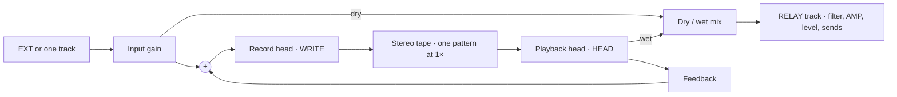
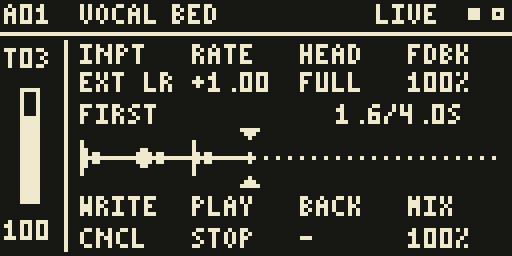
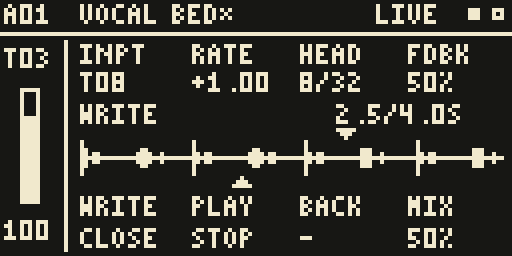
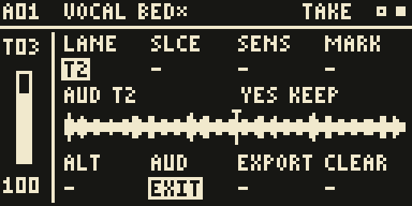

# RELAY · Digitakt II stereo tape loop

**Design proposal for DTII OS 1.17.** Each RELAY audio track owns a stereo tape one pattern long. A motor carries the tape past a record head and a playback head. Move the heads apart for an echo, turn up feedback to print the echo back to tape, or put note trigs on the track to repeat a phrase. Closing the record head leaves the tape playing. LIVE is the instrument. TAKE holds alternate performances, audition, slicing and export.

## What you hear

WRITE opens the record head. As each piece of tape passes, the head **replaces** it with input plus feedback from the playback head. The dry path lets you hear your playing immediately. MIX changes what you hear at the track output. FDBK changes what will be on the tape the next time it passes. The feedback tap is before MIX, the track filter, AMP, level and sends. The two stereo channels follow the same route independently. This routing follows the two-head drawing in the jroo manual. [Signal-flow diagram, p. 3](https://jroo.co/s/jroo-loop-documentation-latest.pdf#page=3)

### Three ways to play it

- **Layer a phrase.** Pick EXT LR. Leave RATE at +1×, HEAD at FULL and FDBK at 100%. Press WRITE. The first pass closes after one pattern and starts repeating. Press WRITE again, play a harmony, then press WRITE to punch out. At FULL, the record head receives the previous lap underneath the new performance. BACK undoes the whole punch.
- **Make a dotted echo.** On a 16-step pattern at 120 BPM and 1× scale, set HEAD to 3/16 of the tape, FDBK to 50% and MIX to 50%. Open WRITE and play one hit. The dry hit is immediate. The first wet hit follows 375 ms later and each subsequent repeat is half the previous amplitude. Closing WRITE preserves the echoes printed so far.
- **Play the tape with trigs.** With a recorded phrase, set HEAD to FULL and place note trigs on steps 1 and 9. Each trig plays the start of the phrase, so you hear its first half twice. Remove the second trig to hear the whole loop. Set HEAD to half a lap and the same trigs start halfway through the recording. Turn RATE negative to play it backwards.

## LIVE · controls and display

*First pass on T03. The time is elapsed / total at normal speed. The upper pointer is the record head and the lower pointer is the playback head. They line up at FULL. The tape under the play head is from the previous lap.*

*Writing an echo from T08. On this 32-step tape the heads are eight steps apart. The waveform and pointers belong to T03 even when another track supplies its input.*

| Encoder | Turn | Press |
|---|---|---|
| A · INPT | EXT LR, EXT L, EXT R, or T01–T16, excluding this track. Default EXT LR. | Switch between INPT and GAIN. GAIN sets the input level for both dry monitoring and recording, 0–100%, default 100%. Hold A and tap a TRIG to pick a source track directly. The shortcut consumes the press. |
| B · RATE | Signed tape speed from −2× through 0 to +2×. Both heads share one motor. Default +1×. Slow turns change speed by 0.01×, with detents at −2, −1, −0.5, 0, +0.5, +1 and +2. | Return to +1×. |
| C · HEAD | Distance behind the writer in the current direction of travel. Each slow detent is one recorded master step, from 0 to FULL. Default FULL. Show, for example, 3/16 or 8/32. | Return to FULL. |
| D · FDBK | Fraction of wet playback returned to the writer, 0–100%. Default 100% for layering. | — |
| E · WRITE | Move the record head one recorded step per detent, wrapping at the tape ends. The playback head stays in place. | On blank tape, arm the first pass. Press again while armed to cancel. On existing tape, punch in or out immediately. |
| F · PLAY | Move the playback head one recorded step per detent. The record head stays in place. | Single-click to start or stop. Double-click within 240 ms to return the reader to the beginning while preserving the motor and write gate. |
| G · BACK | — | Undo the last completed write gesture on this track. Press again to redo. Unavailable while writing. |
| H · MIX | Linear crossfade. 0% is dry input, 50% gives half gain to each path, 100% is tape only. Default 100%, useful when the source track is already in the main mix. | — |
| LEVEL/DATA | Stock track level for the mixed output. | Stock behavior. |

The 128 × 64 SRC screen keeps the stock header, track/level strip, show-values gesture and two page indicators. The upper row shows source, rate, head spacing and feedback. The center shows FIRST, WRITE, PLAY or STOP, the waveform, and both pointers on the same strip. A filled downward pointer marks the writer while open, an outline while closed. An upward pointer marks the reader. The lower row shows the next WRITE, PLAY and BACK actions and the current MIX. While first capture is armed, show WAIT 1. At RATE 0 show PARK. Use the same waveform data on LIVE and TAKE. Turning either head works on a running or stopped tape. Changing HEAD spacing, a reset trig or a transport start restores the configured head relationship. Status messages have their own row above the waveform. Show READING while measuring a revision, NO WAVE if the overview fails, and SILENT TAKE only after both channels measure zero.

### Stock MOD destinations

On the stock MOD page, turn DEST and choose a RELAY target in the SRC group. DEP adds a bipolar offset to the current track's LIVE setting. Returning DEP to zero restores the knob value. The stock LFO routing and depth are saved with the Sound. The LIVE pointer follows the modulated playback position, and the knob readouts show the stored settings.

| Destination | What moves |
|---|---|
| Tape rate (RATE) | Both heads' speed and direction, bounded to −2× through +2×. |
| Head spacing (HEAD) | The distance behind the writer, from zero to a full lap. |
| Feedback (FDBK) | The amount of played tape printed during WRITE, from 0 to 100%. |
| Tape mix (MIX) | The dry-to-tape output blend, from 0 to 100%. |
| Input gain (GAIN) | External or track input gain for monitoring and recording, from 0 to 100%. |
| Play position (POS) | A bipolar offset from the current playback head, wrapping around the loop. The writer keeps its position and the motor keeps its speed. |

### Tape length, motion and reset

**One pattern of tape.** The first WRITE allocates a blank stereo loop from the shared pool. When the sequencer is running, begin on the next master step 1 and use the pattern that actually starts there. When stopped, begin immediately using the selected pattern. Latch the finite master step count, scale and tempo at that boundary. A 32-step pattern at 120 BPM and 1× scale makes four seconds of tape, even if this track cycles every eight steps. Infinite or unavailable master length displays SET PAT LEN. Insufficient room displays RAM FULL and the available seconds. Either refusal leaves existing audio intact. [Playing-pattern timing](../findings/365-loop-transport-and-playing-pattern.md)

WRITE starts the motor if it is stopped, using the selected RATE. The first WRITE opens for one pattern's latched duration. At the default +1× it records exactly one lap. Rate changes or reset trigs can revisit a section during that window. Untouched frames stay silent. Press E during first capture to cancel. Thereafter the tape has a fixed frame count and recorded step grid. A new pattern or BPM sets the length of the next blank tape. Existing audio keeps its pitch and duration until you turn RATE. At half speed one lap takes twice as long and sounds an octave lower.

**Two heads, one motor.** HEAD changes the wet signal as you turn it. For tape length N frames, direction s (+1 or −1), writer W and distance d, the reader is at (W − s × d) modulo N. At +1× on a two-second tape, HALF gives a one-second delay. At −1× it gives the same delay in the opposite direction. Smooth changes to speed, spacing and direction. RATE 0 parks both heads, fades wet output and suspends writes so a parked head cannot repeatedly overwrite one sample. The dry monitor continues. Leaving zero resumes the prior write gate. PLAY stop or transport STOP closes it.

**Zero and FULL sound different while writing.** At zero spacing the wet monitor hears the newly written frame. Feed back the preceding wet output sample at this endpoint to keep the feedback path causal. At FULL, read the old tape frame before replacing it. With unity feedback, this gives ordinary sound-on-sound overdubbing. At 0% feedback, a write replaces the old material with the new input. During playback with WRITE closed, zero and FULL address the same recorded position. Use bounded stereo writes and interpolate fractional positions. When running faster than 1×, write the complete stretch of tape traversed by the head in either direction.

**Note trigs reset tape phase.** A fired sequencer note or manual note trig puts the record-head position at recorded frame zero immediately. The playback head follows at the selected spacing. At FULL the trig hears the first frame. At 3/16 spacing on a forward 16-step tape, it hears the start of recorded step 14. After an explicit STOP, a trig leaves the motor stopped. PLAY or WRITE starts it again. At zero speed it sets the position and stays parked. During WRITE a trig also relocates the writer, so repeated trigs can deliberately punch the same region. It never opens or closes the record gate. Use a brief transition at the output to suppress reset clicks while placing the heads on the timed event. [jroo alt-reset, p. 23](https://jroo.co/s/jroo-loop-documentation-latest.pdf#page=23)

Honor fired conditions, microtiming and retrigs. Rests, skipped notes, lock-only steps and note-off leave the tape moving. Stock AMP still shapes audibility. A pattern change with the same RELAY sound preserves phase until a trig fires. Transport STOP cancels an arm or incomplete first pass, closes an active punch on existing tape, retains its completed writes and fades wet playback. PLAY stop during first capture also cancels that pass. Transport PLAY starts populated RELAY tracks together at frame zero. With transport stopped you can still run one motor and punch from LIVE. Pressing the panel STOP button also stops this manual playback. Selecting another track preserves the tape position, write gate and playback level. Completed waveforms are cached for each track and take lane until the tape changes.

### Sources and monitoring

Capture the isolated stereo output of another audio track or the external input. EXT L and EXT R duplicate the chosen channel. Another RELAY track is a valid source. Refuse self-routing and a live cycle between tracks. The intended feedback loop is internal to each machine. The original source track retains its own mixer route. For an ordinary send-like echo, keep that source audible and use 100% wet on RELAY. To hear the complete dry/wet blend through RELAY with external input, turn down the separate external mixer monitor. Leaving SRC, muting the destination or closing its AMP envelope leaves an open writer running.

## TAKE · compare, keep and export

| Encoder | Action |
|---|---|
| A · LANE | Choose MAIN or a completed local alternate, T1 or T2. Browsing leaves MAIN playing until AUD is engaged. |
| B · SLCE | OFF or HITS for export of MAIN. Default OFF. |
| C · SENS | 1–9, default 5. Higher sensitivity finds quieter attacks. |
| D · MARK | Turn to select a slice. Press to preview that interval once. |
| E · ALT | Arm one independent input pass of MAIN’s recorded duration onto a blank alternate. Press again while armed to cancel. |
| F · AUD | Audition one lane at a time. Turn A to compare at matching tape phase. YES swaps the audible alternate with MAIN. NO or F returns. |
| G · EXPORT | Show FULL or FULL+HITS and the unique destination. YES writes the sample. |
| H · CLEAR | Ask before clearing MAIN and its local lanes or deleting one alternate. |

ALT captures the gained source at +1× for one complete forward pass. It temporarily takes the recorder and leaves MAIN intact. During ALT capture, reset trigs can reposition MAIN playback while the alternate writer finishes its uninterrupted pass. Audition runs through MAIN’s RATE, HEAD and output path with WRITE closed. A trig resets the common audition phase. Switching lanes at that phase lets the player compare the same moment. Leaving audition restores the prior playback state. Only one lane sounds. Keeping an alternate retains the old MAIN in that lane and clears outdated undo history.

A punch can span many laps. BACK restores the entire tape to its state immediately before the punch, including areas visited several times or in reverse. Completing a new punch replaces the previous undo. Publication of a completed first pass, punch, undo or lane swap invalidates its waveform and slice analysis. Slice preview is a forward one-shot on stored audio. A note trig during preview returns to normal tape playback.

## Saving and memory

| Action | Result |
|---|---|
| Save preset or project | Store MAIN in tape order, its recorded step count and the panel settings. Save a changed tape as a new stereo revision before publishing its reference. Restore with WRITE closed. Two tracks can share a saved revision and edit independently. |
| Replace a dirty tape | Offer SAVE / DISCARD / CANCEL, default CANCEL. Stage the incoming sample before swapping. Failed saves, missing samples or insufficient RAM leave the current tape recoverable. |
| Load an older take | Preserve the exact stored frames. If its grid is missing, use the destination’s finite master step count, or one step if unavailable. Initialize new controls to their defaults. Preserve the grid on the next save. |
| Export | Write the stored stereo tape at native speed to a unique folder, for example `RELAY/VOCAL-BED-0007/FULL`. Printed feedback is part of that audio. Live dry monitoring, current speed and output effects are playback settings. FULL+HITS adds numbered slices. Export and preset save are separate actions. |
| Leave the session | MAIN and track assignments persist on save. T1, T2 and undo are session revisions. Identify unsaved alternatives before discarding them. Keep an alternate as MAIN and save another preset to retain it. |

**Saving a freshly recorded MAIN on DTII.** Close WRITE first. If you use the stock Save command while the tape has unsaved audio, RELAY starts writing the stereo sample. Wait for **SAVE SOUND AGAIN**, then repeat the original Sound or project save to store its reference. If you prefer to save in one visit to the stock menu, use TAKE → EXPORT → YES first and wait for **SAVED**. Changing only RATE, HEAD, MIX or another panel setting reuses the existing sample.

The shared 32 MiB pool provides 8,372,224 stereo PCM16 frames at 48 kHz, about 174.42 seconds total. Blank tracks reserve no audio. The first release supports multiple independent motors and one active recorder. If another track owns it, show REC ON Txx. Reserve sufficient space before a first pass, alternate or punch. Recheck at the first recording boundary. Pin the pre-punch revision for undo and create a private writable tape for the whole gesture. A reader must hear newly written positions on this tape during the punch for short feedback echoes to work. Other tracks referencing the saved revision keep hearing their own audio. Repeated passes reuse the same workspace. Release pages only after their last reader exits. [Pool layout](../../modules/core/adapters/relay-storage/README.md)

A save or export during an open punch displays CLOSE WRITE and leaves recording uninterrupted. Analyze completed MAIN off the audio thread. Include frame zero, merge transients closer than 30 ms and keep up to 64 starts. Align cuts to nearby low-energy stereo frames. Pin one completed revision during export. SAVING appears only after YES, and success requires every requested file to finish. [Native sample format](../../packages/dksample/src/lib.rs)

## Acceptance on DTII OS 1.17

1. Record a one-bar tape with distinct hits on steps 1, 5, 9 and 13. Repeat on a 32-step master with an eight-step RELAY track. Verify two and four seconds respectively at 120 BPM and 1× scale. Test armed pattern change, stopped capture, cancellation, infinite pattern and insufficient RAM.
2. Feed one impulse into a cleared 16-step tape at 120 BPM, with WRITE open, HEAD at 3/16, RATE +1× and FDBK 50%. Measure wet peaks at 375, 750 and 1,125 ms in a 1:0.5:0.25 ratio. Change MIX and track level between equivalent runs. Their exported tapes must match. Test each stereo channel independently.
3. At FULL, 100% feedback and unity rate, overdub a second phrase across two laps. Verify the first phrase survives, punch-out freezes the result and one undo restores the previous tape. Repeat with silent input and 0% feedback to verify only the traversed region is erased. At HEAD zero check immediate wet sound and bounded feedback.
4. Verify half-speed pitch and duration, reverse order, equal echo spacing in reverse, and silence on the wet path at RATE zero. Park and resume mid-punch. Compare untouched tape frames and check for gaps during fast forward and reverse writes.
5. Reset at steps 1 and 9, then repeat with HEAD offset, microtimed notes and retrigs. Inspect both pointers and recorded transients. A trig while writing must revisit the same tape region. Rests, skipped trigs and note releases keep phase. Compare two tracks sharing a sample and confirm independent resets and edits.
6. Record EXT and isolated track sources, check self/circular route refusal, and switch pages and tracks mid-punch. Exercise ALT capture, phase-matched audition and undo. Save, reboot and load onto another track in a different-length pattern. Verify the original tape, grid and settings. FULL+HITS slices must concatenate byte for byte to FULL.

This proposal defines the revised machine and its hardware acceptance criteria. [Current track machine source](../../modules/machines/relay/src/module.c)
