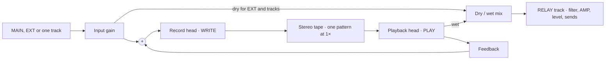

# RELAY · Digitakt II stereo tape loop

**DTII OS 1.17.** Each RELAY track records one pattern of stereo audio. Its record and playback heads share a motor and can move independently. Move PLAY behind WRITE for an echo, turn up feedback to record the echo back to tape, or place note trigs to reset the phrase. Both SRC pages share the same controls. The second has a larger waveform.

## What you hear

WRITE opens the record head. As each piece of tape passes, the head **replaces** it with input plus feedback from the playback head. The dry path lets you monitor EXT and selected track sources immediately. MIX changes what you hear at the track output. FDBK changes what will be on the tape the next time it passes. The feedback tap is before MIX, the track filter, AMP, level and sends. The two stereo channels follow the same route independently. This routing follows the two-head drawing in the jroo manual. [Signal-flow diagram, p. 3](https://jroo.co/s/jroo-loop-documentation-latest.pdf#page=3)

### Three ways to play it

- **Layer a phrase.** Pick EXT LR, leave RATE at +1× and FDBK at 100%, then press WRITE. The first pass closes after one pattern and starts repeating. Press WRITE again, play a harmony, then press WRITE to punch out. With both heads aligned at the default spacing, the recorder adds the new performance to the previous lap. Press LEN to undo the punch.
- **Make a dotted echo.** On a recorded 16-step tape at 120 BPM, turn PLAY three steps behind WRITE. Set FDBK and MIX to 50%, open WRITE and play one hit. The dry hit is immediate, and the first wet hit follows 375 ms later.
- **Play the tape with trigs.** Record a phrase and place note trigs on steps 1 and 9. Each trig resets the tape. Turn RATE negative to hear it backwards, or turn LEN down to repeat the start of the take.

## SRC controls

| Encoder | Turn | Press |
|---|---|---|
| A · INPT | EXT LR, EXT L, EXT R, T01–T16 (excluding this track), or MAIN for the finished stereo mix. Default EXT LR. | Switch between INPT and GAIN. Hold A and tap a TRIG to select a source track directly. |
| B · RATE | Signed tape speed from −2× through 0 to +2×. Both heads share one motor. Default +1×. Slow turns change speed by 0.01×, with detents at −2, −1, −0.5, 0, +0.5, +1 and +2. | Return to +1×. |
| D · FDBK | Fraction of wet playback returned to the writer, 0–100%. Default 100% for layering. | — |
| E · WRITE | Move the record head one recorded step per detent, wrapping at the tape ends. The playback head stays in place. | On blank tape, arm the first pass. Press again while armed to cancel. On existing tape, punch in or out immediately. |
| F · PLAY | Move the playback head one recorded step per detent. The record head stays in place. | Start or pause a completed take. Double-click within 240 ms to move the playback head to the beginning. |
| G · LEN | Set a completed take's loop length from one step to its full recorded step count. The loop starts at the beginning of the take. | Undo or redo the last completed punch. |
| H · MIX | Crossfade between source and tape for EXT and track inputs. With MAIN selected, MIX sets the tape level. Default 100%. | — |
| LEVEL/DATA | Stock track level for the mixed output. | Stock behavior. |

Tap SRC to change waveform size. Both pages keep the same encoder assignments, track header and page indicators. Hold SRC on either page to see values. WRITE and PLAY show their positions in seconds, and LEN shows the active step count. [Digitakt II OS 1.17 manual, Appendix A](https://www.elektron.se/media/2026/10/Digitakt-2-User-Manual_ENG_OS1.17_260930.pdf)

The symbol at the upper left shows paused, playing, armed or recording. The waveform shows the entire take with a dashed mark at a shortened loop's end. A preview follows new writes until the completed overview becomes available. Recorder and file errors appear as brief messages. Confirmations for recalling over a changed tape remain visible until answered.

Each overview column keeps 8-bit minimum and maximum peaks. The display scales all columns together against the strongest visible peak for clearer quiet material. The scaling adds up to 30 dB to the drawing.

### Stock MOD destinations

On the stock MOD page, turn DEST and choose a RELAY target in the SRC group. DEP adds a bipolar offset to the track's setting. Returning DEP to zero restores the stored value. The stock LFO routing and depth save with the Sound. The waveform pointer follows the modulated playback position.

| Destination | What moves |
|---|---|
| Tape rate (RATE) | Both heads' speed and direction, bounded to −2× through +2×. |
| Head spacing (HEAD) | The distance behind the writer, from zero to a full lap. |
| Feedback (FDBK) | The amount of played tape printed during WRITE, from 0 to 100%. |
| Tape mix (MIX) | The dry-to-tape output blend, from 0 to 100%. |
| Input gain (GAIN) | Input gain from 0 to 100%, for recording and for monitoring EXT and track inputs. |
| Play position (POS) | A bipolar offset from the current playback head, wrapping around the loop. The writer keeps its position and the motor keeps its speed. |

### Tape length, motion and reset

**One pattern of tape.** The first WRITE allocates a blank stereo loop from the shared pool. When the sequencer is running, begin on the next master step 1 and use the pattern that actually starts there. When stopped, begin immediately using the selected pattern. Latch the finite master step count, scale and tempo at that boundary. A 32-step pattern at 120 BPM and 1× scale makes four seconds of tape, even if this track cycles every eight steps. Infinite or unavailable master length displays SET PAT LEN. Insufficient room displays RAM FULL and the available seconds. Either refusal leaves existing audio intact. [Playing-pattern timing](../findings/365-loop-transport-and-playing-pattern.md)

WRITE starts the motor if it is stopped, using the selected RATE. The first WRITE opens for one pattern's latched duration. At the default +1× it records exactly one lap. Rate changes or reset trigs can revisit a section during that window. Untouched frames stay silent. Press WRITE during first capture to cancel. Once recorded, LEN changes the number of steps the heads loop over. Restoring LEN brings the rest of the take back into playback. At half speed one lap takes twice as long and sounds an octave lower.

**Two heads, one motor.** WRITE and PLAY move their own heads, wrapping at the current loop length in either direction. RATE 0 parks both heads, fades wet output and suspends writes. The dry monitor remains active for EXT and track sources. Leaving zero resumes the prior write gate. Press WRITE or the transport STOP button to close the writer.

**Zero and FULL sound different while writing.** At zero spacing the wet monitor hears the newly written frame. Feed back the preceding wet output sample at this endpoint to keep the feedback path causal. At FULL, read the old tape frame before replacing it. With unity feedback, this gives ordinary sound-on-sound overdubbing. At 0% feedback, a write replaces the old material with the new input. During playback with WRITE closed, zero and FULL address the same recorded position. Use bounded stereo writes and interpolate fractional positions. When running faster than 1×, write the complete stretch of tape traversed by the head in either direction.

**Note trigs reset tape phase.** A fired sequencer note or manual note trig places WRITE at frame zero. With aligned heads, the first audible frame is also frame zero. With PLAY three steps behind WRITE on a forward 16-step loop, the first audible frame is at the start of recorded step 14. After STOP, a trig leaves the motor stopped. PLAY or WRITE starts it again. During WRITE, a trig relocates the writer with the record gate still open. A brief transition suppresses reset clicks. [jroo alt-reset, p. 23](https://jroo.co/s/jroo-loop-documentation-latest.pdf#page=23)

Honor fired conditions, microtiming and retrigs. Rests, skipped notes, lock-only steps and note-off leave the tape moving. Stock AMP still shapes audibility. A pattern change with the same RELAY sound preserves phase until a trig fires. Transport STOP cancels an arm or incomplete first pass, closes an active punch on existing tape, retains its completed writes and fades wet playback. Transport PLAY starts populated RELAY tracks together at frame zero. Both SRC pages can run a motor and punch with transport stopped. Pressing the panel STOP button stops this manual playback. Selecting another track preserves the tape position, write gate and playback level. Completed waveforms stay available until the tape changes.

### Sources and monitoring

EXT L and EXT R duplicate the selected channel. Isolated track sources keep their own mixer route. RELAY allows another RELAY track as a source and rejects self-routing and live cycles between tracks. MAIN records the finished stereo mix, including audible tracks and effects. The direct monitor is muted for MAIN to avoid feeding the mix back into itself. A MAIN overdub can record tape playback already audible in the mix.

A punch can span many laps. Press LEN to restore the tape to its state before the last completed punch. Press again to redo. A new punch replaces the previous undo revision.

## Saving and memory

| Action | Result |
|---|---|
| Save preset or project | Store the entire take, its recorded step count and panel settings, including LEN. Save changed audio as a new stereo revision before publishing its reference. Restore with WRITE closed. Two tracks can share a saved revision and edit independently. |
| Replace a dirty tape | Offer SAVE / DISCARD / CANCEL, default CANCEL. Stage the incoming sample before swapping. Failed saves, missing samples or insufficient RAM leave the current tape recoverable. |
| Load an older take | Preserve the exact stored frames. If its grid is missing, use the destination’s finite master step count, or one step if unavailable. Initialize new controls to their defaults. Preserve the grid on the next save. |
| Leave the session | The take and track assignments persist on save. Undo is a session revision. |

**Saving a fresh recording.** Close WRITE and use the stock Sound or project Save command. RELAY writes the stereo sample and shows **SAVE SOUND AGAIN**. Repeat the original save to store its reference. Panel changes such as RATE, LEN and MIX reuse the recorded sample. [Native sample format](../../packages/dksample/src/lib.rs)

The shared tape pool provides 8,372,224 stereo PCM16 frames at 48 kHz, about 174 seconds. Multiple tracks can play independently while one records. If another track owns the recorder, RELAY shows **REC ON Txx**. A punch creates a private writable revision and retains the previous version for undo. Tracks sharing a saved revision keep their own audio when one of them records again. [Pool layout](../../modules/core/adapters/relay-storage/README.md)

## Acceptance on DTII OS 1.17

1. Record a one-bar tape with distinct hits on steps 1, 5, 9 and 13. Repeat on a 32-step master with an eight-step RELAY track. Verify two and four seconds respectively at 120 BPM and 1× scale. Test armed pattern change, stopped capture, cancellation, infinite pattern and insufficient RAM.
2. Feed one impulse into a cleared 16-step tape at 120 BPM, with WRITE open, PLAY three steps behind WRITE, RATE +1× and FDBK 50%. Measure wet peaks at 375, 750 and 1,125 ms in a 1:0.5:0.25 ratio. Change MIX and track level between equivalent runs and compare the stored tapes. Test each stereo channel independently.
3. With the heads aligned at full-lap spacing, 100% feedback and unity rate, overdub a second phrase across two laps. Verify that the first phrase survives and that pressing LEN restores the tape before the punch. Repeat with silent input and 0% feedback to verify the traversed region is erased.
4. Verify half-speed pitch and duration, reverse order, equal echo spacing in reverse, and silence on the wet path at RATE zero. Park and resume mid-punch. Compare untouched tape frames and check for gaps during fast forward and reverse writes.
5. Reset at steps 1 and 9, then repeat with a PLAY offset, microtimed notes and retrigs. Inspect both pointers and recorded transients. A trig while writing must revisit the same tape region. Rests, skipped trigs and note releases keep phase. Compare two tracks sharing a sample and confirm independent resets and edits.
6. Record EXT, isolated tracks and MAIN. Verify that MAIN captures the final stereo mix and that its dry monitor is silent. Check self-routing and circular route refusal.
7. Switch pages and tracks during a punch. Verify blank PLAY stays idle. Shorten a completed loop with LEN, check its boundary in both directions, then restore LEN and play the full take again. Check that both pages use the same WRITE, PLAY and LEN controls.
8. Save, reboot and load onto another track in a different-length pattern. Verify the full take, recorded step grid and selected loop length.

[Track machine source](../../modules/machines/relay/src/module.c)
